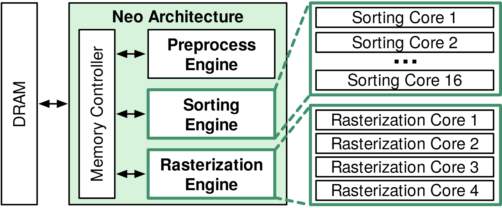

# VA-045 · 共享资源控制器与异构执行阵列

左侧资源接口连接中央控制器，控制器分别与三个功能引擎双向交换。右侧把其中两类引擎展开为重复核心阵列，一组使用省略号表达规模，一组完整列出。该图适合说明共享入口下的功能分工与内部并行度，不能单凭上下排列推断执行顺序。



## 适用范围

- 多个功能引擎共享存储或资源接口
- 需要对两类模块的内部并行组织作展开

不适合：没有共享接口的独立流水线；并行核心之间存在复杂互连需要逐条解释。

## 阅读顺序

1. 先看最左外部资源及双向接口。
2. 进入中央控制器，逐个读取相连的三类引擎。
3. 沿绿色虚线查看右侧对应展开。
4. 对照两组核心的数量表达及省略号。

## 图形表达

**布局**：外部资源、控制器、引擎竖栈、展开阵列从左至右排列；两组展开各占独立框。

**对象**：窄长矩形用于公共资源和控制器，宽矩形用于功能，引擎内部重复框表示并行实例。

**连线**：黑色双向箭头表示交换，绿色虚线是展开关系；展开线不承担任务或数据传输语义。

**配色**：浅绿色铺出系统范围，深绿色描边标记被展开的引擎及其阵列，白色模块保持文字清晰。

**文字**：功能引擎使用粗体，核心名称用常规无衬线；竖排控制器名应保持同一阅读方向。

## 部件与复用

| 部件 | 含义 | 改造方法 |
|---|---|---|
| 资源接口 (`memory-interface`) | 外部存储和进入系统的双向通道。 | 可换数据库或资源池，但补充交换对象。 |
| 控制与功能栈 (`engine-stack`) | 控制器服务三种功能模块。 | 增删功能时重排对应端口。 |
| 第一阵列 (`sorting-array`) | 第一类功能的重复核心及省略表达。 | 明确核心总数，不继承显示的尾编号。 |
| 第二阵列 (`raster-array`) | 第二类功能的完整重复列表。 | 数量增多时可改省略表示，但需统一规则。 |

## 改造步骤

1. 先决定并行实例代表物理核心还是逻辑工作者。
2. 分别定义控制器和各引擎的输入输出。
3. 如需表达阶段依赖，应另加有向处理线，不能借用展开虚线。

## 新情景示例（假设）

可用于共享数据池上的清洗、排序和汇总服务。

控制器映射为数据访问调度器，三个引擎映射为三类服务，右侧展开排序与汇总工作者。

改写外部接口并补充服务依赖；工作者数量仅作示意，除非有配置证据。

## 编辑入口

**入口**：运行 make_figure.py；example.json 为配置，labels.json 查文字键，asset.json 查部件。使用 --parts 导出独立矢量部件。

**配置可改**：labels 可改文字及字体；components 可设置 visible、dx/dy、attributes；elements 可按键改图元属性。移动量使用整图 viewBox 单位，重叠部件只选一个层级移动。

**需改代码**：增删节点、调整连接和重排结构须在 customize() 中处理；新增图元使用唯一 data-asset-key，并登记至相应部件 element_keys。配置不会自动排版。

**字体**：本图使用 texgyreheros-bold.otf、texgyreheros-regular.otf。font_size 是图元局部坐标单位，受既有缩放影响，不等于纸面 pt；改字后检查实际字宽与最终阅读尺寸。

准备独立工作副本：

```text
python "<SKILL>/scripts/prepare_architecture.py" --id VA-045 --out figures/architecture
```

在工作副本运行：

```text
python make_figure.py --config example.json --out . --parts
python render_architecture.py fig.svg
```

## 本图检查

- 绿色展开线是否指向正确的两类引擎。
- 尾编号与实际或示意并行数量是否一致。
- 是否误把上下引擎排列解释成有向流水线。

部件图用于复用局部对象；跨边界的连接和共享容器仍需按新关系处理。示例名称、数值和曲线不是当前研究结果。

来源与许可见 [ATTRIBUTION.md](ATTRIBUTION.md)。
