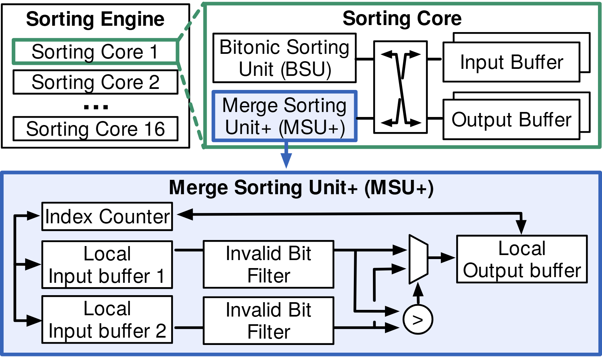

# VA-084 · 并行核心与关键单元逐级展开

从左上的并行核心列表选中一个核心，在右上展开其内部，再把其中关键归并单元放大到底部。绿色和蓝色边界建立两次局部放大关系，底部双输入、过滤、比较和输出让创新细节保持可见。



## 适用范围

- 整体复制结构与单元内部机制需要同图说明
- 具有两级包含关系且关键模块足够紧凑的架构

不适合：各面板没有包含关系的并列方案；需要自动扩展任意深度层次的总图。

## 阅读顺序

1. 看左上核心列表和被绿色强调的一项。
2. 沿绿色展开关系到右上核心内部。
3. 定位蓝框关键单元及向下展开线。
4. 在底部依次读双输入、过滤、比较选择、输出及索引回路。

## 图形表达

**布局**：上排左右分区，下排通栏细节；主体宽度逐级增加，将最复杂结构留给底部。

**对象**：重复列表框表示同构核心，叠矩形表示缓冲，梯形选择器与圆形比较符号承载运算。

**连线**：彩色虚线是包含展开，黑实线是信号；底部反馈折线与输入主线须分开辨认。

**配色**：绿色只连接第一级放大，蓝色包关键单元及第二级放大；底部浅蓝统一标同一模块。

**文字**：模块名允许两行，比较符号必须有可理解定义；局部标题保持层级，避免三层标题同样大。

## 部件与复用

| 部件 | 含义 | 改造方法 |
|---|---|---|
| 并行核心集合 (`engine`) | 重复核心列表及被选中的实例。 | 改为同类站点或处理器，并标清选中项是代表性展开而非独有功能。 |
| 单核心内部 (`core-detail`) | 包含两个处理单元和输入输出缓冲。 | 用真实子模块替换，核心内部布线需符合当前处理关系。 |
| 关键归并单元 (`merge-unit`) | 双路缓冲、过滤、选择和反馈组成的细节区域。 | 改为实际合并机制，删除不成立的比较器和索引回路。 |
| 双路输入过滤 (`input-filter`) | 关键单元中的两个输入与各自过滤器。 | 可单独复用并行过滤，移动时不可再移动包含它的整单元。 |

## 改造步骤

1. 先确认两次展开确实对应包含关系。
2. 改变核心数时更新列表编号与省略号。
3. 逐个解释比较器、选择器和反馈线的职责，不保留无意义硬件符号。
4. 保持彩色展开线与数据流箭头的外观差异。

## 新情景示例（假设）

假设绘制传感数据边缘融合单元。

核心列表为边缘站点，核心内为清洗和融合模块，底部展示两个传感器流的有效性过滤与融合。

若融合采用加权平均，将比较选择符号改成加权融合块，并删除不适用的排序索引回路。

## 编辑入口

**入口**：运行 make_figure.py，以 example.json 为改造配置；labels.json 查文字键，--parts 同步导出部件。

**配置可改**：labels 改文字，components 改显示、位移及样式，elements 改单个矢量属性；只选一个部件层级移动，避免重叠归属使对象移动两次。

**需改代码**：这是可编辑矢量结构，未实现自动布局。增删模块、改变连接或重新排版，须在 customize() 中改真实对象并更新部件成员。

**字体**：使用随包完整映射字体；改字后核查换行、符号和最终纸面字号。font_size 是对象局部单位，不能直接当作 PDF 的磅值。

准备独立工作副本：

```text
python "<SKILL>/scripts/prepare_architecture.py" --id VA-084 --out figures/architecture
```

在工作副本运行：

```text
python make_figure.py --config example.json --out . --parts
python render_architecture.py fig.svg
```

## 本图检查

- 绿色、蓝色展开线是否指向正确被放大对象。
- 底部反馈路径是否仍具有真实算法意义。
- 输入过滤部件是否与整归并区重叠移动而错位。

部件图用于复用局部对象；跨边界的连接和共享容器仍需按新关系处理。示例名称、数值和曲线不是当前研究结果。

来源与许可见 [ATTRIBUTION.md](ATTRIBUTION.md)。
