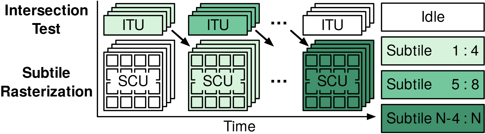

# VA-126 · 双泳道批次交叠执行时间线

两条执行泳道在同一时间方向上错位展开，以浅至深绿表示不同批次。堆叠卡片和下方小格突出每批内的多对象，斜箭头表达阶段依赖；白色末端与开头对象表示空闲。



## 适用范围

- 同一批次经过两种处理单元且相邻批次可以交叠
- 解释流水线启动、稳定执行和排空的定性过程

不适合：要求精确时长比例的甘特图；没有前后依赖、只是两个独立并行任务的系统。

## 阅读顺序

1. 先识别左侧上下两条执行泳道。
2. 从左往右看上方 ITU 到下方 SCU 的斜向交接。
3. 结合右侧图例区分三个批次和白色空闲，最后确认时间方向。

## 图形表达

**布局**：两泳道居中，左侧用两行粗体名称，右侧四行图例；底部水平箭头统一时间方向。

**对象**：上层叠置矩形表示测试批，下层带多格的叠置矩形表示计算批。

**连线**：黑色斜箭头从上泳道指向稍后下泳道；底部箭头只表示时间，省略号表示中间批次。

**配色**：白色表示 Idle，浅绿、中绿、深绿分别表示三组对象，不表示性能优劣。

**文字**：无衬线字体；泳道名称加粗，块内 ITU、SCU 为大写简写，图例使用区间编号。

## 部件与复用

| 部件 | 含义 | 改造方法 |
|---|---|---|
| 双泳道批次交接主体 (`processing-lanes`) | 两条泳道、批次叠层与斜向交接箭头共同表达依赖和交叠。 | 整体抽取以保留跨泳道箭头；重排阶段时同步移动两个泳道及其交接关系。 |
| 空闲与批次图例 (`batch-legend`) | 四条图例解释白色和三种绿。 | 改批次数时同步更新图例颜色及区间。 |
| 统一时间箭头 (`time-axis`) | 两泳道共享同一个向右时间方向。 | 定量化时需另建刻度，不能只给现有块宽强加时间单位。 |

## 改造步骤

1. 先列出阶段依赖与可交叠的批次，再决定白色空闲应出现在哪一端。
2. 阶段名变长时扩大左侧标签空间，避免压缩实际批次。
3. 新增第三泳道或精确时间尺度需要代码重排，不能仅改 SCU 标签。

## 新情景示例（假设）

假设场景：数据预取与批次模型推理交叠。

ITU 改为预取，SCU 改为推理，三档绿色表示批次编号，白色保留为空闲。

按预取完成时间重设斜箭头及下排偏移，若有预取失败再单独增加异常分支。

## 编辑入口

**入口**：运行 make_figure.py 读取 example.json 的迁移配置；labels.json 登记文字，asset.json 登记部件。使用 --parts 可导出部件；准备后的工作副本通过 render_architecture.py 输出论文图。

**配置可改**：labels、components 可设置文字、配色、显隐和位移；不会自动加宽文本框或重排连线。先保留示例几何再逐项调整。

**需改代码**：改变节点数量、分支和跨区域连线须修改 customize(root, context)。新增元素设置 data-asset-key，并加入对应部件的 element_keys；共享边框与跨区箭头保留整图级，避免重叠移动。

**字体**：无衬线字体；泳道名称加粗，块内 ITU、SCU 为大写简写，图例使用区间编号。 最终字体文件以构建映射为准；局部 font_size 受 SVG 变换影响，不直接等于纸面 pt。本批构建已确认并嵌入完整字体：texgyreheros-bold.otf, texgyreheros-regular.otf。映射可能改变原字形和字宽，需按实际论文尺寸复核。

准备独立工作副本：

```text
python "<SKILL>/scripts/prepare_architecture.py" --id VA-126 --out figures/architecture
```

在工作副本运行：

```text
python make_figure.py --config example.json --out . --parts
python render_architecture.py fig.svg
```

## 本图检查

- 每个批次在两个泳道中的颜色应一致。
- 白色空闲不能被误标为最终批次。
- 斜箭头终点必须在依赖阶段之后。
- 省略号不代表零时长，不可据图估算加速比。

部件图用于复用局部对象；跨边界的连接和共享容器仍需按新关系处理。示例名称、数值和曲线不是当前研究结果。

来源与许可见 [ATTRIBUTION.md](ATTRIBUTION.md)。
