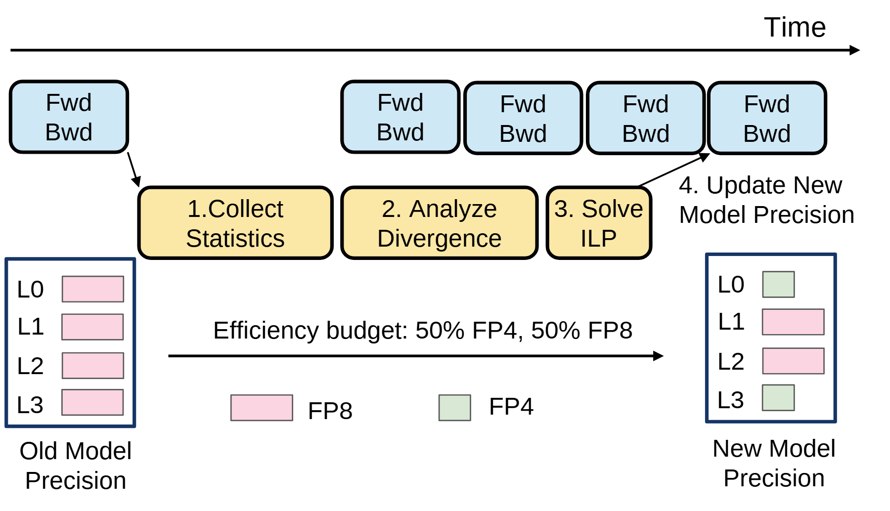

# VA-046 · 持续执行旁路优化与配置更新

顶部时间轴承载持续重复的工作块，中部统计、分析、求解构成旁路优化流程，并在后续迭代处写回配置。底部左右两列展示同一组对象的更新前后类别，中央预算说明约束变化范围。图中空隙表现流程关系，未经时间标定不能解释为耗时比例。



## 适用范围

- 在线自适应控制与后台策略优化
- 需要同时解释更新步骤和配置变化

不适合：完全离线一次性求解；要求精确甘特时间尺度的调度结果。

## 阅读顺序

1. 沿时间箭头看持续执行块
2. 从采集箭头进入统计、分析和求解
3. 追踪更新箭头回到稍后的执行块
4. 比较下方旧配置与新配置，并读取类别图例和预算

## 图形表达

**布局**：上层时间线、中层旁路步骤、下层左右对照，更新箭头斜向回接上层以表达异步关系。

**对象**：圆角蓝块是常规迭代，黄色步骤块是优化工作；细边框竖列中每一行对应一个对象。

**连线**：采集与写回箭头跨层，底部横箭头表示配置转变；顶部时间线不必与每步计算严格等距。

**配色**：浅蓝区分正常工作，浅黄区分优化阶段；粉色和浅绿是配置类别，必须由图例解释。

**文字**：无衬线步骤编号与短动词便于顺读，预算文字独占中部空间，长约束应移到图注。

## 部件与复用

| 部件 | 含义 | 改造方法 |
|---|---|---|
| 持续工作序列 (`running-timeline`) | 更新期间继续推进的重复任务。 | 如存在暂停必须显式画出，不应保留连续运行假象。 |
| 旁路优化链 (`background-optimizer`) | 从观测到分析再到优化求解的中间流程。 | 按实际算法改步骤，求解器名称不能由图形惯例决定。 |
| 更新前配置 (`old-state`) | 按对象逐行列出原配置类别。 | 对象名与右列一一对应；条形长度不是数值大小。 |
| 更新后配置 (`new-state`) | 显示优化应用后的类别变化。 | 只能用真实或明确假设的配置，不把配色变化当改善证据。 |
| 约束和图例 (`budget-legend`) | 解释配置颜色，并给出共同资源预算。 | 预算数值和单位来自任务定义，图例随类别变化同步修改。 |

## 改造步骤

1. 确定采样时点与实际生效时点，再放置两条跨层箭头
2. 底部比较必须维持对象顺序一致
3. 类别增加时扩大图例并补全颜色映射
4. 若更新会阻塞执行，在时间线上增加停顿段并调整文案

## 新情景示例（假设）

可用于自适应路口信号控制的方案说明。

常规迭代对应信号周期，旁路链对应流量统计、拥堵预测、配时求解，左右列对应各路口策略类别。

用各路口真实策略替代层精度标签；将预算改为周期或总延误约束，标出生效周期而非暗示即时切换。

## 编辑入口

**入口**：make_figure.py 读取 example.json；labels.json 查文字键，asset.json 查部件键；输出 SVG，可用配套渲染脚本导出 PDF。

**配置可改**：labels 修改文字及字体属性；components 可设 visible、dx/dy、attributes；elements 修改单个对象属性。平移使用图的坐标单位，重叠部件不要同时平移。

**需改代码**：改变模块数量、连接关系或分栏布局须编辑 customize()，不会自动布线。新对象需唯一 data-asset-key，并加入对应部件 element_keys，才会随部件导出。

**字体**：本图映射字体：Arimo-Regular.ttf。沿用完整字体覆盖新字符；font_size 是元素局部单位，不是纸面 pt。改长标签后检查字宽、裁切及最终 PDF。

准备独立工作副本：

```text
python "<SKILL>/scripts/prepare_architecture.py" --id VA-046 --out figures/architecture
```

在工作副本运行：

```text
python make_figure.py --config example.json --out . --parts
python render_architecture.py fig.svg
```

## 本图检查

- 采集与更新是否落在正确迭代位置
- 左右配置对象是否同名同序
- 预算与图例类别是否覆盖全部变化

部件图用于复用局部对象；跨边界的连接和共享容器仍需按新关系处理。示例名称、数值和曲线不是当前研究结果。

来源与许可见 [ATTRIBUTION.md](ATTRIBUTION.md)。
