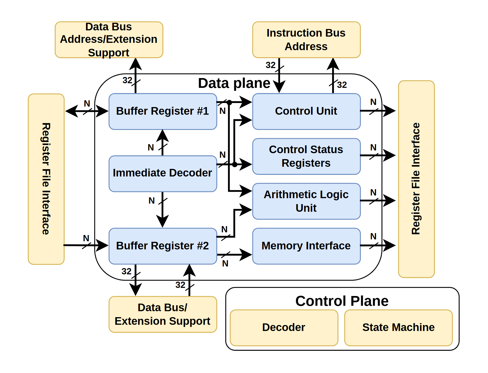

# VA-127 · 数据通路与外围控制接口分区

蓝色数据通路被浅黄色接口与控制逻辑包围。中央圆角边界集中寄存器、译码和运算模块，底部独立控制面给出译码器与状态机，适合表达核心处理与宽度无关支撑逻辑的分工。



## 适用范围

- 中央数据通路与外围控制接口分离的硬件框图
- 需要显示固定宽度总线与参数位宽数据路径的模块设计

不适合：纯软件层级架构且没有接口位宽含义；只需要表达时间先后的一条简单流水线。

## 阅读顺序

1. 从上方数据总线与指令总线接口进入中央 Data plane。
2. 读取左右两列蓝色处理模块和双侧寄存器接口。
3. 最后看下方独立 Control Plane 的 Decoder 与 State Machine。

## 图形表达

**布局**：中央圆角数据面含左右两列蓝块，左右各一个纵向接口，上下是总线接入，右下独立控制面。

**对象**：圆角浅蓝矩形用于处理模块，浅黄用于接口及控制；位宽直接标在线旁。

**连线**：黑色有向线区分输入输出，N 与 32 标注位宽；部分箭头双向，不能统一改成单向。

**配色**：蓝色区分数据路径，浅黄色区分外围接口及底部控制，白底外框仅作聚合。

**文字**：Arial 风格无衬线，分区标题较粗，模块名常分两行；接口竖排文字需要保留阅读方向。

## 部件与复用

| 部件 | 含义 | 改造方法 |
|---|---|---|
| 中央数据面 (`datapath`) | 寄存器、立即数译码、控制状态、算术和内存接口形成核心数据通路。 | 扩展运算单元时连同端口与 N 位连接一起添加。 |
| 左寄存器接口 (`left-register-interface`) | 左侧接口为缓冲寄存器提供读入路径。 | 保留纵向接口布局，长名称可改为外部说明。 |
| 右寄存器接口 (`right-register-interface`) | 右侧汇聚多个内部模块输出。 | 若新设计有多个独立接口需拆分，并按输出关系重连。 |
| 顶部双总线入口 (`top-buses`) | 数据地址扩展与指令地址入口并列。 | 分别映射数据与控制输入，不合并两种位宽。 |
| 底部数据扩展入口 (`bottom-bus`) | 底部独立总线支持缓冲寄存器路径。 | 可改为回写或外部传输接口，但必须核对箭头方向。 |
| 底部控制面 (`control-plane`) | 译码器与状态机被同一圆角框归为控制层。 | 可独立抽取为小型控制子系统，增加状态时修改布局。 |

## 改造步骤

1. 先确定 N 是否仍是新设计的参数位宽；没有位宽语义应删除全部 N/32 标识。
2. 保留数据与控制两种色彩角色，再替换具体处理职责。
3. 调整中央模块数量时需重新布线双侧接口，避免穿过模块文字。

## 新情景示例（假设）

假设场景：可变精度流式传感处理器。

两个缓冲区对应采样缓存，运算块对应滤波核，控制面对应指令译码和采样状态机。

按滤波阶段增加运算模块；将 N 统一定义为样本位宽，并核实两个外部 32 位接口。

## 编辑入口

**入口**：运行 make_figure.py 读取 example.json 的迁移配置；labels.json 登记文字，asset.json 登记部件。使用 --parts 可导出部件；准备后的工作副本通过 render_architecture.py 输出论文图。

**配置可改**：labels、components 可设置文字、配色、显隐和位移；不会自动加宽文本框或重排连线。先保留示例几何再逐项调整。

**需改代码**：改变节点数量、分支和跨区域连线须修改 customize(root, context)。新增元素设置 data-asset-key，并加入对应部件的 element_keys；共享边框与跨区箭头保留整图级，避免重叠移动。

**字体**：Arial 风格无衬线，分区标题较粗，模块名常分两行；接口竖排文字需要保留阅读方向。 最终字体文件以构建映射为准；局部 font_size 受 SVG 变换影响，不直接等于纸面 pt。本批构建已确认并嵌入完整字体：Arimo-Bold.ttf。映射可能改变原字形和字宽，需按实际论文尺寸复核。

准备独立工作副本：

```text
python "<SKILL>/scripts/prepare_architecture.py" --id VA-127 --out figures/architecture
```

在工作副本运行：

```text
python make_figure.py --config example.json --out . --parts
python render_architecture.py fig.svg
```

## 本图检查

- 确认 N 与固定 32 位的标注没有混用。
- 上下缓冲区的箭头方向须符合当前输入输出关系；语义未变时保留原方向。
- 外围黄块不能被解释成同一条串行流水线。
- 竖排字和两行模块名需在论文尺寸检查。
- 部件按语义区域抽取，端口处可能保留跨区连接的箭头头部或短线；完整连接以整图为准，独立移动时须重新接线。

部件图用于复用局部对象；跨边界的连接和共享容器仍需按新关系处理。示例名称、数值和曲线不是当前研究结果。

来源与许可见 [ATTRIBUTION.md](ATTRIBUTION.md)。
