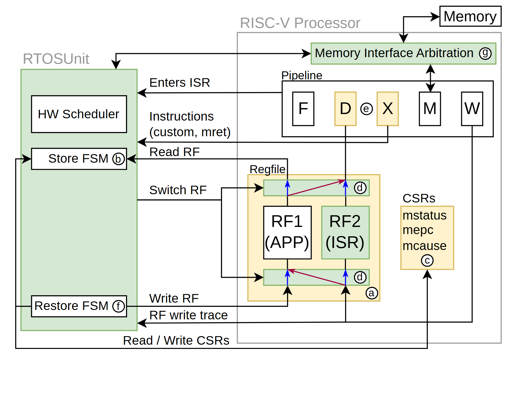

# VA-128 · 旁挂调度单元与双寄存器组耦合

左侧独立调度单元通过多条具名接口耦合右侧处理器。右侧流水线、双寄存器组和状态寄存器分开绘制，使保存恢复的职责与普通指令执行路径可以同时追踪。



## 适用范围

- 外部控制器介入现有执行核心的协同架构
- 需要说明上下文保存恢复与双缓冲寄存器切换的系统

不适合：只需展示一个抽象 CPU 方框的总览；连接方向尚未明确的概念提案。

## 阅读顺序

1. 先读左侧绿色 RTOSUnit 内调度、保存和恢复三个模块。
2. 再看右上流水线和顶部内存仲裁。
3. 沿中间接口到双寄存器组与右侧 CSRs，逐条辨认读写和切换。

## 图形表达

**布局**：左侧窄高调度区域，右侧大处理器边界内上部流水、中央寄存器组、右侧状态寄存器。

**对象**：矩形处理阶段用字母简写，双寄存器组并排，左侧三个窄块显示不同控制职能。

**连线**：黑色折线配接口名称；寄存器组内有红蓝切换连线，外部线路跨区较多，必须追踪端点。

**配色**：左区浅绿，寄存器组外框及部分状态黄色；两个寄存器组白色与浅绿区分，红蓝线强调切换关系。

**文字**：无衬线小字多，流水阶段单字母较大；圈字母是接口引用，不是时间步骤。

## 部件与复用

| 部件 | 含义 | 改造方法 |
|---|---|---|
| 旁挂调度单元 (`rtos-controller`) | 调度器及保存、恢复状态机聚合于独立区域。 | 移植为协处理单元时分别保留三个职责或明确合并。 |
| 流水线与内存仲裁 (`pipeline-memory`) | 上部指令阶段与内存接口仲裁连接。 | 修改级数时同步改写接口进入哪一级。 |
| 双寄存器组切换区 (`register-banks`) | 两个寄存器组及切换线表达应用与中断上下文并存。 | 改成双缓冲数据区时重命名并重画切换控制，不沿用中断语义。 |
| 状态寄存器簇 (`status-registers`) | 右侧 CSRs 保存处理器控制状态。 | 根据目标系统增删字段，独立调整簇的宽高。 |

## 改造步骤

1. 先为每条具名接口确定新系统中的发送方和接收方，不能只批量替换模块名。
2. 双组切换与保存恢复职责要一致，必要时合并或删除无用通道。
3. 移动左侧控制器后在 customize 中重算跨区折线，整体处理器边界留在整图。

## 新情景示例（假设）

假设场景：为实时仿真内核增加上下文切换协处理器。

左区映射调度、状态保存、恢复；双寄存器组映射任务与事件上下文；CSR 簇映射运行模式。

按实际内核支持的接口删除硬件特有指令阶段，并重构只保留有实现依据的读写线。

## 编辑入口

**入口**：运行 make_figure.py 读取 example.json 的迁移配置；labels.json 登记文字，asset.json 登记部件。使用 --parts 可导出部件；准备后的工作副本通过 render_architecture.py 输出论文图。

**配置可改**：labels、components 可设置文字、配色、显隐和位移；不会自动加宽文本框或重排连线。先保留示例几何再逐项调整。

**需改代码**：改变节点数量、分支和跨区域连线须修改 customize(root, context)。新增元素设置 data-asset-key，并加入对应部件的 element_keys；共享边框与跨区箭头保留整图级，避免重叠移动。

**字体**：无衬线小字多，流水阶段单字母较大；圈字母是接口引用，不是时间步骤。 最终字体文件以构建映射为准；局部 font_size 受 SVG 变换影响，不直接等于纸面 pt。本批构建已确认并嵌入完整字体：Arimo-Regular.ttf。映射可能改变原字形和字宽，需按实际论文尺寸复核。

准备独立工作副本：

```text
python "<SKILL>/scripts/prepare_architecture.py" --id VA-128 --out figures/architecture
```

在工作副本运行：

```text
python make_figure.py --config example.json --out . --parts
python render_architecture.py fig.svg
```

## 本图检查

- Read RF 与 Write RF 的方向不能颠倒。
- 外框跨区线路不得被部件移动截断。
- 圈字母与正文接口表需一致。
- 核实 RF1/RF2 的颜色是否仍与新上下文对应。
- 部件按语义区域抽取，端口处可能保留跨区连接的箭头头部或短线；完整连接以整图为准，独立移动时须重新接线。

部件图用于复用局部对象；跨边界的连接和共享容器仍需按新关系处理。示例名称、数值和曲线不是当前研究结果。

来源与许可见 [ATTRIBUTION.md](ATTRIBUTION.md)。
