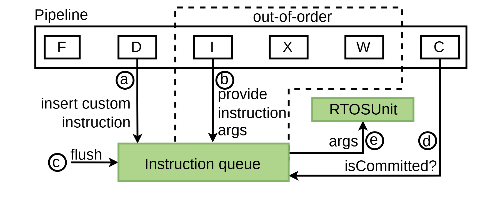

# VA-129 · 乱序流水旁路的顺序提交队列

上方六级流水线用虚线框指出乱序区，下方队列接收译码指令与发射参数，并在提交确认后向辅助单元送出参数。图形用少量跨层箭头说明旁路执行必须服从提交与冲刷约束。



## 适用范围

- 主流水与旁路单元之间需要顺序提交门控
- 说明投机执行后由队列保证外部副作用正确性的结构

不适合：各阶段都严格顺序且没有提交确认机制；要展示队列长度或吞吐数据的定量结果。

## 阅读顺序

1. 从左到右看 F、D、I、X、W、C 六个阶段。
2. 用上方虚线范围识别 I/X/W 乱序区。
3. 再跟随下行指令与参数进入队列，检查冲刷、提交确认与输出参数接口。

## 图形表达

**布局**：横向流水占上半部，绿色队列位于左下，辅助单元位于右下；虚线跨越上方三个中间阶段。

**对象**：流水阶段为白底小框，队列为宽绿框，辅助单元为短绿框。

**连线**：D/I 向队列输入，C 的 isCommitted? 路径回到队列；flush 从左进入，args 从队列折向辅助单元。

**配色**：白色流水与绿色旁路处理区区分主从关系，黑线与虚线表示信号和区域。

**文字**：无衬线；阶段单字母最大，说明用小字分行，圈字母 a–e 用于定位接口。

## 部件与复用

| 部件 | 含义 | 改造方法 |
|---|---|---|
| 六级流水阶段条 (`pipeline`) | 仅抽取六个阶段和外框；上方标题及跨层乱序范围虚线留在整图。 | 改级名可复用阶段条，增减阶段须同步重画整图的乱序范围和下行控制线。 |
| 指令顺序队列 (`instruction-queue`) | 队列暂存待确认指令。 | 改容量不能用框宽暗示，需明确标注条目数。 |
| 旁路执行单元 (`side-unit`) | 提交后接收参数的独立功能单元。 | 替换为外设或加速器时仍需验证副作用时机。 |
| 队列冲刷入口 (`flush-input`) | 错误投机导致队列清空的输入。 | 复用时保留取消语义，不能改为普通新数据。 |

## 改造步骤

1. 先定义哪些阶段允许乱序，以及外部副作用何时被允许。
2. 确认 flush、args 和 isCommitted? 的新名字对应真实控制语义。
3. 如果改变队列位置，需同时修改 D、I、C 三条跨层线与通往辅助单元的折线。

## 新情景示例（假设）

假设场景：投机任务调度器对接不可回滚的设备请求。

主流水映射任务解析到提交，队列缓存设备请求，旁路单元负责实际发送。

删除不适用的处理器字母，保留提交许可和失败取消，并按真实流水级重画乱序范围。

## 编辑入口

**入口**：运行 make_figure.py 读取 example.json 的迁移配置；labels.json 登记文字，asset.json 登记部件。使用 --parts 可导出部件；准备后的工作副本通过 render_architecture.py 输出论文图。

**配置可改**：labels、components 可设置文字、配色、显隐和位移；不会自动加宽文本框或重排连线。先保留示例几何再逐项调整。

**需改代码**：改变节点数量、分支和跨区域连线须修改 customize(root, context)。新增元素设置 data-asset-key，并加入对应部件的 element_keys；共享边框与跨区箭头保留整图级，避免重叠移动。

**字体**：无衬线；阶段单字母最大，说明用小字分行，圈字母 a–e 用于定位接口。 最终字体文件以构建映射为准；局部 font_size 受 SVG 变换影响，不直接等于纸面 pt。本批构建已确认并嵌入完整字体：Arimo-Regular.ttf。映射可能改变原字形和字宽，需按实际论文尺寸复核。

准备独立工作副本：

```text
python "<SKILL>/scripts/prepare_architecture.py" --id VA-129 --out figures/architecture
```

在工作副本运行：

```text
python make_figure.py --config example.json --out . --parts
python render_architecture.py fig.svg
```

## 本图检查

- 提交确认应进入队列门控，不能直接送往设备。
- flush 应作用于尚未提交项目。
- 乱序虚线框只覆盖实际乱序阶段。
- 改图后核对五个接口标记没有遗留引用。

部件图用于复用局部对象；跨边界的连接和共享容器仍需按新关系处理。示例名称、数值和曲线不是当前研究结果。

来源与许可见 [ATTRIBUTION.md](ATTRIBUTION.md)。
