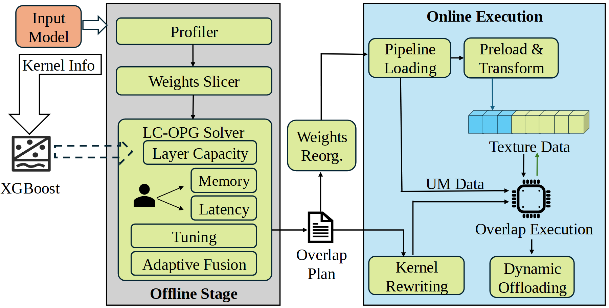

# VA-130 · 离线约束规划与在线重叠执行

离线侧通过分析、切分和求解输出可执行计划，在线侧按计划组织装载、变换和计算。中间用文档图标及权重重组块承接两个阶段，细节同时呈现资源约束与不同存储路径。



## 适用范围

- 离线优化产出计划并指导在线执行的系统
- 需要把性能预测、资源约束和运行时调度放在一图中的方法

不适合：全流程在线即时决策且没有离线产物；只需简单训练到推理箭头的概念图。

## 阅读顺序

1. 左边输入模型与 Kernel Info 分别进入分析和预测路径。
2. 灰色离线区从 Profiler、Weights Slicer 到约束求解器。
3. 通过中间重组和计划两类输出进入蓝色在线区。
4. 在在线区读装载、变换、存储、执行及下方改写与卸载模块。

## 图形表达

**布局**：左输入窄列、中间灰色离线高框、过渡制品列、右蓝色在线高框组成不等宽四列。

**对象**：圆角浅绿功能块、文件图标、芯片图标和立体条带分别表达处理、计划、执行与纹理数据。

**连线**：黑色实线连接主过程；预测器到求解器为虚线宽箭头，在线存储与执行间有不同方向箭头。

**配色**：输入模型橙色；离线背景灰、在线背景浅蓝；功能块浅绿，纹理数据用蓝与黄绿分段。

**文字**：主体为衬线字，阶段标题加粗；长模块名多行，输入与图标标注应保持同一字号层次。

## 部件与复用

| 部件 | 含义 | 改造方法 |
|---|---|---|
| 模型信息与容量预测 (`input-predictor`) | 输入模型与内核信息引出预测辅助路径。 | 更换预测方法时连同 Kernel Info 的输入依据说明。 |
| 离线分析与约束规划 (`offline-planner`) | 分析、权重切分和求解器在同一离线区域中串联。 | 修改约束时同步修改 Memory、Latency 和求解器内部块。 |
| 计划与重组中间制品 (`handoff-artifacts`) | 文件式计划和权重重组模块承接阶段间依赖。 | 若计划不含权重重组应删去相应分支，并修改接入点。 |
| 在线存储与重叠执行 (`online-runtime`) | 装载、变换、多存储路径和内核处理共同构成在线执行区。 | 抽取整区时保留对计划的输入端口，增加运行模块需重布线。 |

## 改造步骤

1. 先说明离线可获得哪些信息，以及计划中包含哪些运行决策。
2. 按实际系统重写求解器约束和中间制品，不能保留无证据的内存或延迟目标。
3. 在线区若没有纹理存储，应替换条带及相关数据通道而非只改其文字。
4. 两阶段之间新增反馈需要另加真实回路；当前图本身不是训练反馈闭环。

## 新情景示例（假设）

假设场景：离线仓储任务规划与在线机器人装载执行。

模型输入改为订单与地图，求解器约束改为容量和时限，计划文档指导在线装载和调度。

将纹理数据与芯片图标改为队列和执行站，按物料/控制分别重画通道。

## 编辑入口

**入口**：运行 make_figure.py 读取 example.json 的迁移配置；labels.json 登记文字，asset.json 登记部件。使用 --parts 可导出部件；准备后的工作副本通过 render_architecture.py 输出论文图。

**配置可改**：labels、components 可设置文字、配色、显隐和位移；不会自动加宽文本框或重排连线。先保留示例几何再逐项调整。

**需改代码**：改变节点数量、分支和跨区域连线须修改 customize(root, context)。新增元素设置 data-asset-key，并加入对应部件的 element_keys；共享边框与跨区箭头保留整图级，避免重叠移动。

**字体**：主体为衬线字，阶段标题加粗；长模块名多行，输入与图标标注应保持同一字号层次。 最终字体文件以构建映射为准；局部 font_size 受 SVG 变换影响，不直接等于纸面 pt。本批构建已确认并嵌入完整字体：Tinos-Bold.ttf, Tinos-Regular.ttf。映射可能改变原字形和字宽，需按实际论文尺寸复核。

准备独立工作副本：

```text
python "<SKILL>/scripts/prepare_architecture.py" --id VA-130 --out figures/architecture
```

在工作副本运行：

```text
python make_figure.py --config example.json --out . --parts
python render_architecture.py fig.svg
```

## 本图检查

- 预测输入应有数据依据。
- 文件计划与权重重组并非同一制品。
- 离线/在线背景含义必须稳定。
- 实际输出尺寸检查求解器内部小字和分段条带。

部件图用于复用局部对象；跨边界的连接和共享容器仍需按新关系处理。示例名称、数值和曲线不是当前研究结果。

来源与许可见 [ATTRIBUTION.md](ATTRIBUTION.md)。
