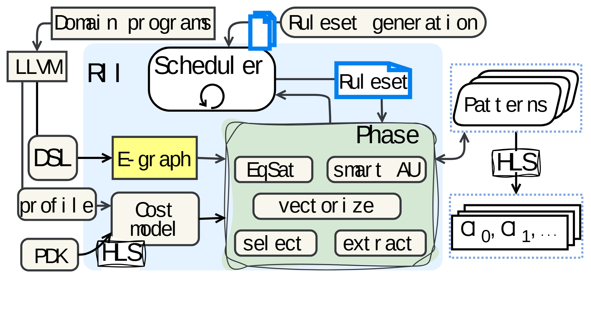

# VA-048 · 规则与代价共同驱动的迭代变换图

这张图围绕中间的迭代阶段栈组织多种输入：左侧提供问题表示与测量信息，上方提供规则，底部提供代价依据，右侧收集可复用模式和最终方案。它适合展示多路约束共同驱动搜索的机制。阶段栈表示重复执行，同一个框内列出的操作并不自动意味着严格串行时序。



## 适用范围

- 规则变换与代价评估相结合的方案搜索
- 同时具有输入转换、候选模式和实现输出的设计流程

不适合：仅有一条线性处理管线；无法明确规则来源或代价模型输入。

## 阅读顺序

1. 从左上问题输入沿转换链进入中间表示
2. 查看上方规则生成与调度器如何选择一轮规则
3. 结合左下代价输入理解中央阶段栈
4. 跟随右侧输出到模式集合及实现结果，并检查阶段回路

## 图形表达

**布局**：中央浅蓝区域包住主搜索过程，左侧分上下输入通道，右侧留两级输出，形成围绕核心而非均匀方框网格的组织。

**对象**：文件叠片表示规则或结果集合，多张圆角阶段卡表示迭代；阶段内部短胶囊表示操作。

**连线**：曲线连接强调输入汇入，调度器旁小回环表示循环；交叉线必须留可辨识端点，不能靠位置猜流向。

**配色**：中央阶段以浅绿色成组，中间表示用黄色突出，规则对象用蓝边强调；色彩主要表达对象类别。

**文字**：当前预览存在不均匀字距，长标题尤其明显；换字后必须重设连续标签与基线，不能直接沿用字符散布。

## 部件与复用

| 部件 | 含义 | 改造方法 |
|---|---|---|
| 输入转换链 (`input-transform`) | 问题经前端转换为可搜索的中间表示。 | 用当前问题的真实表示替换编译术语，保留转换先后。 |
| 规则调度 (`rule-scheduler`) | 规则集合提供变换，调度器决定每轮使用。 | 说明规则来自人工约束、库或生成过程，不能笼统写智能优化。 |
| 代价依据 (`cost-model`) | 测量与目标条件共同形成评价模型。 | 列出实际成本项，删除无对应的工艺参数入口。 |
| 迭代操作栈 (`iterative-phase`) | 多轮操作产生和选择候选结构。 | 按真实方法删改操作，新增时重排内部胶囊和回线。 |
| 候选与实现集合 (`solution-stack`) | 先输出可复用模式，再形成可落地方案。 | 明确两级产物的区别，若只有最终方案应合并输出。 |

## 改造步骤

1. 先清理标签字距和缩写，再调整内容，避免把排版问题带入新图
2. 把规则、评价数据和目标约束分成不同输入
3. 为每轮操作补充先后说明，必要时增加编号而非靠卡片位置暗示
4. 输出集合大小变化应改叠片图元，不能只改数字

## 新情景示例（假设）

可用于假设的仓储作业流程自动改进。

问题输入对应作业日志，中间表示对应流程图，规则对应可合并或可并行步骤，代价模型衡量耗时与拥堵。

将中央操作改为重排、合并、并行化、筛选和导出；删除硬件工艺入口，右侧输出流程模式与执行方案。

## 编辑入口

**入口**：make_figure.py 读取 example.json 生成 fig.svg；加 --parts 导出部件，render_architecture.py 渲染预览及 PDF。

**配置可改**：labels 按 labels.json 对象键改字；components 支持 visible、dx/dy、attributes；elements 改对象属性。位移用图内坐标，连线不自动重布。

**需改代码**：增删模块、改连接和布局须修改 customize()。新对象须有唯一 data-asset-key 并登记部件归属；嵌套部件选一个层级平移，避免重复移动。本图已有字符间距异常，建议整条替换关键标题，而不是逐字符移动修补。

**字体**：当前完整字体为 Arimo-Regular。font_size 是元素局部坐标单位，受缩放变换影响，不是纸面字号；改长标签后按最终版面宽度复核换行与字距。

准备独立工作副本：

```text
python "<SKILL>/scripts/prepare_architecture.py" --id VA-048 --out figures/architecture
```

在工作副本运行：

```text
python make_figure.py --config example.json --out . --parts
python render_architecture.py fig.svg
```

## 本图检查

- 所有长标题字距是否均匀且未与箭头相交
- 规则输入和代价输入是否仍可明确区分
- 阶段内操作及迭代终止条件是否有真实定义

部件图用于复用局部对象；跨边界的连接和共享容器仍需按新关系处理。示例名称、数值和曲线不是当前研究结果。

来源与许可见 [ATTRIBUTION.md](ATTRIBUTION.md)。
