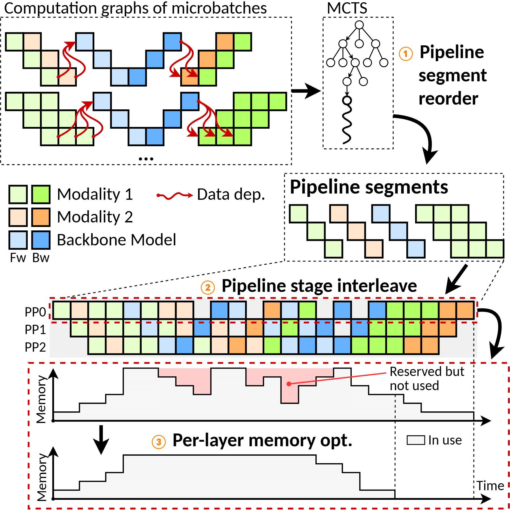

# VA-049 · 依赖任务到资源日程的三步优化

这张图把离散任务依赖、组合搜索、资源排程和占用变化连成一条可追踪的设计过程。上方彩色单元是有依赖的任务块，中间树形搜索产生重排段，随后落入三条资源泳道；底部两幅占用轮廓解释进一步去除无效保留量。它提供的是过程组织方式，示意轮廓不能被当作新情景已经取得的性能收益。



## 适用范围

- 依赖任务的重排、交错执行与占用优化
- 需要把优化步骤与资源时间图衔接的算法概览

不适合：没有离散任务及资源时间轴的连续控制系统；只想比较两个标量结果而无过程解释的结果图。

## 阅读顺序

1. 从左上两组任务图辨认类别和红色依赖边。
2. 看树形搜索如何产出右中部的流水段。
3. 沿步骤二箭头读三条资源泳道，核对任务身份延续。
4. 最后读占用曲线的优化前后与被标出的保留但未使用区域。

## 图形表达

**布局**：近方形纵向叙事；上层依赖图与搜索并列，中层段序列转入全宽泳道，下层为前后占用对。

**对象**：单位方块代表任务，树节点代表搜索选择，阶梯轮廓代表占用；三种图形承担不同语义，不混作装饰。

**连线**：红色曲线仅标任务依赖，粗黑箭头串联处理步骤；细虚线把片段展开到泳道，不能表示额外运算。

**配色**：绿橙蓝区分任务类别，深浅进一步区分两个执行阶段；粉色仅标占用差额，图例必须同步更改。

**文字**：步骤标题较粗、圈号醒目，资源行名与轴名短；单元过密时先减少示例任务，不把整体文字压小。

## 部件与复用

| 部件 | 含义 | 改造方法 |
|---|---|---|
| 任务依赖块 (`task-graphs`) | 按类别和阶段编码的待排程单元及先后约束 | 替换任务数量时同时调整依赖边，重复块不能凭颜色制造依赖。 |
| 顺序搜索树 (`search-tree`) | 探索候选顺序的组合搜索阶段 | 只有实际采用树搜索时保留树形图，否则改为对应求解方法。 |
| 重排片段 (`segment-artifact`) | 从任务图得到的可调度局部段 | 段内顺序须保持真实约束，改名不足以表达新的并行性。 |
| 资源时间泳道 (`resource-lanes`) | 任务在多个执行资源上的交错安排 | 为新任务重算或示意安排，不沿用现有格子当作计算结果。 |
| 占用前后对 (`occupancy-before-after`) | 资源被预留与实际使用的差异及优化后的轮廓 | 有证据时用真实轨迹重画；否则明确为机制示意，并保持轴尺度可比。 |

## 改造步骤

1. 把新任务分为类别与执行阶段，定义单元格和红依赖边。
2. 选择实际求解过程，替换搜索树和重排段，删除不存在的优化步骤。
3. 根据合法排程重建泳道，逐项检查先后依赖和单资源冲突。
4. 用可追溯数据生成占用图，或改成不带效果暗示的示意；统一前后轴尺度。

## 新情景示例（假设）

假设说明实验室多仪器检测任务的排程方案。

任务颜色对应检测类型，深浅对应准备与执行；资源泳道对应仪器，占用轮廓对应临时样本存储。

若采用整数规划则将搜索树替换为约束求解模块；泳道必须按仪器兼容性重排，占用曲线由样本留存时间计算。

## 编辑入口

**入口**：在工作副本修改 example.json，运行 python make_figure.py --config example.json --out output --parts；再通过 Vivid 的矢量渲染入口检查 SVG 与 PDF。

**配置可改**：labels 按 labels.json 的元素键改字；components 按本页部件 id 设置 visible、dx、dy 或 attributes；elements 修改指定矢量元素属性。重叠部件可能共享元素，避免对父区域和内部区域重复位移。

**需改代码**：任务格、树节点、泳道和阶梯曲线变化均需代码或数据驱动重建；引擎不会求解排程或重新计算占用。这些接口不会自动重排，也不会随部件移动自动修复跨部件连线。

**字体**：本资产已记录的完整字形资源：Carlito-Bold.ttf, Carlito-Regular.ttf。修改英文标签优先沿用对应字体族与字重；文字变长时调整框宽和换行，不靠整体缩小压入。其他语言须另选覆盖所需字符的字体并实查导出。

准备独立工作副本：

```text
python "<SKILL>/scripts/prepare_architecture.py" --id VA-049 --out figures/architecture
```

在工作副本运行：

```text
python make_figure.py --config example.json --out . --parts
python render_architecture.py fig.svg
```

## 本图检查

- 重排后每条红色依赖是否仍成立，泳道是否有非法同时占用？
- 深浅颜色的第二层含义是否在所有片段和图例中一致？
- 优化前后占用轮廓是否使用相同时间与容量口径，差额是否有依据？

部件图用于复用局部对象；跨边界的连接和共享容器仍需按新关系处理。示例名称、数值和曲线不是当前研究结果。

来源与许可见 [ATTRIBUTION.md](ATTRIBUTION.md)。
