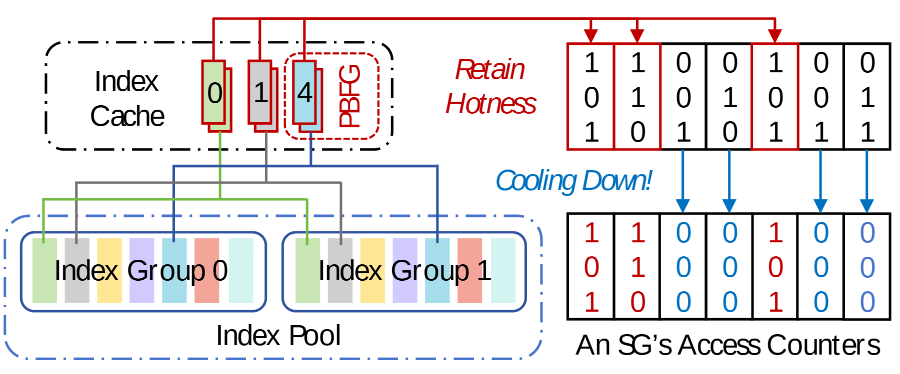

# VA-131 · 缓存索引驱动的热度保留与冷却

左侧缓存索引及后备池确定右侧位图哪些列应保留，红色顶部路径强调保留热度，蓝色向下箭头显示冷却后的变化。上下两幅位图构成状态转移，而不是两份独立计数器。



## 适用范围

- 缓存驻留与对象热度更新之间的选择关系
- 用二值位图展示选择性保留和衰减机制

不适合：连续数值热度且未二值化的统计图；只有索引层级、没有状态更新语义的存储总览。

## 阅读顺序

1. 先读左上 Index Cache 的编号项。
2. 沿左下索引池连接确认缓存项与索引组的对应。
3. 看红色保留路径进入右上计数器位图。
4. 沿蓝色冷却箭头比较右下更新后的位图。

## 图形表达

**布局**：左半区上缓存、下索引池；右半区上下两幅同列位图，保留说明居中上方，冷却说明居中下方。

**对象**：缓存项为细窄竖卡，索引组为彩色条带；位图用细矩形网格和 0/1 字符表示。

**连线**：红色水平总线及向下箭头连接选中列，蓝色箭头指示冷却，索引池连接是细折线。

**配色**：红色强调保留列，蓝色强调冷却后零值；左侧索引卡使用淡彩区分组内对象而非热度等级。

**文字**：紧凑无衬线数字，Retain Hotness 与 Cooling Down! 为斜体；数字格内文字必须精确对齐。

## 部件与复用

| 部件 | 含义 | 改造方法 |
|---|---|---|
| 当前缓存索引 (`index-cache`) | 缓存项 0、1、4 与 PBFG 标签位于虚线框。 | 替换编号时同步变更池中对象和右侧保留列。 |
| 后备索引池 (`index-pool`) | 两个索引组由多色条带构成，提供缓存项的来源。 | 组数变化需重新布局条带并重连上方选择线。 |
| 保留前热度位图 (`counter-before`) | 上方位图给出冷却前计数器状态。 | 可改二进制实例，但上下位图必须严格同列。 |
| 冷却后热度位图 (`counter-after`) | 下方位图给出选择性保留后状态并标注计数器。 | 保留列与冷却列应由同一更新规则计算，不能随意调色。 |

## 改造步骤

1. 先确定热度表示是二进制位还是数值计数；改变表示需重构网格。
2. 把缓存索引、后备池和位图列建立一一对应，再改示例数字。
3. 保留和清零两条规则要分别写清楚，箭头颜色与格中文字颜色同步。

## 新情景示例（假设）

假设场景：边缘缓存对对象访问活跃位进行周期更新。

Index Cache 改为驻留对象列表，Index Pool 改为对象分组，右侧位图对应访问活跃位。

若采用指数衰减而非清零，需将二值格改为数值并重新设计色标，不能沿用当前 0/1 图。

## 编辑入口

**入口**：运行 make_figure.py 读取 example.json 的迁移配置；labels.json 登记文字，asset.json 登记部件。使用 --parts 可导出部件；准备后的工作副本通过 render_architecture.py 输出论文图。

**配置可改**：labels、components 可设置文字、配色、显隐和位移；不会自动加宽文本框或重排连线。先保留示例几何再逐项调整。

**需改代码**：改变节点数量、分支和跨区域连线须修改 customize(root, context)。新增元素设置 data-asset-key，并加入对应部件的 element_keys；共享边框与跨区箭头保留整图级，避免重叠移动。

**字体**：紧凑无衬线数字，Retain Hotness 与 Cooling Down! 为斜体；数字格内文字必须精确对齐。 最终字体文件以构建映射为准；局部 font_size 受 SVG 变换影响，不直接等于纸面 pt。本批构建已确认并嵌入完整字体：Arimo-Italic.ttf, Arimo-Regular.ttf。映射可能改变原字形和字宽，需按实际论文尺寸复核。

准备独立工作副本：

```text
python "<SKILL>/scripts/prepare_architecture.py" --id VA-131 --out figures/architecture
```

在工作副本运行：

```text
python make_figure.py --config example.json --out . --parts
python render_architecture.py fig.svg
```

## 本图检查

- 缓存项编号与红色保留列应对应。
- 上下位图列数、顺序一致。
- 冷却后的零值是否满足所述规则。
- 小号 0/1 在最终输出中不得变成难区分细线。
- 部件按语义区域抽取，端口处可能保留跨区连接的箭头头部或短线；完整连接以整图为准，独立移动时须重新接线。

部件图用于复用局部对象；跨边界的连接和共享容器仍需按新关系处理。示例名称、数值和曲线不是当前研究结果。

来源与许可见 [ATTRIBUTION.md](ATTRIBUTION.md)。
