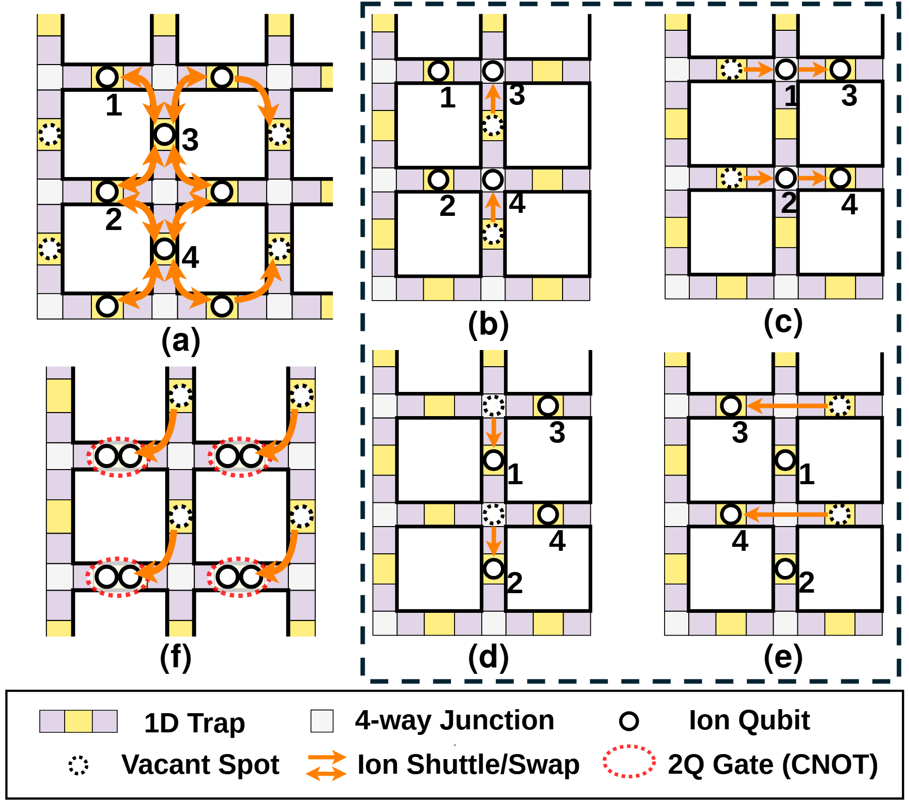

# VA-132 · 二维通道拓扑上的对象搬移分解

同一二维通道拓扑在六个面板中重复，左上显示总体交换目标，右侧四格拆解搬移动作，左下展示最终同处操作。共享图例用占位、空位和路径符号让拓扑上的状态变化可追踪。



## 适用范围

- 固定通道网络中对象经空位搬移实现重排
- 需要把总体目标、局部步骤和终态同时展示的拓扑说明

不适合：任意连续空间运动且没有离散通道约束；只需要静态节点连通关系的网络总览。

## 阅读顺序

1. 读左上 (a) 总体交换目标与四个编号对象。
2. 进入右侧虚线框，依次读 (b)、(c)、(d)、(e)。
3. 回到左下 (f) 终态，确认红虚线圈选中的同处操作。
4. 底部图例核对通道、交叉口、对象、空位与动作符号。

## 图形表达

**布局**：左列两面板为总览和结果，右侧二乘二步骤组由共享虚线框包围，底部通栏图例。

**对象**：黄紫相间通道连接灰色交叉点，空心圆为对象，点线圆为空位，红虚线椭圆圈出联合操作。

**连线**：橙色箭头画在通道之上表示搬移或交换；面板间不使用实体箭头，顺序由字母给出。

**配色**：通道黄与淡紫交替，灰色交叉口，橙色动作路径，红色终态联合操作圈。

**文字**：粗体无衬线数字标对象身份，面板字母加粗；图例中的物理术语应随新语境重写。

## 部件与复用

| 部件 | 含义 | 改造方法 |
|---|---|---|
| 整体交换目标 (`overview`) | 左上面板展示多对象总体交换路线。 | 改目标位置时同步更新分解步骤，保留同一对象编号。 |
| 第一步搬移 (`step-one`) | 第一步沿竖向通道移动对象到交叉位置。 | 根据新通道合法动作修改箭头，不跨越障碍。 |
| 第二步搬移 (`step-two`) | 第二步横向搬移到相邻通道。 | 对象编号与上一步一致，空位必须随占用更新。 |
| 第三步搬移 (`step-three`) | 第三步再次沿竖向调整。 | 不允许仅移动数字而保留旧对象圆位置。 |
| 第四步搬移 (`step-four`) | 第四步沿横向完成交换。 | 复用时与总览目标逐对象核对。 |
| 同处联合操作终态 (`joint-operation`) | 左下用红色虚线圈标出两个对象聚集后的操作。 | 可改为组队或配对处理；必须重写 CNOT 的领域含义。 |
| 拓扑与动作图例 (`symbol-legend`) | 六种符号解释通道、交叉、对象、空位、搬移和联合操作。 | 改变任何符号编码时同步更新图例。 |

## 改造步骤

1. 确定新情景是否具有固定通道、离散占位和允许的移动规则。
2. 以每步对象坐标表推导动作，再修改面板与箭头；不要凭视觉随意搬移。
3. 量子门专用标签必须替换成目标领域真实操作，同时保留对象身份连续性。

## 新情景示例（假设）

假设场景：窄通道仓库中四个料箱的交换与配对处理。

离子圆改为料箱，空位仍为空闲格，通道为输送通路，红圈为配对工作站。

重新检查每步通路容量和碰撞约束，替换量子术语与终态圈选规则。

## 编辑入口

**入口**：运行 make_figure.py 读取 example.json 的迁移配置；labels.json 登记文字，asset.json 登记部件。使用 --parts 可导出部件；准备后的工作副本通过 render_architecture.py 输出论文图。

**配置可改**：labels、components 可设置文字、配色、显隐和位移；不会自动加宽文本框或重排连线。先保留示例几何再逐项调整。

**需改代码**：改变节点数量、分支和跨区域连线须修改 customize(root, context)。新增元素设置 data-asset-key，并加入对应部件的 element_keys；共享边框与跨区箭头保留整图级，避免重叠移动。

**字体**：粗体无衬线数字标对象身份，面板字母加粗；图例中的物理术语应随新语境重写。 最终字体文件以构建映射为准；局部 font_size 受 SVG 变换影响，不直接等于纸面 pt。本批构建已确认并嵌入完整字体：Arimo-Bold.ttf, Arimo-Regular.ttf, texgyreheros-bold.otf。映射可能改变原字形和字宽，需按实际论文尺寸复核。

准备独立工作副本：

```text
python "<SKILL>/scripts/prepare_architecture.py" --id VA-132 --out figures/architecture
```

在工作副本运行：

```text
python make_figure.py --config example.json --out . --parts
python render_architecture.py fig.svg
```

## 本图检查

- 每个编号对象跨面板只能有一个位置。
- 空位变化与对象移动守恒。
- 橙色箭头必须沿合法通道。
- (f) 是最终操作，不应误读为步骤 (b) 的前置面板。
- 共享虚线框不应随单个面板一起移动。

部件图用于复用局部对象；跨边界的连接和共享容器仍需按新关系处理。示例名称、数值和曲线不是当前研究结果。

来源与许可见 [ATTRIBUTION.md](ATTRIBUTION.md)。
