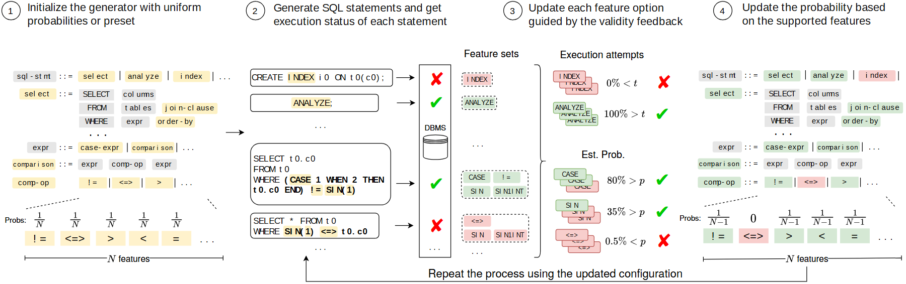

# VA-133 · 反馈驱动的规则概率自适应生成

四个横向阶段把规则采样、具体执行、特征归因和概率更新串联。规则片段的着色在首尾呼应，中央用执行结果与估计概率解释更新依据，底部返回线将新配置送回生成执行阶段。



## 适用范围

- 基于执行成功率更新采样策略的测试或搜索系统
- 要展示规则级反馈如何影响下一轮生成概率的闭环

不适合：没有概率更新依据的通用流程图；将示例百分比当作真实实验结果的论文图。

## 阅读顺序

1. 从左侧初始规则及均匀概率开始。
2. 读第二栏生成的语句和数据库执行成败。
3. 读第三栏特征集合、执行尝试和支持概率估计。
4. 看第四栏重新着色的规则及更新概率，再沿底线返回生成执行阶段。

## 图形表达

**布局**：四个不等宽横栏，上方圈数与两行标题，下方密集代码片段；底部反馈线贯穿后面三栏。

**对象**：规则以彩色短文本条表示，执行语句置圆角框，数据库为圆柱图标，特征集合为虚线框。

**连线**：主流程向右，语句到执行状态分别有箭头；底部返回箭头接到第二栏生成过程下方，并非重新初始化。

**配色**：初始规则浅黄；反馈后支持规则绿、不支持红；成败分别用绿勾红叉，灰条表示通用语法。

**文字**：代码为等宽风格，步骤说明为无衬线；含概率分数、不等号和 Type3 符号，不能仅靠替换字体保证完整。

## 部件与复用

| 部件 | 含义 | 改造方法 |
|---|---|---|
| 初始规则与采样概率 (`initial-rules`) | 规则产生式和均匀概率给出初始生成策略。 | 更换规则时同步调整终结符、可选项数及概率分母。 |
| 生成语句与执行反馈 (`execution-feedback`) | 具体生成实例与执行成败为后续特征归因提供输入。 | 实例必须由目标系统生成或标明示意，失败原因不能仅由红叉推断。 |
| 特征归因与支持估计 (`feature-estimation`) | 特征集合、尝试次数和估计概率解释更新决策。 | 改阈值或估计方法时一起修改不等号、百分比及成败判定。 |
| 更新后的规则概率 (`updated-rules`) | 首栏规则在新支持判断下重新分配概率。 | 每种规则对应同一对象，禁用项概率置零需有实际规则依据。 |

## 改造步骤

1. 先定义特征粒度与成功判定，再建立失败如何影响规则概率的算法。
2. 把 SQL 语句替换为目标生成对象，同时更新中央特征归因示例。
3. 返回线应进入重复生成阶段；若新算法每轮重新初始化，才改变反馈终点。
4. 百分比和阈值只是示例，迁移时需替换为已验证计算或明确示意值。

## 新情景示例（假设）

假设场景：根据求解器可接受性调整约束实例生成器。

SQL 规则改为约束语法，DBMS 改为求解器，特征集合改为支持的约束算子。

定义失败是否来自语法、超时或不可行，并分别统计；不能把不可行直接视作算子不支持。

## 编辑入口

**入口**：运行 make_figure.py 读取 example.json 的迁移配置；labels.json 登记文字，asset.json 登记部件。使用 --parts 可导出部件；准备后的工作副本通过 render_architecture.py 输出论文图。

**配置可改**：labels、components 可设置文字、配色、显隐和位移；不会自动加宽文本框或重排连线。先保留示例几何再逐项调整。

**需改代码**：改变节点数量、分支和跨区域连线须修改 customize(root, context)。新增元素设置 data-asset-key，并加入对应部件的 element_keys；共享边框与跨区箭头保留整图级，避免重叠移动。

**字体**：代码为等宽风格，步骤说明为无衬线；含概率分数、不等号和 Type3 符号，不能仅靠替换字体保证完整。 最终字体文件以构建映射为准；局部 font_size 受 SVG 变换影响，不直接等于纸面 pt。本批构建已确认并嵌入完整字体：Arimo-Bold.ttf, Arimo-Regular.ttf, DejaVuSans.ttf, texgyreheros-regular.otf。映射可能改变原字形和字宽，需按实际论文尺寸复核。

准备独立工作副本：

```text
python "<SKILL>/scripts/prepare_architecture.py" --id VA-133 --out figures/architecture
```

在工作副本运行：

```text
python make_figure.py --config example.json --out . --parts
python render_architecture.py fig.svg
```

## 本图检查

- 初始与更新后的规则名称应逐项对应。
- 各分支采样概率应归一且禁用规则为零。
- 比较符号与红叉绿勾必须一致。
- 底部反馈箭头连接重复生成而非盲目返回初始化。
- 检查等宽代码、分数、不等号与勾叉是否缺字。
- 部件按语义区域抽取，端口处可能保留跨区连接的箭头头部或短线；完整连接以整图为准，独立移动时须重新接线。

部件图用于复用局部对象；跨边界的连接和共享容器仍需按新关系处理。示例名称、数值和曲线不是当前研究结果。

来源与许可见 [ATTRIBUTION.md](ATTRIBUTION.md)。
