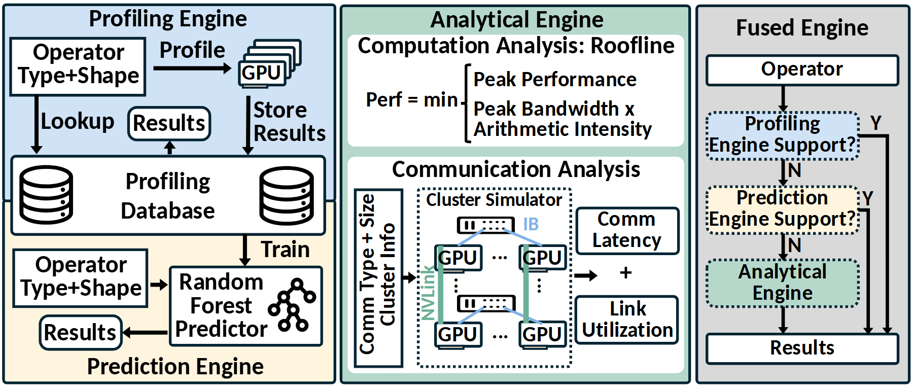

# VA-104 · 实测、预测与解析的分级回退图

图把三种估计来源和一种选择逻辑放在同一画面：左侧实测结果入库并支持预测模型，中间解析引擎分别处理计算与通信，右侧按支持条件逐级选择输出。这里的融合是有条件回退，不是三个结果求平均；数据库供训练使用，也不能被误画成预测模型生成了真实观测。



## 适用范围

- 实测覆盖有限且需要预测或解析补充的评估工具
- 需要解释方法选择优先级及估计依据

不适合：三个模型始终同时参与加权融合；只有一个计算公式且无数据来源分层。

## 阅读顺序

1. 先看左上实测、查询与入库关系
2. 再看左下预测模型如何使用数据库训练并生成结果
3. 进入中间计算解析与通信解析两个区域
4. 最后按右侧自上而下的支持判断读取回退路径

## 图形表达

**布局**：横向三栏，左栏上下分成实测与预测，中栏上下分成计算与通信，右栏窄而高容纳决策链。

**对象**：数据库圆柱、硬件叠片、树状预测器和网络小图让对象种类可辨，右侧虚边框强调判断位置。

**连线**：短黑箭头配动词表达查询、存储和训练；右侧 Y 路径直达结果，N 路径继续下一级，不混同循环。

**配色**：浅蓝实测、浅黄预测、浅绿解析、浅灰选择器；右侧判断框沿用对应方法颜色，方便跨栏对照。

**文字**：标题与关键算式多用粗无衬线，公式区留足上下高度；判断标签需要简短，Y/N 不得贴到竖线外误指其他分支。

## 部件与复用

| 部件 | 含义 | 改造方法 |
|---|---|---|
| 实测查询模块 (`profiling`) | 对输入对象查已有结果或执行测量。 | 明确命中条件及测量设备，不能将未知对象直接视为有实测。 |
| 共同证据库 (`database`) | 保存实测样本并供预测训练使用。 | 标注存储字段、覆盖范围和训练读取关系。 |
| 预测模块 (`prediction`) | 根据输入特征生成未直接测量对象的估计。 | 替换实际模型类型，明确适用域，树图标不适合所有模型。 |
| 计算解析模块 (`analytic-compute`) | 利用性能上限与工作量关系估计计算行为。 | 换成适用公式和单位，若没有上限模型应重新设计内容。 |
| 通信解析模块 (`analytic-communication`) | 借助拓扑与链路参数估计传输影响。 | 重画实际网络拓扑，区分延迟与利用率，勿继承硬件缩写。 |
| 支持性回退链 (`fallback`) | 按实测、预测、解析的顺序选择可用方法。 | 写出每层支持条件，全部不支持时需增加失败或人工处理出口。 |

## 改造步骤

1. 明确“支持”的判据是已有记录、特征范围还是模型适用条件
2. 同步修改右侧框色和左中对应引擎，保持跨栏可追踪
3. 替换公式、网络设备和训练算法，不能只重命名大标题
4. 若实际采用组合估计，应重画右侧汇合逻辑而非继续沿用Y/N回退

## 新情景示例（假设）

可用于假设的物流线路耗时估计工具。

实测库保存已运行路线时间，预测器估计相近路线，解析层依据距离、速度与转运等待计算。

将计算解析与通信解析改成行驶时间与节点等待，网络小图改成物流节点；增加无可用路况时的未知输出。

## 编辑入口

**入口**：make_figure.py 读取 example.json 生成 fig.svg；加 --parts 导出部件，render_architecture.py 渲染预览及 PDF。

**配置可改**：labels 按 labels.json 对象键改字；components 支持 visible、dx/dy、attributes；elements 改对象属性。位移用图内坐标，连线不自动重布。

**需改代码**：增删模块、改连接和布局须修改 customize()。新对象须有唯一 data-asset-key 并登记部件归属；嵌套部件选一个层级平移，避免重复移动。

**字体**：当前完整字体为 Carlito-Bold。font_size 是元素局部坐标单位，受缩放变换影响，不是纸面字号；改长标签后按最终版面宽度复核换行与字距。

准备独立工作副本：

```text
python "<SKILL>/scripts/prepare_architecture.py" --id VA-104 --out figures/architecture
```

在工作副本运行：

```text
python make_figure.py --config example.json --out . --parts
python render_architecture.py fig.svg
```

## 本图检查

- 每个Y分支是否直接进入结果且每个N分支继续下一级
- 训练箭头是否从实测库指向预测器
- 解析公式与预测适用域是否能覆盖回退后的输入

部件图用于复用局部对象；跨边界的连接和共享容器仍需按新关系处理。示例名称、数值和曲线不是当前研究结果。

来源与许可见 [ATTRIBUTION.md](ATTRIBUTION.md)。
