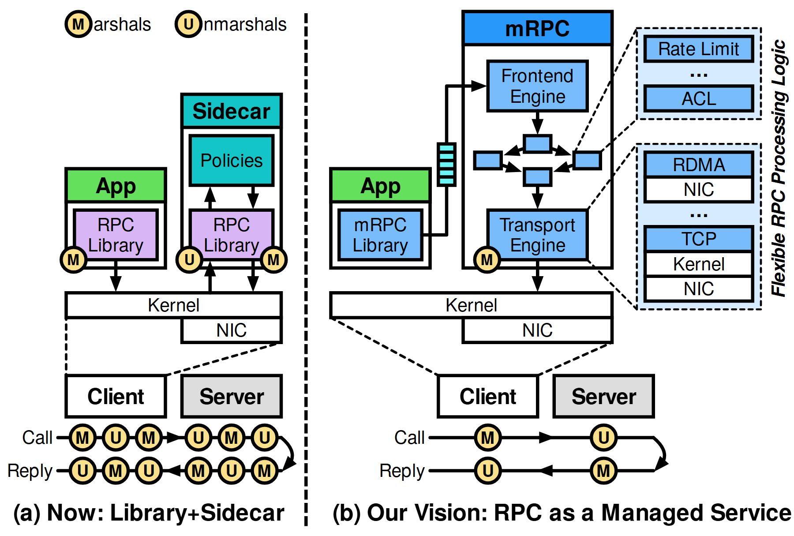

# VA-050 · 通信处理前后对照与插件展开

左右两幅系统结构配合底部调用链，比较分散处理与集中托管。左侧应用和旁路服务各自执行编码转换，右侧把处理集中到统一服务，并用局部展开显示策略和传输插件。底部小圆徽标把重复处理成本具象化。



## 适用范围

- 通信栈重构前后对照
- 强调减少重复中间处理的设计

不适合：两个方案接口不一致的公平性比较；需要给出性能数值的实验结果图。

## 阅读顺序

1. 阅读顶部转换操作图例。
2. 看左侧应用、旁路服务及底部多次转换链。
3. 看右侧应用进入统一处理服务。
4. 最后查看右边插件展开和简化后的调用链。

## 图形表达

**布局**：竖虚线分成两方案，底部按相同高度放调用与返回链；右侧附插件放大栏。

**对象**：叠层矩形表示协议栈，小圆 M/U 表示两类转换操作，中心连接形状表示内部服务转接。

**连线**：上部实线是模块交互；下部水平双向路线分别表示调用与回复；细虚线引出插件细节。

**配色**：应用绿色、旁路政策青色、统一服务与插件蓝色，黄色徽标用于转换动作。

**文字**：方案标题加粗并置底，插件名较短；代码或协议名不宜扩写成长句。

## 部件与复用

| 部件 | 含义 | 改造方法 |
|---|---|---|
| 分散处理结构 (`legacy-service`) | 应用与旁路服务各有通信库。 | 保留两次边界穿越仅当新对照确实如此。 |
| 统一服务结构 (`managed-service`) | 应用把公共处理交给独立服务。 | 重定义前端、传输和内部转接职责。 |
| 插件展开 (`plugin-inset`) | 策略插件与传输实现分层。 | 替换为实际可插拔模块，不混同必选依赖。 |
| 原调用链 (`legacy-path`) | 展示多次编码和解码。 | 按真实协议逐一核对徽标，不为突出改进夸大次数。 |
| 改造后调用链 (`new-path`) | 展示经过集中处理的转换序列。 | 接口与左图保持一致，才能比较路径差异。 |

## 改造步骤

1. 先固定两方案的同一请求和同一返回口径。
2. 图中少掉的转换步骤必须能由实现解释。
3. 插件层若不是可替换选项，应改成普通组成模块。

## 新情景示例（假设）

假设用于多服务数据格式转换优化。

左侧每个服务前置独立格式适配器，右侧使用共享转换网关，徽标表示序列化和反序列化。

将传输协议栈换成格式解析、校验和传输插件，并重画真实调用链。

## 编辑入口

**入口**：以 make_figure.py 为入口，先复制 example.json 作为当前情景配置；labels.json 定位标签，asset.json 定位部件。

**配置可改**：labels 可改文字和文字样式，components 可做显隐、平移和局部样式调整；elements 可定位矢量元素。配置只作用于已有几何，不会自动解决布局冲突。

**需改代码**：增减转换次数、替换插件层数或修改方案布局需改小徽标、箭头及边界；不能仅靠更名证明性能改进。

**字体**：当前替换字体为 texgyreheros-bold、texgyreheros-bolditalic、texgyreheros-regular。改字后检查字宽、基线及 PDF 字体嵌入；原图的逐字定位不保证能容纳更长名称。

准备独立工作副本：

```text
python "<SKILL>/scripts/prepare_architecture.py" --id VA-050 --out figures/architecture
```

在工作副本运行：

```text
python make_figure.py --config example.json --out . --parts
python render_architecture.py fig.svg
```

## 本图检查

- 两方案的调用与回复起终点相同。
- 每个转换徽标在上部结构中有对应位置。
- 插件引线没有被误认为额外网络请求。

部件图用于复用局部对象；跨边界的连接和共享容器仍需按新关系处理。示例名称、数值和曲线不是当前研究结果。

来源与许可见 [ATTRIBUTION.md](ATTRIBUTION.md)。
