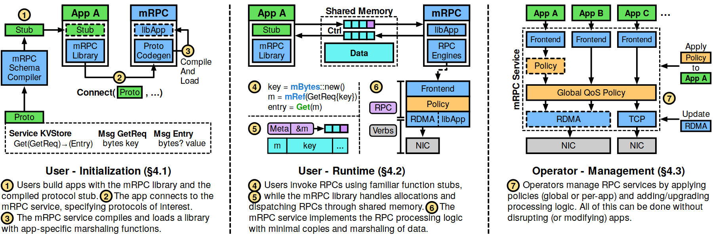

# VA-134 · 用户初始化运行与运维管理三阶段

三个并列角色阶段分别解释初始化、运行和管理，用连续编号 1–7 串起同一服务的生命周期。每栏保留各自的接口细节及底部说明，适合展示应用开发者与运维者如何作用于共享基础设施。



## 适用范围

- 同一平台涉及初始化、业务运行和后续管理三个使用阶段
- 需要并列用户与运维视角而又保持步骤连续性的服务架构

不适合：具有返回边的反馈闭环；只展示内部组件而无角色操作过程的纯静态架构。

## 阅读顺序

1. 左栏按 1–3 读接口定义、编译和连接。
2. 中栏按 4–6 读请求构造、共享内存分派与处理流水。
3. 右栏读第7步，了解全局策略、单应用策略和传输更新。
4. 各栏下方说明补足对应步骤语义。

## 图形表达

**布局**：三栏由竖向虚线分隔，每栏上部是机制框图，下部是粗体阶段标题和多行说明；没有横跨全图的回路。

**对象**：绿色应用块、蓝色服务块、黄色策略块、青色共享数据块和灰色硬件块按职责分色。

**连线**：黑色箭头在每栏内部连接对象；左栏编译加载有回折线，中栏有双向控制流，右栏策略箭头自外部指向服务。

**配色**：绿为应用与接口定义，蓝为服务处理，黄为策略，青为共享数据，紫为元信息，灰为网卡；圈数黄底强调操作顺序。

**文字**：无衬线；阶段标题粗体，框内模块名短，底部说明小字多；代码片段含颜色，符号与括号应完整保留。

## 部件与复用

| 部件 | 含义 | 改造方法 |
|---|---|---|
| 用户初始化流程 (`initialization`) | 定义协议、编译存根、应用连接和加载服务端代码形成初始化链。 | 替换技术栈时同步更新底部接口定义框与步骤说明。 |
| 用户运行流程 (`runtime`) | 请求分配与分派经过共享内存进入服务处理流水。 | 若不使用共享内存，需重画双向控制路径和数据区域。 |
| 运维管理流程 (`management`) | 多应用前端共享策略与传输资源，外部运维更新服务。 | 按新系统权限边界调整全局和单应用策略接入点。 |

## 改造步骤

1. 先定义三种角色阶段，确认步骤1–7是否符合新系统生命周期。
2. 改变中栏通信机制时，重新设计数据与元信息传输，不只替换 Shared Memory 文本。
3. 右栏应用数量可增减，但前端、策略和传输的对应关系需一起重排。
4. 底部说明与正文引用章节号按新文稿更新，不能保留示例章节编号。

## 新情景示例（假设）

假设场景：仿真任务平台的接入、任务执行与资源管理。

左栏改为模型接口注册与客户端生成；中栏为任务提交及执行服务；右栏为资源配额与后端更新。

如任务通过消息队列传递则替换共享内存区域；为运维策略明确生效范围并更新所有步骤说明。

## 编辑入口

**入口**：运行 make_figure.py 读取 example.json 的迁移配置；labels.json 登记文字，asset.json 登记部件。使用 --parts 可导出部件；准备后的工作副本通过 render_architecture.py 输出论文图。

**配置可改**：labels、components 可设置文字、配色、显隐和位移；不会自动加宽文本框或重排连线。先保留示例几何再逐项调整。

**需改代码**：改变节点数量、分支和跨区域连线须修改 customize(root, context)。新增元素设置 data-asset-key，并加入对应部件的 element_keys；共享边框与跨区箭头保留整图级，避免重叠移动。

**字体**：无衬线；阶段标题粗体，框内模块名短，底部说明小字多；代码片段含颜色，符号与括号应完整保留。 最终字体文件以构建映射为准；局部 font_size 受 SVG 变换影响，不直接等于纸面 pt。本批构建已确认并嵌入完整字体：Arimo-Regular.ttf, texgyreheros-bold.otf, texgyreheros-regular.otf。映射可能改变原字形和字宽，需按实际论文尺寸复核。

准备独立工作副本：

```text
python "<SKILL>/scripts/prepare_architecture.py" --id VA-134 --out figures/architecture
```

在工作副本运行：

```text
python make_figure.py --config example.json --out . --parts
python render_architecture.py fig.svg
```

## 本图检查

- 连续编号不能在每栏重新从1开始。
- 右栏单应用策略与全局策略作用域要区分。
- 共享内存的控制与数据方向应有真实实现依据。
- 修改后删除旧章节号和专用 API 文本。
- 论文缩放时检查底部说明是否仍可读。

部件图用于复用局部对象；跨边界的连接和共享容器仍需按新关系处理。示例名称、数值和曲线不是当前研究结果。

来源与许可见 [ATTRIBUTION.md](ATTRIBUTION.md)。
