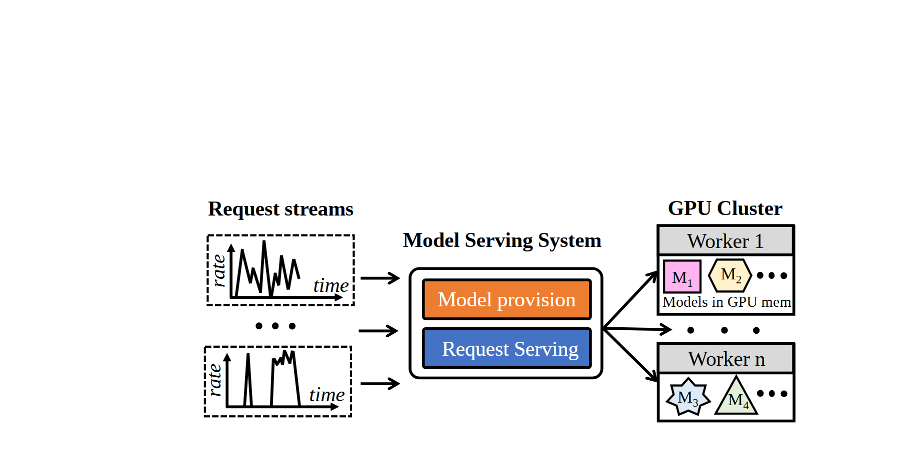

# VA-135 · 波动请求输入与双决策资源分派

把多路随时间变化的请求、两类调度决策和多个执行节点放在同一横向链路中。输入旁的小曲线说明请求性质，执行节点内不同形状的对象说明资源可混合放置；它适合表达“需求变化—策略决策—资源分配”的关系。



## 适用范围

- 多种到达模式共用一个分派服务，再送往多个工作节点
- 同时需要区分资源预置与实时请求分派的服务架构

不适合：需要精确展示吞吐量或延迟数据的统计图；每个请求都严格一对一绑定独立节点的无共享系统。

## 阅读顺序

1. 先看左侧两种波动请求及中间省略号，理解输入可以扩展。
2. 再看中间服务框内上下两个决策块，它们是同一服务中的不同职责。
3. 沿右侧分叉箭头看 Worker 1 与 Worker n，并比较节点内对象的形状。

## 图形表达

**布局**：左侧竖排输入、中间紧凑双层决策、右侧竖排工作节点；源画布上方留白较多，正式插图可整体裁紧但需同步 viewBox。

**对象**：虚线小图框承载波动曲线；圆角外框含两条实色策略块；工作节点用带标题栏的矩形，内部用六边形、方形、星形、三角形区分类别。

**连线**：输入箭头水平指向服务；服务右端以共用起点扇出到节点。跨区分叉保留在整图，调整节点位置后重新路由。

**配色**：橙色与蓝色区分预置/服务职责；节点标题为灰色，内部模型用淡粉、淡黄、淡蓝、淡绿配合形状编码。

**文字**：标题使用较粗的衬线风格，节点名和曲线坐标较小；模型符号带下标，替换时保留基线与层级。

## 部件与复用

| 部件 | 含义 | 改造方法 |
|---|---|---|
| 波动请求流 (`request-streams`) | 两种示意到达曲线和省略号表达多路不同流量。 | 替换真实所需流量形态；无数据时标为示意，不填造统计量。 |
| 双职责决策服务 (`decision-service`) | 同一服务内分离资源预置与请求处理决策。 | 更换两个职责名时保持共同外框；若职责串行需补明确连接。 |
| 首个执行节点 (`first-worker`) | 带标题栏的节点容纳多类资源对象。 | 按实际资源类别替换模型形状，并补充图例。 |
| 末个执行节点 (`last-worker`) | 用首末节点与省略号暗示可扩展集群。 | 节点数量少时展开全部节点，数量多时保留省略语义。 |

## 改造步骤

1. 先改请求类型、两个决策职责和工作节点名称，保持标签长度可读。
2. 明确颜色与形状是否都表示对象类别；新增图例解释当前未明示的形状。
3. 按新的分派关系修改扇出连线，不把节点中的对象误画为服务的处理步骤。
4. 裁减源画布上方空白后重算导出范围，确保曲线轴与节点标题未被切掉。

## 新情景示例（假设）

假设场景：城市配送中按订单波动预置运力并实时派单。

请求小图表示商圈订单到达；两个决策块对应运力预置和即时派单；节点对应配送站，形状代表车辆类型。

配送站数与车辆类别需按场景调整；若站间允许调拨，另绘站间边，不能借用原分派箭头。

## 编辑入口

**入口**：make_figure.py 负责构建；example.json 保存改造配置；labels.json 定位可编辑文字；asset.json 登记部件及 element_keys。先在工作副本运行 python make_figure.py --config example.json --out . --parts 查看整图与部件。

**配置可改**：labels、components 可改文字、配色、显隐和位移；配置不自动重排。先改请求类型、两个决策职责和工作节点名称，保持标签长度可读。

**需改代码**：在 customize(root, context) 中实施拓扑和几何修改。配送站数与车辆类别需按场景调整；若站间允许调拨，另绘站间边，不能借用原分派箭头。 新增对象要分配唯一 data-asset-key，并补入部件的 element_keys；跨区连线应随两端重绘，不随两个部件重复移动。

**字体**：标题使用较粗的衬线风格，节点名和曲线坐标较小；模型符号带下标，替换时保留基线与层级。 最终字体文件以构建后的映射为准；局部 font_size 属于源坐标，不能直接当作论文纸面 pt，须按最终插图尺寸检查。本批构建已确认并嵌入完整字体：Tinos-Bold.ttf, Tinos-Italic.ttf, Tinos-Regular.ttf。映射可能改变原字形和字宽，需按实际论文尺寸复核。

准备独立工作副本：

```text
python "<SKILL>/scripts/prepare_architecture.py" --id VA-135 --out figures/architecture
```

在工作副本运行：

```text
python make_figure.py --config example.json --out . --parts
python render_architecture.py fig.svg
```

## 本图检查

- 曲线仅为示意还是实测已说明。
- 两项决策的职责边界清楚，颜色没有被误读为数据大小。
- 每条分叉线端点指向实际节点，内部符号有图例。
- 裁切后模型下标与左侧曲线标签仍完整。

部件图用于复用局部对象；跨边界的连接和共享容器仍需按新关系处理。示例名称、数值和曲线不是当前研究结果。

来源与许可见 [ATTRIBUTION.md](ATTRIBUTION.md)。
