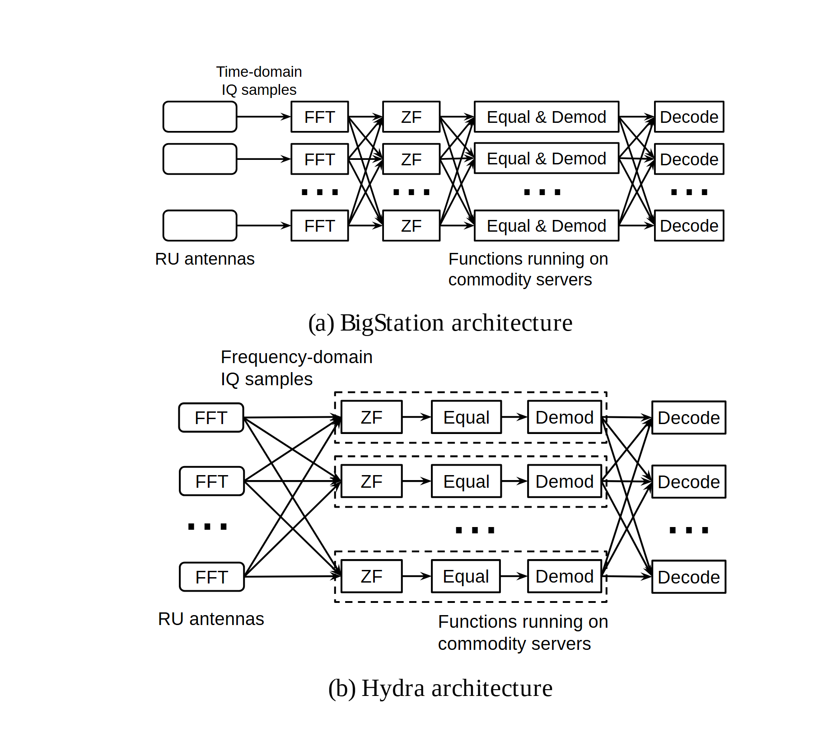

# VA-136 · 并行流水线合并前后的双层对照

上下两套流水线用相近的节点大小、行数和方向构成可比视图。差异集中在下方被虚线包围的连续阶段：其内部用短直线，外部保留交叉交换线，从拓扑上呈现通信边界的变化。



## 适用范围

- 比较分布式流水线的阶段合并、算子融合或通信重排
- 需要把多路输入与跨节点全互连交换画在同一张图中

不适合：主要差异是结果数值而非处理拓扑的方案比较；读者不需要了解跨路交换的简单串行过程。

## 阅读顺序

1. 先从上图左侧输入沿 FFT、ZF、Equal & Demod 到 Decode 阅读，观察阶段之间的交叉线。
2. 再读下图左侧输入，识别 FFT 已成为输入侧方块。
3. 观察下图虚线内 ZF、Equal、Demod 的局部串行连接，并与框外交叉线对照。
4. 最后核对上下图阶段名称和行省略号，使比较针对同一种任务。

## 图形表达

**布局**：两套横向多行处理链上下堆叠，各自带面板标题；对照共用左右方向，阶段位置不完全同列，应按实际角色对应。

**对象**：小矩形表示处理阶段，省略号表示更多并行路；下图虚线大框界定合并阶段的部署边界。

**连线**：交叉线表示多路数据交换，短水平线表示本地串行传递。不能把交叉线交点当作新节点；拆出的下图模块不包含全部外部交换线。

**配色**：全图以黑白线条为主，差异由虚线分组和连线拓扑表达，适合灰度打印。

**文字**：阶段采用短缩写，输入类型、底部部署说明及面板标题较小；密集连线区需要保持文字留白。

## 部件与复用

| 部件 | 含义 | 改造方法 |
|---|---|---|
| 上方分散阶段流水线 (`baseline-pipeline`) | 完整基线包括输入、多个阶段和其间交换。 | 整体用作比较基准；内部阶段数量更改需同步交换线。 |
| 下方输入处理列 (`lower-inputs`) | 三个 FFT 示例框和省略号形成下图输入列。 | 替换输入阶段并保持与上图任务口径一致。 |
| 下方融合阶段组 (`fused-stages`) | 虚线外框包住三列局部串行处理。 | 改变融合范围时同时改变外框与内部边，不能仅重命名。 |
| 下方输出处理列 (`lower-decoders`) | 每路最终处理保持独立输出。 | 按实际输出路数增减，并重绘其左侧交换。 |

## 改造步骤

1. 先按两个方案统一输入、阶段和输出术语，保留可对应关系。
2. 用虚线框标出实际合并部署的阶段，不把逻辑相关性当作共置。
3. 逐一重画合并前后交换边，避免只改框而保留旧通信。
4. 如需表达节省量，加入有依据的交换次数说明，图本身不产生性能结论。

## 新情景示例（假设）

假设场景：将多台传感器的频域分析、特征提取和分类处理从分散节点调整为合并节点。

每一行对应传感器分片，FFT 对应预处理，融合组对应特征计算，Decode 对应最终分类。

新方案的实际分片数、跨节点交换边和融合边界都需要重写，虚线内可改为两列或四列。

## 编辑入口

**入口**：make_figure.py 负责构建；example.json 保存改造配置；labels.json 定位可编辑文字；asset.json 登记部件及 element_keys。先在工作副本运行 python make_figure.py --config example.json --out . --parts 查看整图与部件。

**配置可改**：labels、components 可改文字、配色、显隐和位移；配置不自动重排。先按两个方案统一输入、阶段和输出术语，保留可对应关系。

**需改代码**：在 customize(root, context) 中实施拓扑和几何修改。新方案的实际分片数、跨节点交换边和融合边界都需要重写，虚线内可改为两列或四列。 新增对象要分配唯一 data-asset-key，并补入部件的 element_keys；跨区连线应随两端重绘，不随两个部件重复移动。

**字体**：阶段采用短缩写，输入类型、底部部署说明及面板标题较小；密集连线区需要保持文字留白。 最终字体文件以构建后的映射为准；局部 font_size 属于源坐标，不能直接当作论文纸面 pt，须按最终插图尺寸检查。本批构建已确认并嵌入完整字体：Arimo-Regular.ttf, Tinos-Regular.ttf。映射可能改变原字形和字宽，需按实际论文尺寸复核。

准备独立工作副本：

```text
python "<SKILL>/scripts/prepare_architecture.py" --id VA-136 --out figures/architecture
```

在工作副本运行：

```text
python make_figure.py --config example.json --out . --parts
python render_architecture.py fig.svg
```

## 本图检查

- 两个面板表示同一任务和一致的数据范围。
- 交换交叉处没有误加连接点。
- 虚线框的部署含义写明。
- 面板标题和缩写在最终宽度下可辨，不能靠放大原图阅读。

部件图用于复用局部对象；跨边界的连接和共享容器仍需按新关系处理。示例名称、数值和曲线不是当前研究结果。

来源与许可见 [ATTRIBUTION.md](ATTRIBUTION.md)。
