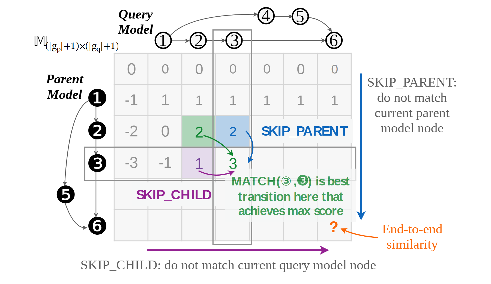

# VA-137 · 图结构索引与状态转移矩阵

把两个小型节点图直接放在矩阵的上方和左侧，让行列索引保留结构含义；矩阵内部用着色格和弯箭头解释局部转移，外围的彩色注释说明跳过与匹配操作，右下角标出最终结果位置。



## 适用范围

- 图、序列或模型结构之间的匹配状态矩阵
- 需要用一个具体小例说明动态规划递推方向

不适合：只有类别交叉统计而没有状态递推的列联表；大规模矩阵逐格显示会导致字小不可读的场景。

## 阅读顺序

1. 先识别上方 Query Model 和左侧 Parent Model 的节点图，明确横纵索引。
2. 进入矩阵观察初始化行列及灰色数值。
3. 看中部绿色、蓝色、紫色单元和箭头，区分匹配与跳过转移。
4. 沿右侧和下方的方向标注追踪至右下结果位置。

## 图形表达

**布局**：矩阵占中央，列图在上、行图在左，右侧和下方留给解释；这是“结构索引+局部演算”而不是纯表格。

**对象**：空心与实心编号圆区分两套图节点；矩阵用细线网格，局部填色格突出递推例子。

**连线**：节点图保留自身有向边；矩阵内短曲线说明候选转移，外围长箭头表示跳过方向，三者不共用一种含义。

**配色**：蓝色对应 SKIP_PARENT，紫色对应 SKIP_CHILD，绿色对应 MATCH，橙色指向最终相似度；灰色数字退居背景。

**文字**：节点号、矩阵数字、数学下标和解释文字共存；局部粗体彩字为视觉重点，不能把数学符号替换成普通基线文字。

## 部件与复用

| 部件 | 含义 | 改造方法 |
|---|---|---|
| 列索引查询图 (`query-graph`) | 列顶节点图提供查询对象的结构顺序。 | 按新序列或图的真实编号与边替换，并同步矩阵列。 |
| 行索引父图 (`parent-graph`) | 左侧节点图提供被比较对象的行索引。 | 调整节点顺序后同步行标签，不移动后保持旧索引。 |
| 局部转移矩阵 (`transition-matrix`) | 网格、数字与内部高亮共同解释一个递推实例。 | 用验证过的小例重算所有单元值和高亮候选。 |
| 纵向跳过说明 (`parent-skip-note`) | 右侧蓝色方向和注释解释当前父节点跳过。 | 方向必须与采用的行列约定一致。 |
| 最终结果注释 (`result-note`) | 橙色注释指向末端结果单元。 | 用实际结果或明确待求符号，不能把问号当作已算数值。 |
| 横向跳过说明 (`child-skip-note`) | 下方紫色方向解释查询节点跳过。 | 如交换矩阵轴，连同说明和箭头一并交换。 |

## 改造步骤

1. 先明确行列对象并替换两套节点图，保持索引和矩阵一一对应。
2. 重新计算小例数值、边界初始化和最优转移，不保留不适用的示例数字。
3. 分别设定三类转移的颜色与箭头含义，避免颜色只作装饰。
4. 矩阵行列增加时重排网格、节点和外侧注释，不能通过缩小所有字体凑入。

## 新情景示例（假设）

假设场景：比较两个项目依赖图的可复用步骤，并演示一个简化匹配递推。

上方是候选流程图，左侧是历史流程图，格内存已验证的局部匹配分数，彩色箭头代表三种允许操作。

必须按新的递推定义重建网格尺寸、初始化、节点图边以及箭头终点；不直接复用原示例得分。

## 编辑入口

**入口**：make_figure.py 负责构建；example.json 保存改造配置；labels.json 定位可编辑文字；asset.json 登记部件及 element_keys。先在工作副本运行 python make_figure.py --config example.json --out . --parts 查看整图与部件。

**配置可改**：labels、components 可改文字、配色、显隐和位移；配置不自动重排。先明确行列对象并替换两套节点图，保持索引和矩阵一一对应。

**需改代码**：在 customize(root, context) 中实施拓扑和几何修改。必须按新的递推定义重建网格尺寸、初始化、节点图边以及箭头终点；不直接复用原示例得分。 新增对象要分配唯一 data-asset-key，并补入部件的 element_keys；跨区连线应随两端重绘，不随两个部件重复移动。

**字体**：节点号、矩阵数字、数学下标和解释文字共存；局部粗体彩字为视觉重点，不能把数学符号替换成普通基线文字。 最终字体文件以构建后的映射为准；局部 font_size 属于源坐标，不能直接当作论文纸面 pt，须按最终插图尺寸检查。 本资源的圈号和数学符号已在源覆盖文件中单独指定 DejaVuSans；普通文字不作全图换字。本批构建已确认并嵌入完整字体：Arimo-Bold.ttf, Arimo-Regular.ttf, DejaVuSans-Bold.ttf, DejaVuSans.ttf, STIXTwoMath-Regular.ttf, Tinos-BoldItalic.ttf, Tinos-Regular.ttf。映射可能改变原字形和字宽，需按实际论文尺寸复核。

准备独立工作副本：

```text
python "<SKILL>/scripts/prepare_architecture.py" --id VA-137 --out figures/architecture
```

在工作副本运行：

```text
python make_figure.py --config example.json --out . --parts
python render_architecture.py fig.svg
```

## 本图检查

- 每个节点号与对应行列一致。
- 跳过方向与递推公式一致。
- 高亮转移确实达到该格计算值。
- 右下输出单元与正文所定义结果一致。
- 数学下标与外围解释没有盖住网格。

部件图用于复用局部对象；跨边界的连接和共享容器仍需按新关系处理。示例名称、数值和曲线不是当前研究结果。

来源与许可见 [ATTRIBUTION.md](ATTRIBUTION.md)。
