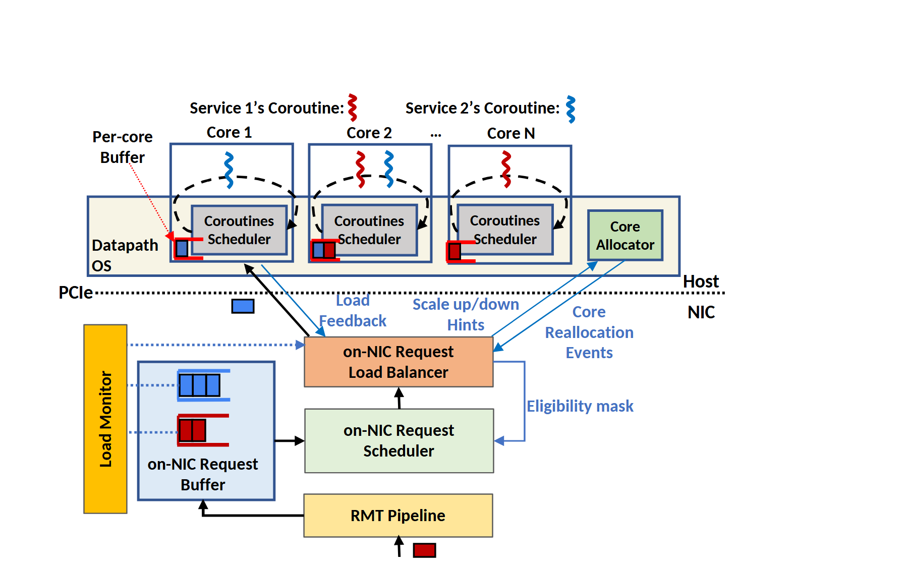

# VA-138 · 主机多核与网卡调度反馈架构

上半区显示主机多核执行，下半区显示网卡侧分类、排队、调度与负载均衡。中间的 PCIe 虚线作为部署分界，跨界蓝色反馈线与黑色请求路径共同解释调度如何利用主机状态。



## 适用范围

- 把控制或调度卸载到网卡、边缘设备、协处理器的架构
- 需要说明多执行单元反馈驱动请求分配的闭环

不适合：没有执行反馈的单向数据清洗流水线；各模块不跨部署域却套用主机/网卡边界的流程。

## 阅读顺序

1. 从底部 RMT Pipeline 的入包箭头开始，识别 NIC 范围。
2. 向左看请求缓冲及负载监视，再向中间看调度器与负载均衡器。
3. 沿上行连接查看主机各核的协程调度器和每核缓冲。
4. 最后查看 Core Allocator 及蓝色负载、资格和重分配反馈。

## 图形表达

**布局**：上部重复三列核单元，右侧另列核心分配器；下部中间竖排三个阶段，左侧缓冲与监视器形成侧支路。源画布顶部保留较宽留白。

**对象**：每核框含小请求缓冲和调度器；细长监视条配合彩色队列；普通矩形表示 NIC 处理阶段。

**连线**：黑线表达主要请求流，蓝线带文本表达状态反馈或控制事件，PCIe 横向虚线只表示边界。部分跨域线很密集，不宜随子部件整体平移。

**配色**：红蓝小请求代表不同服务；橙色负载均衡、浅绿调度、浅黄流水线与监视器形成职责分层。

**文字**：服务名、每核标题较小，主阶段标签相对突出，反馈说明用蓝字；密集区不宜增加长句。

## 部件与复用

| 部件 | 含义 | 改造方法 |
|---|---|---|
| 主机多核执行组 (`host-core-bank`) | 多个核同时执行红蓝服务并维护本地协程调度。 | 增加核列时等距复制内部对象，并逐条重连负载反馈。 |
| 核心分配器 (`core-allocator`) | 独立控制块负责核心资源重分配。 | 替换为资源管理职责，保留与负载均衡器的控制联系。 |
| 负载监视器 (`load-monitor`) | 窄竖条表示队列状态监测。 | 更换监测口径并在正文解释，不把高度当成真实量值。 |
| 网卡请求缓冲 (`request-buffer`) | 蓝红队列按服务暂存待调度请求。 | 改变服务种类时同步队列色与上方协程色。 |
| 网卡负载均衡器 (`load-balancer`) | 上行分派请求到核并读取反馈。 | 调整分派策略名称时同时核对其输入输出。 |
| 网卡请求调度器 (`request-scheduler`) | 根据资格与队列选择下一个服务。 | 新的优先规则需要对应资格输入，不从配色推断。 |
| 入包处理流水线 (`ingress-pipeline`) | 底部入口对请求进行前置处理。 | 按入口分类逻辑替换标签和入包对象。 |

## 改造步骤

1. 先替换主机、设备及主要处理阶段名称，保留真实部署分界。
2. 确定服务颜色并统一请求队列、每核协程和入口对象的编码。
3. 明确数据、负载反馈、资格掩码和资源事件四类关系后逐条修改连线。
4. 执行单元数量改变时重排上方核心组，再重路由跨界连线。

## 新情景示例（假设）

假设场景：边缘网关把紧急与普通任务分派给多个处理核心。

红蓝服务对应两类优先任务，缓冲对应待处理队列，分配器负责核心配额，设备端调度读取主机负载。

按实际设备部署拆分主机与网关；增减核列，并为新的负载信号与配额命令分别设置端点。

## 编辑入口

**入口**：make_figure.py 负责构建；example.json 保存改造配置；labels.json 定位可编辑文字；asset.json 登记部件及 element_keys。先在工作副本运行 python make_figure.py --config example.json --out . --parts 查看整图与部件。

**配置可改**：labels、components 可改文字、配色、显隐和位移；配置不自动重排。先替换主机、设备及主要处理阶段名称，保留真实部署分界。

**需改代码**：在 customize(root, context) 中实施拓扑和几何修改。按实际设备部署拆分主机与网关；增减核列，并为新的负载信号与配额命令分别设置端点。 新增对象要分配唯一 data-asset-key，并补入部件的 element_keys；跨区连线应随两端重绘，不随两个部件重复移动。

**字体**：服务名、每核标题较小，主阶段标签相对突出，反馈说明用蓝字；密集区不宜增加长句。 最终字体文件以构建后的映射为准；局部 font_size 属于源坐标，不能直接当作论文纸面 pt，须按最终插图尺寸检查。本批构建已确认并嵌入完整字体：Carlito-Bold.ttf。映射可能改变原字形和字宽，需按实际论文尺寸复核。

准备独立工作副本：

```text
python "<SKILL>/scripts/prepare_architecture.py" --id VA-138 --out figures/architecture
```

在工作副本运行：

```text
python make_figure.py --config example.json --out . --parts
python render_architecture.py fig.svg
```

## 本图检查

- 分界两侧模块位置符合部署事实。
- 服务颜色贯穿缓冲与执行组。
- 反馈线的方向和标签完整。
- 入口没有被误读为调度结果出口。
- 下部小字及顶部服务标题在最终尺寸可读。

部件图用于复用局部对象；跨边界的连接和共享容器仍需按新关系处理。示例名称、数值和曲线不是当前研究结果。

来源与许可见 [ATTRIBUTION.md](ATTRIBUTION.md)。
