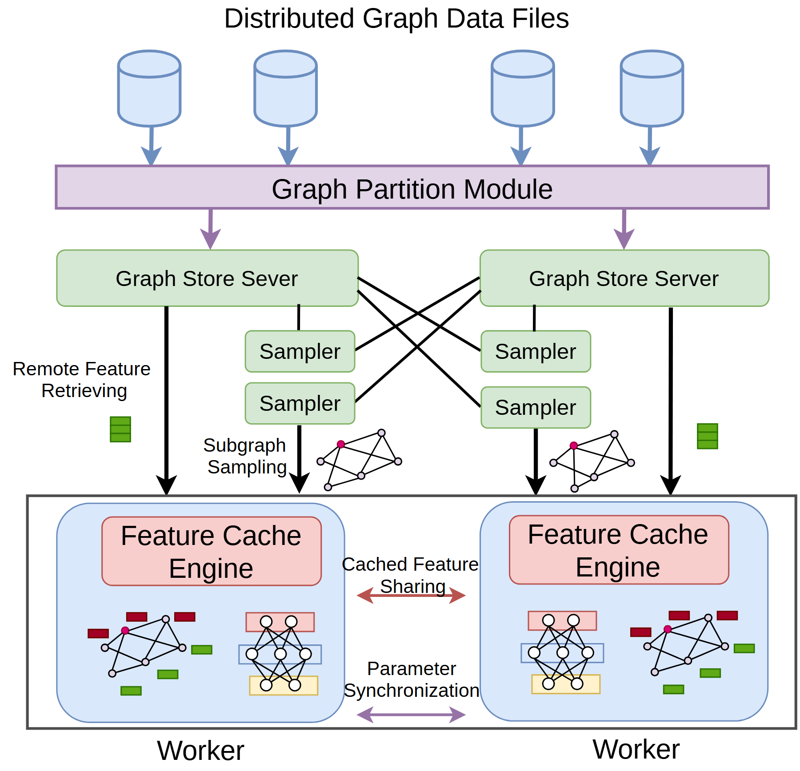

# VA-085 · 分区数据服务与协同计算节点

多个存储源先进入分区模块，分区服务通过采样器向两个计算节点提供子集；计算节点各有缓存引擎，并通过两条不同通道共享特征和同步参数。该图同时表达纵向供数和横向协作，适合说明分布式任务为何不只是一条流水线。



## 适用范围

- 数据分区服务支撑多个协同计算节点
- 采样、缓存共享和参数同步同时存在

不适合：所有数据集中处理的单机模型；没有图结构却保留子图图元而不改含义。

## 阅读顺序

1. 从顶部多个数据源进入横向分区模块。
2. 查看两侧服务与采样器之间的交叉访问。
3. 沿下行箭头进入两个工作节点。
4. 最后对照中间特征共享和底部参数同步两种横向关系。

## 图形表达

**布局**：纵向三层对称布局，中层左右服务，下层左右工作节点，中间留白专供共享说明。

**对象**：圆柱为数据源，长条为分区操作，圆角块为服务和缓存，节点内的小图及色块表示局部结构和特征。

**连线**：向下箭头提供分区和样本；中间交叉线表示跨分区访问，红色横线共享特征，紫色双向线同步参数。

**配色**：紫色标识分区与同步，绿色用于服务及采样，蓝色围住工作节点，粉色突出缓存引擎。

**文字**：无衬线短标签分层排列，小图旁的说明较细，双栏缩放后需核对共享通道文字。

## 部件与复用

| 部件 | 含义 | 改造方法 |
|---|---|---|
| 数据分区 (`data-partition`) | 多个输入被统一切分并分配。 | 写明切分单位及是否一次完成。 |
| 服务与采样 (`store-sampler`) | 两个服务支持本地及交叉抽样。 | 定义跨区访问必要性，删除无依据的交叉线。 |
| 左工作节点 (`left-worker`) | 缓存与局部图对象共同支持计算。 | 按任务换成本地子问题和特征表示。 |
| 右工作节点 (`right-worker`) | 与左侧并行的计算副本。 | 保持对象语义一致但不假设两侧数据相同。 |
| 共享通道 (`sharing`) | 共享缓存内容与同步模型参数两路并列。 | 分别命名传递对象及方向。 |

## 改造步骤

1. 先区分原始数据、采样子集、特征和参数。
2. 将节点内微型图改为新问题的真实对象形式。
3. 增添工作节点时重排交叉访问和同步拓扑。

## 新情景示例（假设）

可用于大区域交通网络的分区训练。

数据源映射为路网文件，服务映射为区域图存储，工作节点训练局部预测器，横向共享边界路段特征。

需定义跨区路段的采样及参数协调方式，不能直接继承现有全交叉访问。

## 编辑入口

**入口**：运行 make_figure.py；example.json 为配置，labels.json 查文字键，asset.json 查部件。使用 --parts 导出独立矢量部件。

**配置可改**：labels 可改文字及字体；components 可设置 visible、dx/dy、attributes；elements 可按键改图元属性。移动量使用整图 viewBox 单位，重叠部件只选一个层级移动。

**需改代码**：增删节点、调整连接和重排结构须在 customize() 中处理；新增图元使用唯一 data-asset-key，并登记至相应部件 element_keys。配置不会自动排版。

**字体**：本图使用 Arimo-Regular.ttf。font_size 是图元局部坐标单位，受既有缩放影响，不等于纸面 pt；改字后检查实际字宽与最终阅读尺寸。

准备独立工作副本：

```text
python "<SKILL>/scripts/prepare_architecture.py" --id VA-085 --out figures/architecture
```

在工作副本运行：

```text
python make_figure.py --config example.json --out . --parts
python render_architecture.py fig.svg
```

## 本图检查

- 采样器是否连接到了实际可访问的数据分区。
- 特征共享与参数同步两种线是否仍可辨认。
- 两侧节点内图元是否与新的数据对象一致。

部件图用于复用局部对象；跨边界的连接和共享容器仍需按新关系处理。示例名称、数值和曲线不是当前研究结果。

来源与许可见 [ATTRIBUTION.md](ATTRIBUTION.md)。
