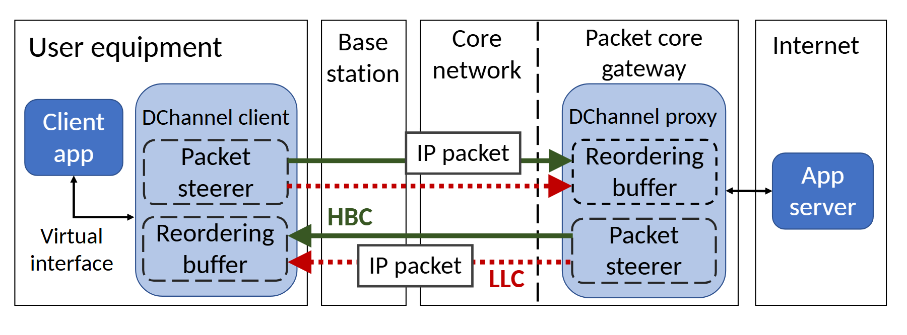

# VA-051 · 双端对称处理的并行网络通道

客户端与网关各有一组导流和重排部件，中间跨多个网络域存在两条并行通道，最右是业务服务。对称端点揭示了发送端拆分与接收端合并的配合；往返方向都画出，避免把低延迟路径误当成只用于单向控制的旁路。



## 适用范围

- 两端需要配合的多路径传输
- 跨接入网与核心网的端到端协议介绍

不适合：没有接收端重排的单一路由；用链路颜色表达带宽数值的网络测量图。

## 阅读顺序

1. 从左侧应用看虚拟接口如何接入端点处理模块。
2. 沿上方双通道向右跨越网络域并到达网关。
3. 读取网关向服务端的普通连接，再沿下方路径理解返回和重排。

## 图形表达

**布局**：按地理或管理域分成纵列，左右两个蓝色大块包围对称处理功能；中间列只承载路径。

**对象**：应用用深蓝圆角框，端点协议用浅蓝容器，虚线小框区分导流与缓冲职责。

**连线**：绿色实线和红色虚线区分并行通道，箭头区分方向；黑细线表示普通业务接口。

**配色**：蓝色统一表示两端协议与应用家族，通道色只用于路径身份，不能再兼任故障或优劣编码。

**文字**：通道缩写需展开解释；纵列标题较高，包标签放在路径空白处，避免盖住箭头。

## 部件与复用

| 部件 | 含义 | 改造方法 |
|---|---|---|
| 客户端端点 (`client-endpoint`) | 业务入口和本地拆分、合并功能。 | 改应用名时保留收发职能对应，不将两个小框合并成无含义模块。 |
| 中间网络域 (`network-domains`) | 展示双路径经过的网络范围。 | 按真实部署改域名、分界和路径，不能假设两路都穿越同样节点。 |
| 网关端点 (`gateway-endpoint`) | 远端与客户端配合的对称处理。 | 校验发送方向使用导流、接收方向使用重排。 |
| 远端服务 (`remote-service`) | 协议之外的业务终点。 | 换成实际服务；若服务在网关内，应移动边界。 |

## 改造步骤

1. 先明确两种路径各自承担的语义，再设置颜色与线型图例。
2. 同时检查上行与下行的导流和缓冲位置。
3. 新场景若没有中间域差异，缩窄中间区域而非堆空白列。

## 新情景示例（假设）

假设显示工业现场的有线与无线冗余传输。

左右为采集端和汇聚端，两通道改为有线和无线，重排缓冲负责恢复到达顺序。

移除蜂窝专有域名，加入现场交换域；若不是拆包传输而是复制发送，要把导流改为复制与去重。

## 编辑入口

**入口**：以 make_figure.py 为入口，example.json 提供编辑配置，labels.json 用于查文字键，asset.json 对应下列部件。

**配置可改**：labels 改指定文字与字号；components 可显隐、平移和改属性；elements 修改单个矢量对象。平移保留固定几何，不会自动重新布线。

**需改代码**：修改通道数量、端点职能或部署边界需要重新布线和改容器，不会自动跟随部件平移。 必须在 customize() 中处理新增矢量对象及连接，不能只扩大文字框。

**字体**：当前字体映射使用 Carlito-Bold.ttf, Carlito-Regular.ttf；换标签后按最终插入宽度检查字宽、上下标和边界，不直接继承小字号。

准备独立工作副本：

```text
python "<SKILL>/scripts/prepare_architecture.py" --id VA-051 --out figures/architecture
```

在工作副本运行：

```text
python make_figure.py --config example.json --out . --parts
python render_architecture.py fig.svg
```

## 本图检查

- 四条有向通道是否连接正确收发部件。
- 通道线型与新图例是否一致。
- 中间域边界是否误穿需要同属一个设备的端点模块。

部件图用于复用局部对象；跨边界的连接和共享容器仍需按新关系处理。示例名称、数值和曲线不是当前研究结果。

来源与许可见 [ATTRIBUTION.md](ATTRIBUTION.md)。
