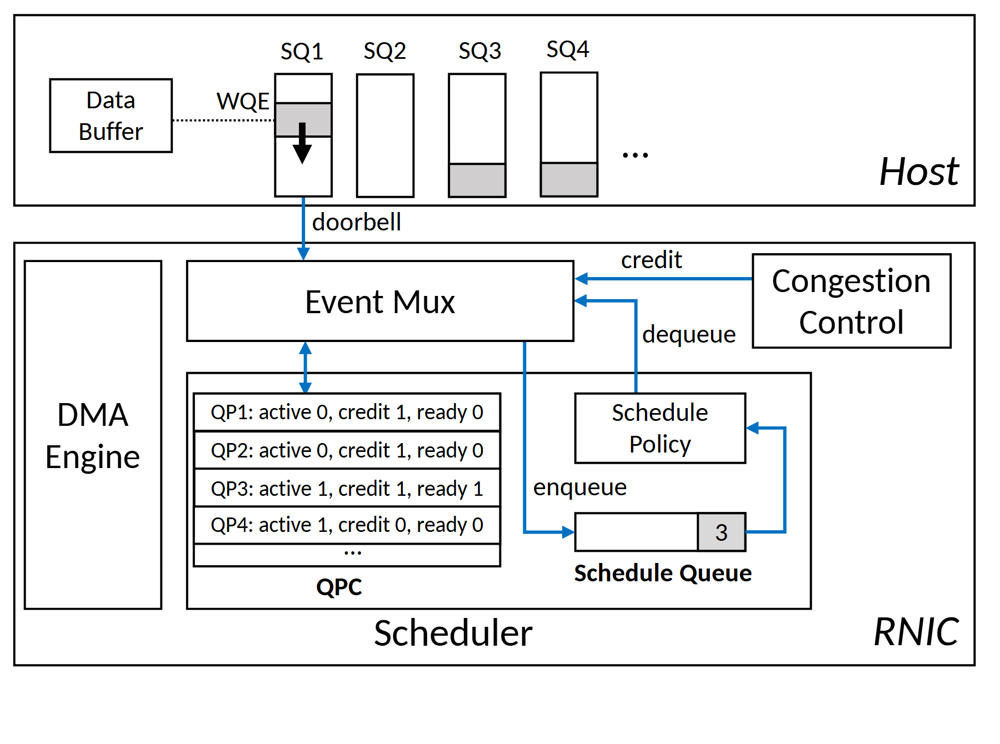

# VA-087 · 多事件汇聚的队列状态调度器

上层保留任务及其队列，下层设备把到达通知、额度变化和出队事件汇入同一入口。入口维护小型状态表，再由策略选择进入执行队列。图把数据搬运和调度状态分开，便于解释如何用少量状态决定大量任务的执行顺序。



## 适用范围

- 多种异步事件共同更新每对象状态的队列调度
- 上层保存任务而设备侧只维护调度元数据的设计

不适合：完全按顺序执行且无需状态判断的流程；需要显示具体任务耗时和抢占区间的时间线。

## 阅读顺序

1. 从上方缓冲和多个提交队列认识任务存放位置。
2. 沿到达通知进入下方中央事件汇聚器。
3. 查看额度控制和出队通知如何同样汇入事件入口。
4. 读状态表到策略及执行队列的闭环，最后确认左侧搬运引擎是独立通路。

## 图形表达

**布局**：上下分隔主机与设备，设备左边留给数据搬运，右边大框容纳状态调度。

**对象**：竖长格表示提交队列，横行表表示每对象状态，下方短分格条表示调度结果队列。

**连线**：蓝色箭头承载到达、额度、入队和出队事件；黑色箭头表达主机侧任务投递，方向比线条长短更重要。

**配色**：白底黑框维持层级，浅灰表示队列占用或被选项；蓝色集中强调事件信息而非实际数据块移动。

**文字**：采用紧凑无衬线，区域名用斜体，状态字段和队列编号小而一致；表格需要足够行高。

## 部件与复用

| 部件 | 含义 | 改造方法 |
|---|---|---|
| 上游任务队列 (`host-queues`) | 任务正文留在主机缓冲与提交队列。 | 明确一个队列属于哪个实体，填充高度不应伪装成负载数据。 |
| 事件汇聚与额度控制 (`event-control`) | 多个来源的事件在统一入口更新调度条件。 | 列清各事件触发条件，额度与完成反馈不能互相替代。 |
| 每对象状态表 (`state-table`) | 活动、额度和就绪字段给策略提供紧凑状态。 | 改为最小必要状态，并说明各字段由谁更新。 |
| 策略与调度队列 (`policy-queue`) | 策略挑选可执行对象，队列的入出事件继续反馈。 | 明确队列存对象编号还是实际任务，重写排序依据。 |
| 独立数据搬运 (`dma-path`) | 数据传输与调度元信息管理在图上分离。 | 若搬运会反馈完成，应显式新增实际存在的事件边。 |

## 改造步骤

1. 先列状态字段、写入事件与读取者，检查每条线是否有对应信息。
2. 区分任务正文和对象编号，不用同一格表示两种粒度。
3. 给队列填充值注明示例，展示算法时不用虚构运行统计。
4. 改变事件类型时同时检查闭环能否重新唤醒被阻塞任务。

## 新情景示例（假设）

可用于仓储机器人任务的事件驱动分配。

上层队列存订单，状态表记录机器人空闲、载重额度和就绪状态，完成与补能事件汇入统一入口。

把搬运引擎改为执行系统，增加任务完成通知，策略块改为实际调度规则；此映射仅为结构设计。

## 编辑入口

**入口**：以 make_figure.py 为入口，example.json 存修改参数；labels.json 定位文字键，asset.json 定位部件。运行后查看整图和独立部件。

**配置可改**：labels 改文字及字体；components 改显示、dx/dy 和属性；elements 改对象属性。位移采用整图 viewBox 单位，父子部件重叠时只选一个层级移动。

**需改代码**：增加状态列、队列数或事件源需要改 customize() 并重排表格。组件移动不重接跨组件箭头，须检查连接端点。

**字体**：使用 Carlito Regular/Bold/Italic；状态表中的数字与逗号保持字距可辨，区域斜体不宜替换成粗体。 font_size 是元素局部单位，受变换影响，不等于纸面字号。

准备独立工作副本：

```text
python "<SKILL>/scripts/prepare_architecture.py" --id VA-087 --out figures/architecture
```

在工作副本运行：

```text
python make_figure.py --config example.json --out . --parts
python render_architecture.py fig.svg
```

## 本图检查

- 每个状态字段是否有清楚的更新事件。
- 入队与出队箭头方向是否正确且没有同时画成输入。
- 蓝色事件线是否误接到数据缓冲的实体内容。

部件图用于复用局部对象；跨边界的连接和共享容器仍需按新关系处理。示例名称、数值和曲线不是当前研究结果。

来源与许可见 [ATTRIBUTION.md](ATTRIBUTION.md)。
