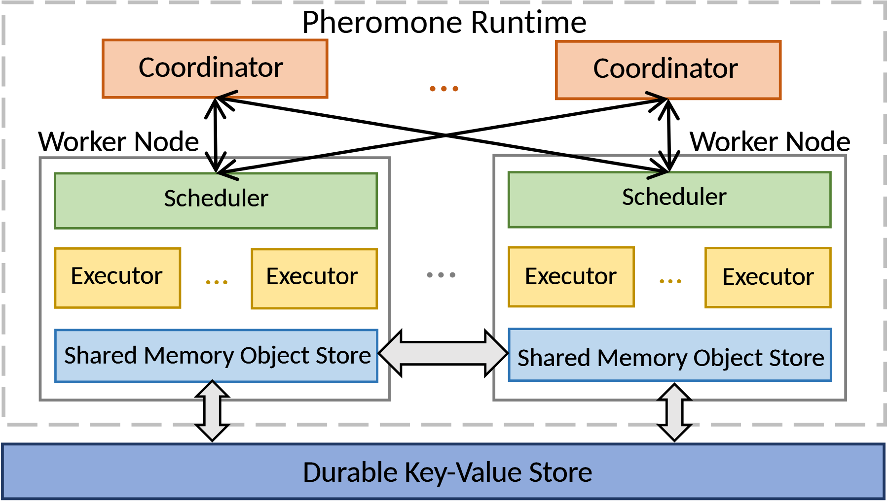

# VA-088 · 多协调器与对等工作节点架构

顶层协调器交叉连接两个工作节点，节点内部按调度、执行、内存对象存储分层；底部独立持久层为两节点提供长期数据。图的关键是区分控制关系、节点间中间对象交换、以及向持久层读写三类关系。同色同形节点表示同构职责，省略号表示规模扩展，不自动表示容错或强一致。



## 适用范围

- 有本地调度和共享对象存储的分布式执行平台
- 需要区分内存中间数据与持久存储

不适合：所有数据都只经过中心数据库且没有节点间交换；协调器与节点职责完全异构的系统。

## 阅读顺序

1. 从上方多个协调器追踪交叉控制连接
2. 分别读取左右节点内的调度器、执行器与对象存储
3. 查看两节点存储间的粗双向交换箭头
4. 沿向下读写接口进入公共持久层，核对运行时边界

## 图形表达

**布局**：顶部协调器并列，中间两个等宽工作节点镜像排列，底部持久存储横跨全图；虚线外框包住运行时。

**对象**：矩形层次清晰，执行器以两个代表框和省略号表示多个实例，粗空心双箭头区分数据通道。

**连线**：协调器到调度器用细交叉线，节点存储间和底部读写用粗双向箭头；线交叉并不表示共享接点。

**配色**：橙色协调、绿色调度、黄色执行、浅蓝内存对象、深蓝持久层按职责编码，同类模块左右保持一致。

**文字**：无衬线字体，长存储名称用单行贯通条承载；各节点标题放容器上边缘，避免被控制线穿过。

## 部件与复用

| 部件 | 含义 | 改造方法 |
|---|---|---|
| 交叉协调器 (`coordinators`) | 多个协调入口与节点调度层通信。 | 明确它们是分片协调还是冗余备份，不从画面自行推断。 |
| 左工作节点 (`left-worker`) | 完整呈现本地调度、多个执行器和中间对象区。 | 替换为当前工作单元，保留内部数据层级，按真实实例删减执行框。 |
| 右工作节点 (`right-worker`) | 与左节点同构的另一实例。 | 使用同样颜色与命名规则，若实际异构须明确差异而非强行镜像。 |
| 节点对象交换 (`peer-exchange`) | 中间结果在两个节点本地存储间传递。 | 写清交换对象和触发条件，不把双向箭头解释成自动一致性。 |
| 共享持久层 (`durable-store`) | 运行时边界外的长期保存服务。 | 改成实际后端，并区分检查点保存与每步读写。 |

## 改造步骤

1. 给协调连接、对象交换和持久化各写一种明确语义
2. 按新系统定义运行时边界，外部存储不应随意包入同一容器
3. 增加第三节点时重布顶层交叉线，避免形成无法辨读的线团
4. 若没有对等交换，删除中央双箭头并调整留白

## 新情景示例（假设）

可用于假设的多区域交通仿真计算平台。

协调器分派仿真场景，各工作节点执行区域模型，本地对象区保存中间车辆状态，持久层存放场景与检查点。

中央通道改成边界车辆状态交换；如协调器负责不同区域而非冗余，增加职责标签，不能宣称自动故障接管。

## 编辑入口

**入口**：make_figure.py 读取 example.json 生成 fig.svg；加 --parts 导出部件，render_architecture.py 渲染预览及 PDF。

**配置可改**：labels 按 labels.json 对象键改字；components 支持 visible、dx/dy、attributes；elements 改对象属性。位移用图内坐标，连线不自动重布。

**需改代码**：增删模块、改连接和布局须修改 customize()。新对象须有唯一 data-asset-key 并登记部件归属；嵌套部件选一个层级平移，避免重复移动。

**字体**：当前完整字体为 Carlito-Regular。font_size 是元素局部坐标单位，受缩放变换影响，不是纸面字号；改长标签后按最终版面宽度复核换行与字距。

准备独立工作副本：

```text
python "<SKILL>/scripts/prepare_architecture.py" --id VA-088 --out figures/architecture
```

在工作副本运行：

```text
python make_figure.py --config example.json --out . --parts
python render_architecture.py fig.svg
```

## 本图检查

- 控制线交叉处是否被误画成连接节点
- 内存对象交换与持久化是否有不同且准确的标签
- 左右同构节点及其底部读写接口是否成对完整

部件图用于复用局部对象；跨边界的连接和共享容器仍需按新关系处理。示例名称、数值和曲线不是当前研究结果。

来源与许可见 [ATTRIBUTION.md](ATTRIBUTION.md)。
