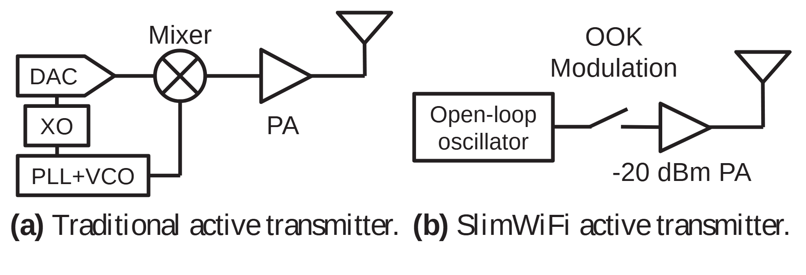

# VA-141 · 传统射频链与简化发射链对照

左右两条电路式信号链用同类放大器和天线符号保持可比性；左边的 DAC、混频器和闭环振荡模块较复杂，右边用开环振荡、开关和功放构成简化链路。结构删减直接通过符号数量与连接体现。



## 适用范围

- 比较信号处理硬件链路的功能删减或替换
- 用标准电路符号解释两种发送架构

不适合：一般业务流程中读者不理解电路符号的场景；希望从模块数量直接推断功耗或性能优势的定量结论。

## 阅读顺序

1. 先看左面板 DAC、XO 和 PLL+VCO 如何连接至混频器。
2. 沿左面板功放至天线查看输出链。
3. 再看右面板开环振荡器、OOK 开关、功放和天线。
4. 结合面板名称比较保留与删减的功能，而非把左右链拼成一条流水线。

## 图形表达

**布局**：两个紧凑信号链左右并排，各自下方有标题；左侧输入模块上下堆叠，右侧保持近水平结构。

**对象**：圆内交叉为混频器，三角为功放，开口三角与竖杆为天线，折线开关表示开关键控；形状有电路语义。

**连线**：普通黑线表示信号连接，接点按各自链路追踪；没有箭头不等于双向通信，应由信号链说明确定方向。

**配色**：单色黑白图，功能对比依赖符号和拓扑，不需要额外颜色编码。

**文字**：元件采用较大的无衬线短标签，面板说明使用衬线；功放数值 -20 dBm 属于原示例条件，迁移必须改成有依据数值或移除。

## 部件与复用

| 部件 | 含义 | 改造方法 |
|---|---|---|
| 完整传统发射链 (`baseline-chain`) | 完整保留传统振荡、数模输入、混频、功放和天线，避免复合路径被拆坏。 | 作为基准信号链整体复用；内部 PLL 外框与混频符号含复合路径，进一步拆分需先重写路径。 |
| 传统功放与天线 (`baseline-output`) | 传统链输出级以功放与天线表达。 | 可整体复用输出符号，连接端点需与新信号链一致。 |
| 简化开关键控链 (`simplified-chain`) | 开环源、开关、功放与天线构成独立简化方案。 | 更换调制方式时重绘开关符号及名称；功率数值需证据。 |

## 改造步骤

1. 先确定左右方案共用的信号条件，并替换面板名称。
2. 按实际删减或替代的硬件模块修改电路连接，不只删除文字。
3. 核对调制符号、频率源和放大器的专业含义。
4. 把 -20 dBm 等原示例数值改为已验证条件，或从示意图移除。

## 新情景示例（假设）

假设场景：比较常规无线信标与低复杂度开关键控信标。

左侧作为完整混频链，右侧作为开环源加门控链；天线保持相同，调制和放大环节按新设计填写。

若新信标仍需要滤波或匹配网络，应添加真实器件符号与连接，不能照搬原简化链省略。

## 编辑入口

**入口**：make_figure.py 负责构建；example.json 保存改造配置；labels.json 定位可编辑文字；asset.json 登记部件及 element_keys。先在工作副本运行 python make_figure.py --config example.json --out . --parts 查看整图与部件。

**配置可改**：labels、components 可改文字、配色、显隐和位移；配置不自动重排。先确定左右方案共用的信号条件，并替换面板名称。

**需改代码**：在 customize(root, context) 中实施拓扑和几何修改。若新信标仍需要滤波或匹配网络，应添加真实器件符号与连接，不能照搬原简化链省略。 新增对象要分配唯一 data-asset-key，并补入部件的 element_keys；跨区连线应随两端重绘，不随两个部件重复移动。

**字体**：元件采用较大的无衬线短标签，面板说明使用衬线；功放数值 -20 dBm 属于原示例条件，迁移必须改成有依据数值或移除。 最终字体文件以构建后的映射为准；局部 font_size 属于源坐标，不能直接当作论文纸面 pt，须按最终插图尺寸检查。本批构建已确认并嵌入完整字体：Arimo-Bold.ttf, Arimo-Regular.ttf。映射可能改变原字形和字宽，需按实际论文尺寸复核。

准备独立工作副本：

```text
python "<SKILL>/scripts/prepare_architecture.py" --id VA-141 --out figures/architecture
```

在工作副本运行：

```text
python make_figure.py --config example.json --out . --parts
python render_architecture.py fig.svg
```

## 本图检查

- 电路符号的含义与正文一致。
- 两面板之间没有连线暗示串联。
- 功率等数字来自实际条件。
- 下方长标题不覆盖元件标签。
- 完整传统链与输出级部件存在父子重叠，不能同时对二者叠加位移。

部件图用于复用局部对象；跨边界的连接和共享容器仍需按新关系处理。示例名称、数值和曲线不是当前研究结果。

来源与许可见 [ATTRIBUTION.md](ATTRIBUTION.md)。
