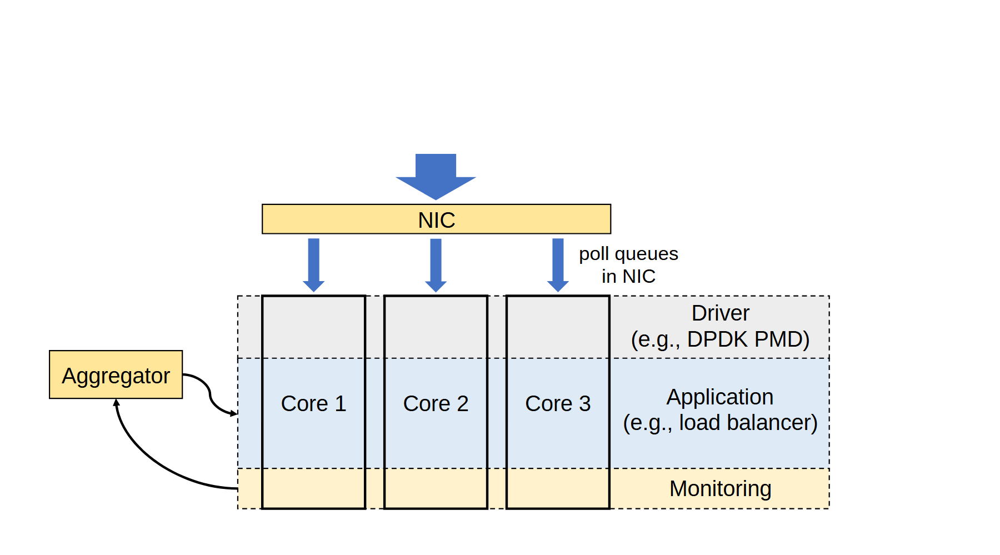

# VA-142 · 流量分发与跨核分层监测

顶部 NIC 将流量分给三列处理核心，横向背景带把驱动、应用和监测三个职责贯穿各列。左侧聚合器通过弯线接入监测层，使“每核都有完整处理栈”和“监测结果还需全局汇总”同时可见。



## 适用范围

- 相同处理栈在多核心或多实例上重复部署，并汇总本地指标
- 需要用行列双维度表达职责层次与执行资源

不适合：各核心运行完全不同处理流程、不能共享横向层定义；希望展示真实吞吐或监测开销数值的性能图。

## 阅读顺序

1. 从顶部粗箭头进入 NIC，识别共同流量入口。
2. 沿三个蓝色下箭头看到三列 Core。
3. 按横向灰、浅蓝、浅黄带阅读 Driver、Application、Monitoring。
4. 最后看左侧 Aggregator 与监测区域的两条曲线连接。

## 图形表达

**布局**：纵向三个等宽核心列穿过横向三层背景带；右侧留层名，左侧单独放聚合器，顶部用横条式入口。源画布上部留白明显。

**对象**：NIC 和聚合器用黄色细矩形；核心用长方形细边框；虚线横向区域表示逻辑层，不是独立物理设备。

**连线**：粗蓝箭头表示 NIC 到各核心的流量分发；左侧黑色弯线表示聚合器与监测区域的联系，不能根据两条曲线推断完整双向协议。

**配色**：灰色驱动、浅蓝应用、浅黄监测，颜色跨列一致；蓝箭头作为数据路径强调。

**文字**：核心名在列中部，层名与举例放右侧；大模块短标签居中，小括号例子要控制长度。

## 部件与复用

| 部件 | 含义 | 改造方法 |
|---|---|---|
| 统一入口与网卡 (`ingress-nic`) | 输入箭头与横条 NIC 组成共同入口。 | 改为实际分发器并与三列输入端对齐。 |
| 多核心与职责层矩阵 (`core-layer-stack`) | 完整包含三核心列、贯通的驱动/应用/监测背景及右侧层名。 | 增减核心时同步重绘贯通层带与右侧标签；共享背景是整条路径，不将单列当含独立背景的部件。 |
| 监测聚合器 (`aggregator`) | 独立聚合模块汇总本地监测。 | 移位后重画两条弯线；实际方向应按新协议说明。 |

## 改造步骤

1. 先替换分发器、核心和三层职责名称，明确层与列的两个维度。
2. 按真实实例数增减核心列，保持背景带和输入箭头对齐。
3. 定义聚合器采集的是哪一层结果，再重画侧向连接。
4. 若新系统需要反馈控制，另加有方向的控制线和标签，不借用现有监测曲线。

## 新情景示例（假设）

假设场景：三个边缘实例各自运行采集、预测和监测，中央服务汇总健康指标。

NIC 改为任务分发器，核心改为边缘实例，三横层对应采集、预测、监测，聚合器对应健康汇总。

新的数据分发关系和指标汇总方向需重绘；若实例层栈不同则不能继续使用贯通背景带。

## 编辑入口

**入口**：make_figure.py 负责构建；example.json 保存改造配置；labels.json 定位可编辑文字；asset.json 登记部件及 element_keys。先在工作副本运行 python make_figure.py --config example.json --out . --parts 查看整图与部件。

**配置可改**：labels、components 可改文字、配色、显隐和位移；配置不自动重排。先替换分发器、核心和三层职责名称，明确层与列的两个维度。

**需改代码**：在 customize(root, context) 中实施拓扑和几何修改。新的数据分发关系和指标汇总方向需重绘；若实例层栈不同则不能继续使用贯通背景带。 新增对象要分配唯一 data-asset-key，并补入部件的 element_keys；跨区连线应随两端重绘，不随两个部件重复移动。

**字体**：核心名在列中部，层名与举例放右侧；大模块短标签居中，小括号例子要控制长度。 最终字体文件以构建后的映射为准；局部 font_size 属于源坐标，不能直接当作论文纸面 pt，须按最终插图尺寸检查。本批构建已确认并嵌入完整字体：Arimo-Regular.ttf。映射可能改变原字形和字宽，需按实际论文尺寸复核。

准备独立工作副本：

```text
python "<SKILL>/scripts/prepare_architecture.py" --id VA-142 --out figures/architecture
```

在工作副本运行：

```text
python make_figure.py --config example.json --out . --parts
python render_architecture.py fig.svg
```

## 本图检查

- 每个核心确实具备三层职责。
- 横向背景带与右侧名称一一对应。
- 聚合器连接的是实际指标来源。
- 背景层与核心框的边界没有造成假连接。
- 最终裁切去除空白时保留顶部输入箭头。

部件图用于复用局部对象；跨边界的连接和共享容器仍需按新关系处理。示例名称、数值和曲线不是当前研究结果。

来源与许可见 [ATTRIBUTION.md](ATTRIBUTION.md)。
