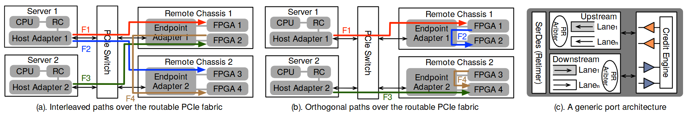

# VA-143 · 双拓扑流量对照与端口内部放大

前两面板重复同一服务器—交换机—远端机箱拓扑，只改变彩色流的经过方式，第三个小面板补充公共端口内部的通道、仲裁与信用引擎。公共结构与差异流分开表达，适合解释资源共享位置。



## 适用范围

- 比较相同网络或互连拓扑上的不同流量共享方式
- 需要对比整体路由并补充一个公共接口内部构造

不适合：两个方案的物理节点完全不同、无法保持结构可比；狭窄单栏中必须保留全部小标签的使用场景。

## 阅读顺序

1. 先看面板 a 的两个服务器、交换机和两个远端机箱。
2. 沿 F1–F4 彩色路线辨认各流共享哪些适配器与链路。
3. 对照面板 b 的相同拓扑，观察正交路径关系。
4. 最后读面板 c：SerDes、上下游通道、仲裁器与 Credit Engine。

## 图形表达

**布局**：超宽横向三面板，前两个面积近似、第三个较窄；每个大拓扑左右为主机与机箱，中间竖放交换机。

**对象**：灰底容器嵌 CPU、RC、适配器与 FPGA 小块；端口细节使用椭圆仲裁器和三角输入符号。

**连线**：黑色基础连接承托红蓝绿棕多条流；彩线贴着共享链路走但端点不同。端口内部双向通道箭头与流路径箭头含义不同。

**配色**：灰色作为硬件背景，F1–F4 用红、蓝、绿、棕区分；两大面板对同一流保持颜色一致。

**文字**：设备名、流名和面板说明都很小；此图适合通栏。原端口仲裁标签存在 Aribter 拼写，应在改造输出中改为 Arbiter。

## 部件与复用

| 部件 | 含义 | 改造方法 |
|---|---|---|
| 交织路径拓扑 (`interleaved-topology`) | 第一套完整拓扑显示多个流在不同共享位置交织。 | 保持服务器与机箱关系，按实际流端点改彩线；不要随意交换流编号。 |
| 正交路径拓扑 (`orthogonal-topology`) | 第二套重复拓扑用于隔离路径共享差异。 | 以同样硬件为基准，只改实验变量所需路径。 |
| 公共端口内部 (`port-internals`) | 第三面板补充 SerDes、通道、仲裁和信用引擎。 | 根据真实接口裁减或扩展通道；细节不必在两个大面板重复。 |

## 改造步骤

1. 先统一两大面板节点名、硬件配置与拓扑，明确唯一比较变量。
2. 根据真实端点重画各流，确保颜色和 F 编号在两面板一致。
3. 替换端口内部实际通道与仲裁功能，修正 Aribter 为 Arbiter。
4. 通栏仍无法读清时拆成主图和细节图，而不是无限缩小文字。

## 新情景示例（假设）

假设场景：比较两台计算服务器访问两个存储机箱时的共享与隔离路由。

主机保留计算服务器角色，FPGA 改为存储端点，彩色流改为读写请求，端口小面板表示仲裁与额度控制。

需重画存储端点内部结构和请求路径，端口细节按实际总线协议替换；不是简单把 FPGA 换成 Disk。

## 编辑入口

**入口**：make_figure.py 负责构建；example.json 保存改造配置；labels.json 定位可编辑文字；asset.json 登记部件及 element_keys。先在工作副本运行 python make_figure.py --config example.json --out . --parts 查看整图与部件。

**配置可改**：labels、components 可改文字、配色、显隐和位移；配置不自动重排。先统一两大面板节点名、硬件配置与拓扑，明确唯一比较变量。

**需改代码**：在 customize(root, context) 中实施拓扑和几何修改。需重画存储端点内部结构和请求路径，端口细节按实际总线协议替换；不是简单把 FPGA 换成 Disk。 新增对象要分配唯一 data-asset-key，并补入部件的 element_keys；跨区连线应随两端重绘，不随两个部件重复移动。

**字体**：设备名、流名和面板说明都很小；此图适合通栏。原端口仲裁标签存在 Aribter 拼写，应在改造输出中改为 Arbiter。 最终字体文件以构建后的映射为准；局部 font_size 属于源坐标，不能直接当作论文纸面 pt，须按最终插图尺寸检查。本批构建已确认并嵌入完整字体：texgyreheros-regular.otf。映射可能改变原字形和字宽，需按实际论文尺寸复核。

准备独立工作副本：

```text
python "<SKILL>/scripts/prepare_architecture.py" --id VA-143 --out figures/architecture
```

在工作副本运行：

```text
python make_figure.py --config example.json --out . --parts
python render_architecture.py fig.svg
```

## 本图检查

- 两个拓扑的硬件配置相同或差异已明确。
- F1–F4 的颜色、端点和共享位置一致。
- 端口通道方向与仲裁关系正确。
- Aribter 拼写已按改造要求检查。
- 通栏缩放后所有小标签仍可读。

部件图用于复用局部对象；跨边界的连接和共享容器仍需按新关系处理。示例名称、数值和曲线不是当前研究结果。

来源与许可见 [ATTRIBUTION.md](ATTRIBUTION.md)。
