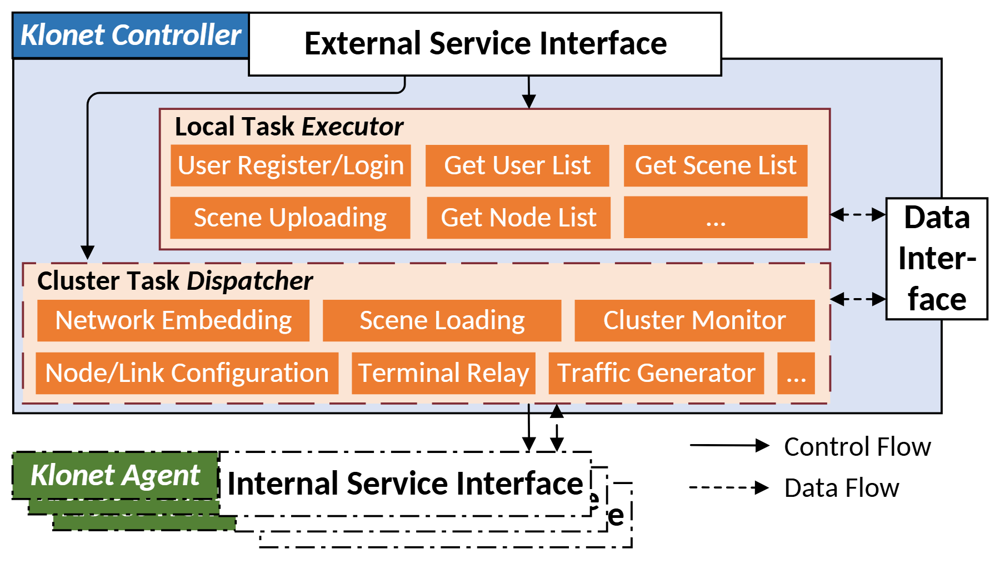

# VA-014 · 本地服务与分布式任务控制台

主体是一块控制台，内部按执行位置分成两排功能矩阵：上排处理本地事务，下排负责把任务下发到远端代理。上方外部接口接请求，右侧独立数据接口被两排共用，下方叠片表示多个代理实例。它适合说明职责归属，不用于表达每个按钮的调用时序。



## 适用范围

- 平台功能分层与代理调度
- 本地管理和远端执行并存的服务架构

不适合：严格时序协议；只有单台机器且不需要任务下发的平台。

## 阅读顺序

1. 先看顶端外部请求接口进入控制台
2. 辨认本地任务和集群任务两排功能
3. 沿右侧虚线检查共享数据访问
4. 向下追踪集群任务到内部服务接口及代理

## 图形表达

**布局**：上接口、右数据、下代理形成三个接触面，两个功能区垂直排列在淡蓝大容器中。

**对象**：橙色小矩形是功能而非机器；下方偏移叠框代表重复代理，不应逐框解释为额外软件层。

**连线**：实线箭头表示控制传递，虚线箭头表示数据交换；虚线分组边框本身不是数据流。

**配色**：淡蓝界定控制台，浅桃底托住橙色功能，绿色标题强调外部代理；同排小格不编码优先级。

**文字**：无衬线白字置于橙色块内，功能标题加粗；较长名称应分行或扩大格子，避免缩到难读。

## 部件与复用

| 部件 | 含义 | 改造方法 |
|---|---|---|
| 外部入口 (`external-interface`) | 接收平台用户或外部服务请求。 | 可改成业务API，但不与代理内部接口混称。 |
| 本地功能组 (`local-executor`) | 无需远程派发即可完成的认证、管理或查询功能集合。 | 按真实部署划分职责，删除不属于当前场景的示例功能。 |
| 分布式任务组 (`cluster-dispatch`) | 需由远端代理完成的任务入口和调度功能集合。 | 每个格子改成任务类别，不直接填节点编号。 |
| 共享数据访问口 (`data-interface`) | 为上下两类功能提供共同的数据访问边界。 | 明确单向写入或双向读写，再调整两条虚线。 |
| 远端代理组 (`agent-interface`) | 内部接口连接多个执行代理的抽象。 | 在叠片旁注明实例含义；异构代理需拆成并排类别。 |

## 改造步骤

1. 先按执行位置归类功能，再决定两排格子数量
2. 统一所有功能名称为动作短语，外部和内部接口用名词
3. 新增功能须重排该排格宽与外框，不承诺自动换行布局
4. 若代理有独立缓存或任务队列，在下方增设详情区而非塞进叠片

## 新情景示例（假设）

可用于校园能源管理平台的架构说明。

本地组对应用户、设备目录和报表查询；分布式组对应采样、策略下发和设备巡检；数据口对应运行数据库。

把代理定义为各楼宇网关，并增加离线回报路径；只有系统确实支持双向控制时才保留上下双箭头。

## 编辑入口

**入口**：make_figure.py 读取 example.json；labels.json 查文字键，asset.json 查部件键；输出 SVG，可用配套渲染脚本导出 PDF。

**配置可改**：labels 修改文字及字体属性；components 可设 visible、dx/dy、attributes；elements 修改单个对象属性。平移使用图的坐标单位，重叠部件不要同时平移。

**需改代码**：改变模块数量、连接关系或分栏布局须编辑 customize()，不会自动布线。新对象需唯一 data-asset-key，并加入对应部件 element_keys，才会随部件导出。

**字体**：本图映射字体：Carlito-Bold.ttf, Carlito-BoldItalic.ttf, Carlito-Regular.ttf。沿用完整字体覆盖新字符；font_size 是元素局部单位，不是纸面 pt。改长标签后检查字宽、裁切及最终 PDF。

准备独立工作副本：

```text
python "<SKILL>/scripts/prepare_architecture.py" --id VA-014 --out figures/architecture
```

在工作副本运行：

```text
python make_figure.py --config example.json --out . --parts
python render_architecture.py fig.svg
```

## 本图检查

- 本地与远程功能有没有交叉归属
- 虚实箭头是否和图例逐一一致
- 代理叠片是否误被读作串行执行链

部件图用于复用局部对象；跨边界的连接和共享容器仍需按新关系处理。示例名称、数值和曲线不是当前研究结果。

来源与许可见 [ATTRIBUTION.md](ATTRIBUTION.md)。
