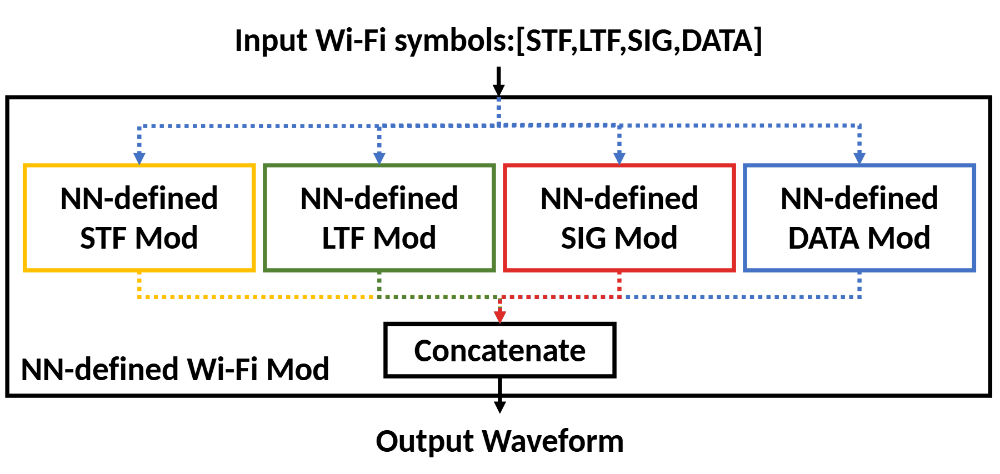

# VA-144 · 四路并行调制与统一拼接

共同输入经蓝色虚线分到四个等大的模块，四路输出沿各自颜色的虚线向底部拼接器汇合，再形成一个统一输出。外层容器把并行模块和拼接器定义为同一个复合系统。



## 适用范围

- 输入可分成若干独立部分处理，再按固定规则组合输出
- 多类子模块共用结构、各自处理不同字段的系统

不适合：四路是顺序依赖而非并行处理；汇合实际是选择其中一路而非拼接或融合却未更改语义。

## 阅读顺序

1. 从最上方输入标签和黑色下箭头进入系统。
2. 沿蓝色虚线扇出到四个同尺寸模块。
3. 查看四种边框及其相应输出虚线，理解字段分别处理。
4. 看底部 Concatenate 与黑色输出箭头，最后确认外框系统名。

## 图形表达

**布局**：宽横向外框内四模块等距并排，拼接器在下方居中；输入位于框外上方，输出位于框外下方。

**对象**：四个粗边矩形同型，底部拼接矩形更矮；外框粗线界定复合系统。

**连线**：黑色箭头连接系统入口和最终出口；蓝色虚线负责分发，黄绿红蓝虚线负责各模块汇入。中间汇合虚线共用部分路径，部件移动后必须整段重路由。

**配色**：模块填充为白色，边框分别黄、绿、红、蓝，输出虚线按模块同色；不是“同色填充”编码。

**文字**：粗体无衬线标签，模块文字分三行以内，输入字段列表较长；最终字体映射后需核查密集字距。

## 部件与复用

| 部件 | 含义 | 改造方法 |
|---|---|---|
| 输入字段与入口 (`system-input`) | 字段列表与下箭头说明共同输入。 | 根据真实字段调整列表，不把模块名当实测数据。 |
| 第一并行分支 (`stf-branch`) | 黄色边框的第一个同型处理模块。 | 修改其字段与处理器名称，并同步输出虚线颜色。 |
| 第二并行分支 (`ltf-branch`) | 绿色边框的第二个模块。 | 保持与其他分支相同尺寸；内容长度增加时整体重排。 |
| 第三并行分支 (`sig-branch`) | 红色边框的第三个模块。 | 替换处理职责后检查它仍可独立运行。 |
| 第四并行分支 (`data-branch`) | 蓝色边框的第四个模块。 | 增减字段时不能只隐藏模块而遗留输出虚线。 |
| 拼接与系统输出 (`concatenate-output`) | 拼接器和输出箭头组成统一出口。 | 若改成求和、融合或选择，必须改名并解释输出语义。 |

## 改造步骤

1. 先把输入字段列表、四个模块和最终输出改成相互一致的任务名称。
2. 保留白底和彩色边框的角色，输出虚线与所属模块同色。
3. 模块数改变时重排等宽模块并重建扇出/汇合，配置不会自动完成。
4. 明确汇合到底是拼接、聚合还是选择，再修改汇合器标签与连接。

## 新情景示例（假设）

假设场景：四种城市传感器分别提取特征后拼接成预测模型输入。

四个调制器改为温度、交通、能耗和环境特征编码器，Concatenate 对应特征拼接，输出为统一特征向量。

输入应改为四类独立传感器流，必要时各分支增加预处理；拼接顺序和维度应按模型定义填写。

## 编辑入口

**入口**：make_figure.py 负责构建；example.json 保存改造配置；labels.json 定位可编辑文字；asset.json 登记部件及 element_keys。先在工作副本运行 python make_figure.py --config example.json --out . --parts 查看整图与部件。

**配置可改**：labels、components 可改文字、配色、显隐和位移；配置不自动重排。先把输入字段列表、四个模块和最终输出改成相互一致的任务名称。

**需改代码**：在 customize(root, context) 中实施拓扑和几何修改。输入应改为四类独立传感器流，必要时各分支增加预处理；拼接顺序和维度应按模型定义填写。 新增对象要分配唯一 data-asset-key，并补入部件的 element_keys；跨区连线应随两端重绘，不随两个部件重复移动。

**字体**：粗体无衬线标签，模块文字分三行以内，输入字段列表较长；最终字体映射后需核查密集字距。 最终字体文件以构建后的映射为准；局部 font_size 属于源坐标，不能直接当作论文纸面 pt，须按最终插图尺寸检查。本批构建已确认并嵌入完整字体：Carlito-Bold.ttf。映射可能改变原字形和字宽，需按实际论文尺寸复核。

准备独立工作副本：

```text
python "<SKILL>/scripts/prepare_architecture.py" --id VA-144 --out figures/architecture
```

在工作副本运行：

```text
python make_figure.py --config example.json --out . --parts
python render_architecture.py fig.svg
```

## 本图检查

- 四个模块确实并行且无未画出的依赖。
- 输入字段与分支数量对应。
- 各虚线路径无悬空端点，汇合后的箭头只指向统一出口。
- 系统名在外框内且没有被拼接器遮挡。
- 没有把彩色边框误说明为填充色。

部件图用于复用局部对象；跨边界的连接和共享容器仍需按新关系处理。示例名称、数值和曲线不是当前研究结果。

来源与许可见 [ATTRIBUTION.md](ATTRIBUTION.md)。
