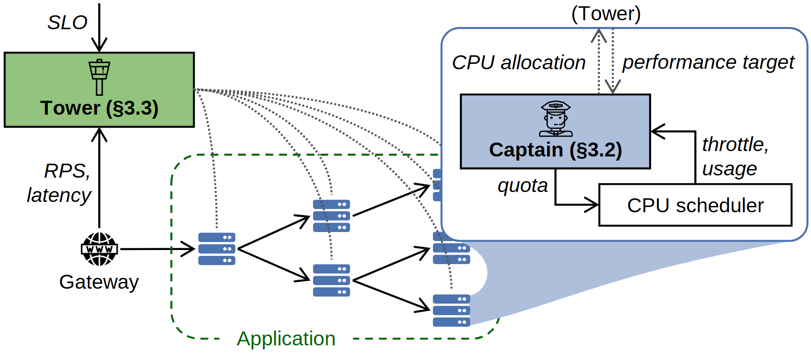

# VA-015 · 全局目标分解与节点自治控制

把全局控制器、服务依赖网络和单节点内部闭环放在同一横幅。全局层关心整体目标，节点层把分配目标转成可执行配额。右侧放大框解释一个节点，底部网络则说明该局部机制在多处重复。



## 适用范围

- 全局目标需分解到多个自治节点的分层控制
- 业务节点之间有依赖，同时各节点有资源反馈回路

不适合：只有一次性全局分配而无局部反馈；网络边只是装饰、节点没有真实依赖。

## 阅读顺序

1. 从左下入口进入底部服务网络，识别业务依赖。
2. 向上读整体观测和目标输入，确认全局控制器职责。
3. 沿点状扇出关系找到各节点，右侧是其中一个节点的展开。
4. 在放大框内分辨下发配额与返回使用情况，再读全局目标交换。

## 图形表达

**布局**：左上小控制框、下方依赖网络、右上大放大框形成三角组织。

**对象**：服务器小图标表示节点，网关图标表示入口；蓝色展开扇面把节点与内部细节绑定。

**连线**：网络实箭头表达业务依赖，点线表示分发控制关系；局部实箭头分开表示指令与反馈。

**配色**：绿色突出全局管理并用于业务网络虚线边界，蓝色表示节点及展开区域；颜色不能替代边界标题。

**文字**：控制器名称粗体，目标和观测斜体；局部放大后字号接近主控制器，便于跨层阅读。

## 部件与复用

| 部件 | 含义 | 改造方法 |
|---|---|---|
| 全局目标控制器 (`global-controller`) | 汇总整体观测并向节点设置目标。 | 替换目标、观测和决策量三项，避免把目标当作直接执行命令。 |
| 业务依赖网络 (`application-network`) | 多服务的有向关系展示请求如何经过系统。 | 按真实依赖增删边，节点数量只表达结构或须注明示意。 |
| 节点控制器展开 (`local-controller`) | 一个节点接收目标并用局部状态决定资源需求。 | 只展开实际存在的局部决策，删除旧章节引用。 |
| 局部执行调度器 (`local-scheduler`) | 执行配额并反馈使用或受限程度。 | 改为实际执行对象，同时改返回指标及其方向。 |

## 改造步骤

1. 先写清全局与局部各自能看到的信息和能调节的变量。
2. 保留一处放大；多个节点机制不同时应拆成多个有标记的展开。
3. 重新绘制底部依赖，勿把扇出控制线误当成业务流。
4. 目标分配和执行反馈要使用不同标签，必要时新增线型图例。

## 新情景示例（假设）

可用于城市供水的总目标与泵站自治控制说明。

全局控制器接收供水压力与总能耗，节点为泵站；局部控制器将压力目标转为转速指令。

把服务器改成泵站符号，按管网重新布边，增加局部压力反馈；展开区保持单站尺度。该示例仅说明适配方式。

## 编辑入口

**入口**：以 make_figure.py 为入口，example.json 存修改参数；labels.json 定位文字键，asset.json 定位部件。运行后查看整图和独立部件。

**配置可改**：labels 改文字及字体；components 改显示、dx/dy 和属性；elements 改对象属性。位移采用整图 viewBox 单位，父子部件重叠时只选一个层级移动。

**需改代码**：改网络节点数、扇出曲线或展开位置须改 customize()。移动局部控制器与其内部调度器时避免对重叠元素重复位移。

**字体**：采用 Arimo Regular、Bold、Italic；控制信号的斜体与模块名粗体应保留层级。 font_size 是元素局部单位，受变换影响，不等于纸面字号。

准备独立工作副本：

```text
python "<SKILL>/scripts/prepare_architecture.py" --id VA-015 --out figures/architecture
```

在工作副本运行：

```text
python make_figure.py --config example.json --out . --parts
python render_architecture.py fig.svg
```

## 本图检查

- 放大扇面是否明确指向一个对应节点。
- 全局观测、局部反馈和业务流是否混用箭头。
- 绿色边界是否意外包含了全局控制器以外的错误对象。

部件图用于复用局部对象；跨边界的连接和共享容器仍需按新关系处理。示例名称、数值和曲线不是当前研究结果。

来源与许可见 [ATTRIBUTION.md](ATTRIBUTION.md)。
