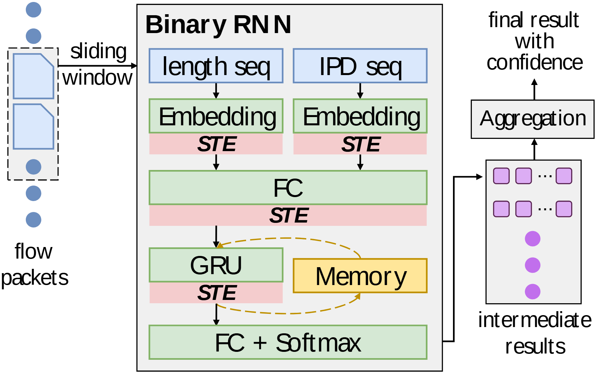

# VA-052 · 滑动窗口与有状态序列判别

左侧连续事件流抽取窗口，中间两路特征分别编码后进入共享状态模型，右侧把多个窗口结果聚合为最终结论。它强调序列记忆和分段推断，不仅是普通分类网络的层列表；粉色窄条还承载特定数值变换语义。



## 适用范围

- 事件流分窗后用有状态模型分类
- 需要同时解释多特征、记忆和跨窗口聚合的算法

不适合：无状态回归流水线；仅靠改模型名称就能替换全部网络结构的场景。

## 阅读顺序

1. 先看左侧点流和虚线滑动窗口。
2. 进入中央上方两路特征与各自嵌入层。
3. 沿下行路径经过合流、循环单元和记忆回路。
4. 从输出层到右侧中间结果列，再向上读最终聚合。

## 图形表达

**布局**：左窄输入、中宽模型、右窄结果；中央自上而下而右侧向上收束。

**对象**：流中折角片表示样本，长条表示层，记忆单独外置；右侧小方块代表多次局部结果。

**连线**：主链为实线下行，记忆用弧形虚线形成双向状态联系，输出线从模型底部绕到右侧。

**配色**：蓝色为特征输入，绿色为处理层，粉色为变换步骤，黄色为记忆，紫色为结果；颜色不是精度数值。

**文字**：层名和缩写需简短；斜体 STE 是专用变换名，改为其他模型时不能当装饰留下。

## 部件与复用

| 部件 | 含义 | 改造方法 |
|---|---|---|
| 流与窗口 (`stream-window`) | 从连续事件中选择一段固定范围。 | 换成传感样本或交易序列，并说明窗口长度及步幅。 |
| 双路特征编码 (`dual-embedding`) | 两种序列分别编码后合流。 | 用真实特征与编码器，单特征情形需删除一支并居中。 |
| 状态推断与记忆 (`stateful-model`) | 共享层、循环单元、记忆和输出层组成核心。 | 没有循环状态就删除回路与记忆框；量化步骤也须据实保留。 |
| 窗口结果聚合 (`result-aggregation`) | 多个中间结论合成最终输出。 | 填实际聚合规则，如概率平均或阈值累积，而非默认投票。 |

## 改造步骤

1. 明确窗口之间是否共享隐藏状态。
2. 分别确认各粉色变换条是否真实存在，不继承二值化设定。
3. 将输出维度与右侧结果符号对应。
4. 聚合策略改变时同时改结果到最终结论的箭头说明。

## 新情景示例（假设）

假设绘制设备故障预警模型。

两路输入为振动幅值和采样间隔，记忆保持设备状态，各窗口生成故障概率。

若采用全精度循环网络，删除所有 STE 窄条并收紧层间距；聚合改为连续超阈值规则。

## 编辑入口

**入口**：运行 make_figure.py，以 example.json 为改造配置；labels.json 查文字键，--parts 同步导出部件。

**配置可改**：labels 改文字，components 改显示、位移及样式，elements 改单个矢量属性；只选一个部件层级移动，避免重叠归属使对象移动两次。

**需改代码**：这是可编辑矢量结构，未实现自动布局。增删模块、改变连接或重新排版，须在 customize() 中改真实对象并更新部件成员。

**字体**：使用随包完整映射字体；改字后核查换行、符号和最终纸面字号。font_size 是对象局部单位，不能直接当作 PDF 的磅值。

准备独立工作副本：

```text
python "<SKILL>/scripts/prepare_architecture.py" --id VA-052 --out figures/architecture
```

在工作副本运行：

```text
python make_figure.py --config example.json --out . --parts
python render_architecture.py fig.svg
```

## 本图检查

- 记忆回路是否包含更新和读取两个含义。
- 模型底部输出是否正确进入中间结果而非直接跳到结论。
- 删除量化条后是否留下不合理空隙或箭头断点。

部件图用于复用局部对象；跨边界的连接和共享容器仍需按新关系处理。示例名称、数值和曲线不是当前研究结果。

来源与许可见 [ATTRIBUTION.md](ATTRIBUTION.md)。
