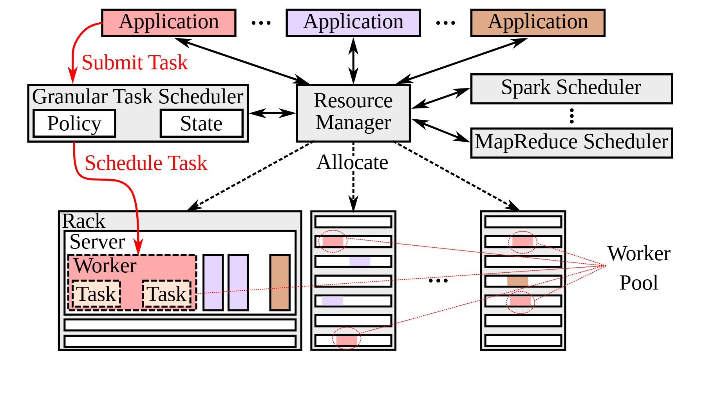

# VA-089 · 细粒度任务调度与共享资源管理

顶部多类应用同时接入任务调度器和资源管理器；前者直接把细任务派到工作者，后者分配可用资源并协调其他调度框架。下方用机架、服务器、工作者、任务四层展开，把抽象资源池落到实际部署。红色路径强调一种调度方式，浅色应用身份延续到任务对象，但不应把两套管理职责混为同一调度动作。



## 适用范围

- 任务级派发与资源级分配共存的平台
- 需要展示共享工作池及一个工作者内部对象的部署图

不适合：只有一层调度、没有资源归属区别的系统；必须展示真实机房物理连线的网络拓扑。

## 阅读顺序

1. 从顶部应用入口看提交到哪类管理模块。
2. 读左侧策略与状态如何服务于细任务派发，再读右侧资源分配路径。
3. 进入左下机架逐层识别服务器、工作者和任务。
4. 跟随圈选引线看其他机架中的成员如何组成逻辑工作池。

## 图形表达

**布局**：上下三带分别为应用、管理、部署；左下展开细节，右下多个简化机架延续同一资源池。

**对象**：外框逐级嵌套表达实体归属，细长格表示服务器或资源槽，虚框工作者内部再含任务。

**连线**：红实线只强调任务提交与派发，黑虚线表示资源分配；圈选引线是成员解释，不是网络传输。

**配色**：应用与任务颜色配对表达来源；灰色基础设施退后，红色强调路径要配文字保证灰度可读。

**文字**：部署层级名靠边放置，任务短标签放内部；调度器内策略与状态框保持同级而非上下流水。

## 部件与复用

| 部件 | 含义 | 改造方法 |
|---|---|---|
| 多类任务入口 (`applications`) | 不同应用提交任务或资源请求 | 用颜色与标签共同跟踪应用归属，补图例防止仅靠相近颜色。 |
| 任务级调度器 (`granular-scheduler`) | 根据策略与状态直接选派工作者 | 明确调度粒度和状态输入，若需要先获得资源应补真实前提。 |
| 资源级管理区 (`resource-manager`) | 分配共享资源并对接其他调度框架 | 保留框架数量的省略语义，避免把资源分配画成执行任务。 |
| 实体层级展开 (`rack-detail`) | 一个机架内部服务器、工作者和任务的包含链 | 跨领域迁移可保留层级逻辑，但需替换不适用的机架图标。 |
| 跨实体工作池 (`worker-pool`) | 不同实体中的可用成员组成逻辑资源池 | 圈选连线表示集合成员，不表示物理互联或任务依赖。 |

## 改造步骤

1. 写清任务派发与资源分配各负责什么，以及两者如何协商。
2. 确定部署层级，保留一个细节展开并将其他实体简化。
3. 更新应用到任务的颜色对应和工作池成员引线。
4. 逐条核对红色路径、分配虚线和成员引线三种关系，避免互相冒用。

## 新情景示例（假设）

假设设计医院多科室共享检查设备的平台。

应用对应科室申请，任务调度器安排具体检查，资源管理器分配设备时段；展开区域对应院区、检查室、设备与检查任务。

机架图标需替换为院区或房间层级，逻辑工作池表示可调度设备集合；资源分配应指向时段或设备而非患者任务。

## 编辑入口

**入口**：在工作副本修改 example.json，运行 python make_figure.py --config example.json --out output --parts；再通过 Vivid 的矢量渲染入口检查 SVG 与 PDF。

**配置可改**：labels 按 labels.json 的元素键改字；components 按本页部件 id 设置 visible、dx、dy 或 attributes；elements 修改指定矢量元素属性。重叠部件可能共享元素，避免对父区域和内部区域重复位移。

**需改代码**：部署层级、框架数量或工作池成员变化需改写对象和引线；现有图不会推导真实调度权限。这些接口不会自动重排，也不会随部件移动自动修复跨部件连线。

**字体**：本资产已记录的完整字形资源：Tinos-Regular.ttf。修改英文标签优先沿用对应字体族与字重；文字变长时调整框宽和换行，不靠整体缩小压入。其他语言须另选覆盖所需字符的字体并实查导出。

准备独立工作副本：

```text
python "<SKILL>/scripts/prepare_architecture.py" --id VA-089 --out figures/architecture
```

在工作副本运行：

```text
python make_figure.py --config example.json --out . --parts
python render_architecture.py fig.svg
```

## 本图检查

- 资源分配是否与任务派发明确分开，两者是否出现未经说明的冲突控制？
- 逻辑工作池引线是否容易误读成数据通信？
- 应用颜色与内部任务颜色是否一一对应，并有文字补充？

部件图用于复用局部对象；跨边界的连接和共享容器仍需按新关系处理。示例名称、数值和曲线不是当前研究结果。

来源与许可见 [ATTRIBUTION.md](ATTRIBUTION.md)。
