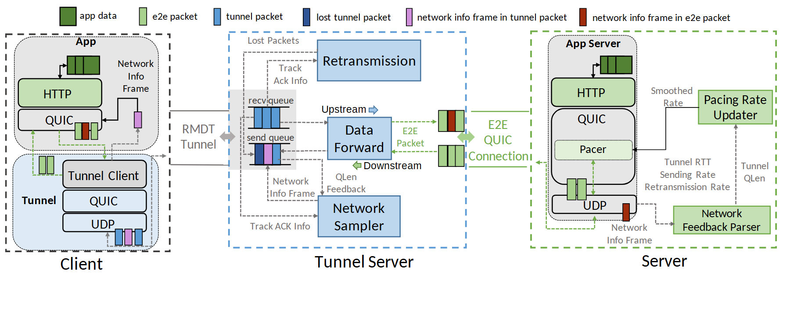

# VA-145 · 两端协议栈与中继反馈三域图

三个虚线域把客户端、中继和服务端并排放置，左右重复协议层提供对照，中间转发、重传、采样构成独立枢纽。包的窄色条随路径出现，能同时解释封装层次和控制反馈。



## 适用范围

- 端到端通信经过一个中继且存在独立反馈的系统
- 需要比较两端共有协议层及不同增强模块的通信架构

不适合：只有单向阶段顺序而没有封装与反馈的普通流程；节点很多、链路拓扑本身才是重点的网络图。

## 阅读顺序

1. 先读顶端六类包的色条图例。
2. 从左侧 App 和 Tunnel 两层识别端到端数据与隧道数据。
3. 读中央转发模块及上方重传、下方采样。
4. 最后读服务端解析、速率更新和 Pacer，回看跨域反馈虚线。

## 图形表达

**布局**：左右窄协议栈夹一个较宽中继域，三域底部角色名对齐；顶端图例独占一行。

**对象**：虚线大框区分域，圆角灰底表示端部栈，矩形标明功能，窄竖条表示包。

**连线**：水平主路径横跨三域；细灰虚线解释控制信息；跨域路径保留在整图，不能随单域移动而断开。

**配色**：浅绿标识端部数据与速率控制，浅蓝标识隧道功能；深绿、蓝、紫和红棕包条的意义由图例约束。

**文字**：主体为无衬线，角色名比层名大；灰色链路注释很小，缩为单栏后需放大或简化。

## 部件与复用

| 部件 | 含义 | 改造方法 |
|---|---|---|
| 包类型图例 (`packet-legend`) | 六种窄色条定义数据和反馈的编码。 | 增删包类别时同步替换图中所有同色包条。 |
| 客户端双层栈 (`client-stack`) | 上部应用栈和下部隧道栈体现封装层次。 | 保留两层嵌套关系，替换实际协议名与包条。 |
| 中继转发与控制 (`relay-services`) | 转发居中，重传在上，采样在下。 | 以实际中继职责重排三个模块；队列与反馈注释一起检查。 |
| 服务端协议与速率控制 (`server-stack`) | 服务端栈和旁路控制模块组合为反馈终点。 | 修改控制目标时同时改解析、更新和执行三处标签。 |

## 改造步骤

1. 先确定新系统确实存在两种封装层次，再修改左侧嵌套栈。
2. 重命名中继三个职责并删除不成立的反馈边。
3. 沿每一种包的路径核对图例，避免只换模块名而保留错误包色。
4. 若加第二中继，在代码中扩画布和跨域连线，不能挤入现有域。

## 新情景示例（假设）

假设场景：遥测网关辅助远程设备传输

客户端为传感终端，中继为边缘网关，服务端为监控平台；采样反馈映射为链路质量。

只有真实实现重传时才保留重传模块；速率控制箭头应改为终端实际接受控制的位置。

## 编辑入口

**入口**：从 make_figure.py 的 customize 入口修改结构；example.json 保存本次配置，labels.json 定位文字，asset.json 登记语义部件。运行 python make_figure.py --config example.json --out . --parts。

**配置可改**：labels 与 components 可改文字、配色、显隐和位移；配置不会自动重排版面，也不会替移动节点重新连接箭头。

**需改代码**：新增、删除、复制节点及重接连线在 customize(root, context) 中完成；新增元素设置唯一 data-asset-key，并将实际成员加入相应部件 element_keys。共享容器与跨区连线留在整图，不能对重叠部件重复施加位移。

**字体**：主体为无衬线，角色名比层名大；灰色链路注释很小，缩为单栏后需放大或简化。 最终字体文件以构建映射为准；局部 font_size 受 SVG 变换影响，不等于最终纸面 pt。本批构建已确认并嵌入完整字体：Arimo-Regular.ttf, Carlito-Bold.ttf, Carlito-Regular.ttf。映射可能改变原字形和字宽，需按实际论文尺寸复核。

准备独立工作副本：

```text
python "<SKILL>/scripts/prepare_architecture.py" --id VA-145 --out figures/architecture
```

在工作副本运行：

```text
python make_figure.py --config example.json --out . --parts
python render_architecture.py fig.svg
```

## 本图检查

- 六类包图例和包条是否一一对应。
- 端到端路径与隧道范围是否仍区分。
- 反馈线是否真的到达解析和速率控制模块。
- 缩放后灰色链路文字是否能读。

部件图用于复用局部对象；跨边界的连接和共享容器仍需按新关系处理。示例名称、数值和曲线不是当前研究结果。

来源与许可见 [ATTRIBUTION.md](ATTRIBUTION.md)。
