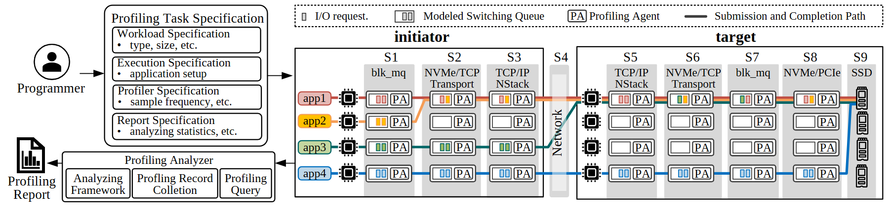

# VA-146 · 配置面与九阶段观测矩阵

左边以规格和报告构成观测控制面，右边将四个任务的存储路径压成九阶段矩阵。每个队列旁的 PA 和保持一致的任务色让路径汇合及采样位置可以对照。



## 适用范围

- 多个任务通过相同处理阶段、部分路径合并的观测系统
- 需要同时展示采样配置与探针落点的端到端性能分析

不适合：无法分解为共享阶段的自由拓扑；数十任务同时展示或需要读详细队列值的图。

## 阅读顺序

1. 左侧程序员输入四类规格，建立控制面入口。
2. 沿右侧 S1 至 S9 读发起端、网络与目标端。
3. 追踪四种任务色，注意 app1 与 app2 在 S2 附近汇合。
4. 回到左下分析器和报告，理解采样记录的用途。

## 图形表达

**布局**：横向超宽图，左侧规格与分析器上下放置，右侧四行九列矩阵；发起端、网络、目标端分组。

**对象**：队列是小长框，探针以 PA 小框标明，芯片与 SSD 小图标标记端点；规格框包含四个小面板。

**连线**：任务线在格间横向贯通并可能合流；配置进入矩阵、记录返回分析器，跨区连接保持整图。

**配色**：四种任务色红、黄橙、绿和蓝一致用于任务标签、线和队列条；阶段底板为灰色，颜色不表示性能高低。

**文字**：衬线文字配合阶段编号，矩阵小字很密；适合跨双栏宽度，不能依赖把字继续缩小来增加任务。

## 部件与复用

| 部件 | 含义 | 改造方法 |
|---|---|---|
| 任务观测规格 (`profiling-spec`) | 程序员及四类规格定义采集任务。 | 替换工作负载、执行、采样和报告四类配置。 |
| 分析与报告 (`analysis-report`) | 采样记录经收集、查询和分析形成报告。 | 按实际分析链修改三个子模块与最终产物。 |
| 发起端前三阶段 (`initiator-stages`) | 四任务经过发起端队列与探针。 | 保持任务颜色，按实际客户端栈增删列。 |
| 中间网络阶段 (`network-stage`) | S4 窄列连接两端并保留传输路径。 | 若网络要展示内部结构，扩大该列并重接四条路径。 |
| 目标端五阶段 (`target-stages`) | 目标端队列链继续探测至存储设备。 | 按真实存储链更新阶段与探针配置。 |
| 请求队列探针图例 (`matrix-legend`) | 图例解释请求、队列、PA 和路径。 | 删除某类图元时同步清理图例。 |

## 改造步骤

1. 先列出新系统共享的阶段和每个任务的实际路径，再调整矩阵列数。
2. 复制任务行时必须成组复制标签、请求条、路径及队列内容，不能仅改图例。
3. 依据采样可达性保留或去除 PA，避免暗示所有位置均可测量。
4. 配置面内容与报告指标应对应实际采集代码；路径汇合点通过 customize 重画。

## 新情景示例（假设）

假设场景：四类物流订单通过仓储处理链的时延观测

四种应用映射订单类型，阶段映射接单、分拣、打包、调度与配送；PA 映射事件记录点。

减少为真实存在的阶段，将网络窄列改为仓际运输，按订单类型重新连接分流与汇流。

## 编辑入口

**入口**：从 make_figure.py 的 customize 入口修改结构；example.json 保存本次配置，labels.json 定位文字，asset.json 登记语义部件。运行 python make_figure.py --config example.json --out . --parts。

**配置可改**：labels 与 components 可改文字、配色、显隐和位移；配置不会自动重排版面，也不会替移动节点重新连接箭头。

**需改代码**：新增、删除、复制节点及重接连线在 customize(root, context) 中完成；新增元素设置唯一 data-asset-key，并将实际成员加入相应部件 element_keys。共享容器与跨区连线留在整图，不能对重叠部件重复施加位移。

**字体**：衬线文字配合阶段编号，矩阵小字很密；适合跨双栏宽度，不能依赖把字继续缩小来增加任务。 最终字体文件以构建映射为准；局部 font_size 受 SVG 变换影响，不等于最终纸面 pt。本批构建已确认并嵌入完整字体：Tinos-Bold.ttf, Tinos-Regular.ttf。映射可能改变原字形和字宽，需按实际论文尺寸复核。

准备独立工作副本：

```text
python "<SKILL>/scripts/prepare_architecture.py" --id VA-146 --out figures/architecture
```

在工作副本运行：

```text
python make_figure.py --config example.json --out . --parts
python render_architecture.py fig.svg
```

## 本图检查

- 每个任务是否可连续追踪且色彩不变。
- 合流是否与业务路径一致。
- 阶段编号与分组边界是否完整。
- 所有探针是否有对应数据来源。
- 双栏打印时 PA 和队列标签是否可读。

部件图用于复用局部对象；跨边界的连接和共享容器仍需按新关系处理。示例名称、数值和曲线不是当前研究结果。

来源与许可见 [ATTRIBUTION.md](ATTRIBUTION.md)。
