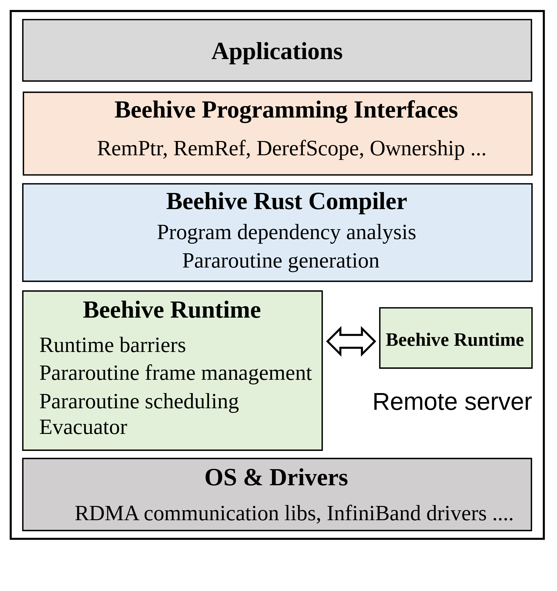

# VA-147 · 语言接口到远程运行时的层栈

纵向层栈依次展开应用、接口、编译器、运行时与驱动；运行时这一层向右分出远程同类节点，用双向箭头突出分布式能力而保持主栈紧凑。



## 适用范围

- 语言或执行系统从 API 到底层驱动的全栈概览
- 大部分层在本机、仅运行时与远端协作的架构

不适合：主要解释执行时间顺序的算法；远端有完整多层职责需要逐层展开的分布式系统。

## 阅读顺序

1. 从最上方 Applications 确认调用主体。
2. 向下读编程接口与编译器的输出职责。
3. 在绿色运行时层停留，比较本地详细职责与远端同名运行时。
4. 最后读 OS & Drivers 的共同支撑。

## 图形表达

**布局**：窄竖幅主栈有五层，运行时层左宽右窄，底层横跨两侧。

**对象**：层为直边矩形，本地运行时是大功能框，远端为小框和外部位置标签。

**连线**：只有运行时之间画双向箭头；相邻上下层表示组织和依赖，图上并未画成流水数据流。

**配色**：应用和驱动为灰，接口浅橙，编译器浅蓝，运行时浅绿；同类远端复用运行时绿色。

**文字**：衬线字体，层标题加粗、职责次级且左对齐；长职责宜增加行高而非压小字号。

## 部件与复用

| 部件 | 含义 | 改造方法 |
|---|---|---|
| 应用入口 (`application`) | 顶层调用入口。 | 替换应用类别并控制单行标题长度。 |
| 编程接口层 (`interfaces`) | 一组语言或库接口。 | 以实际 API 替换列表，保留名称与职责区分。 |
| 编译转换层 (`compiler`) | 依赖分析和执行单元生成。 | 仅保留新编译器真实提供的转换步骤。 |
| 本地远程运行时对 (`runtime-pair`) | 本地职责及远端镜像之间双向通信。 | 一起改两个运行时标签，依据通信事实调整双向边。 |
| 系统驱动基础 (`system-base`) | 跨全宽的操作系统与驱动支撑。 | 列出实际通信库或设备驱动。 |

## 改造步骤

1. 确定层是依赖关系而非执行步骤，再选择新层名。
2. 将接口、编译职责和运行时职责分别填写，避免重复。
3. 若远端也有独立应用与驱动，需代码扩成两列全栈，不能用一个小框替代。
4. 改变运行时框高度时同时下移底层及外框，保证层距一致。

## 新情景示例（假设）

假设场景：分布式仿真语言的执行框架

应用为仿真任务，接口为模型定义 API，编译器负责依赖分析，运行时管理事件并与远端交换。

把远端职责扩大到多节点时复制运行时节点并重新安排连线；驱动标签改为实际通信后端。

## 编辑入口

**入口**：从 make_figure.py 的 customize 入口修改结构；example.json 保存本次配置，labels.json 定位文字，asset.json 登记语义部件。运行 python make_figure.py --config example.json --out . --parts。

**配置可改**：labels 与 components 可改文字、配色、显隐和位移；配置不会自动重排版面，也不会替移动节点重新连接箭头。

**需改代码**：新增、删除、复制节点及重接连线在 customize(root, context) 中完成；新增元素设置唯一 data-asset-key，并将实际成员加入相应部件 element_keys。共享容器与跨区连线留在整图，不能对重叠部件重复施加位移。

**字体**：衬线字体，层标题加粗、职责次级且左对齐；长职责宜增加行高而非压小字号。 最终字体文件以构建映射为准；局部 font_size 受 SVG 变换影响，不等于最终纸面 pt。本批构建已确认并嵌入完整字体：Arimo-Regular.ttf, Tinos-Bold.ttf, Tinos-Regular.ttf。映射可能改变原字形和字宽，需按实际论文尺寸复核。

准备独立工作副本：

```text
python "<SKILL>/scripts/prepare_architecture.py" --id VA-147 --out figures/architecture
```

在工作副本运行：

```text
python make_figure.py --config example.json --out . --parts
python render_architecture.py fig.svg
```

## 本图检查

- 接口与编译职责是否混在同层。
- 远端标签是否仍说明部署位置。
- 双向箭头是否有实现依据。
- 底层边界是否涵盖实际支撑对象。

部件图用于复用局部对象；跨边界的连接和共享容器仍需按新关系处理。示例名称、数值和曲线不是当前研究结果。

来源与许可见 [ATTRIBUTION.md](ATTRIBUTION.md)。
