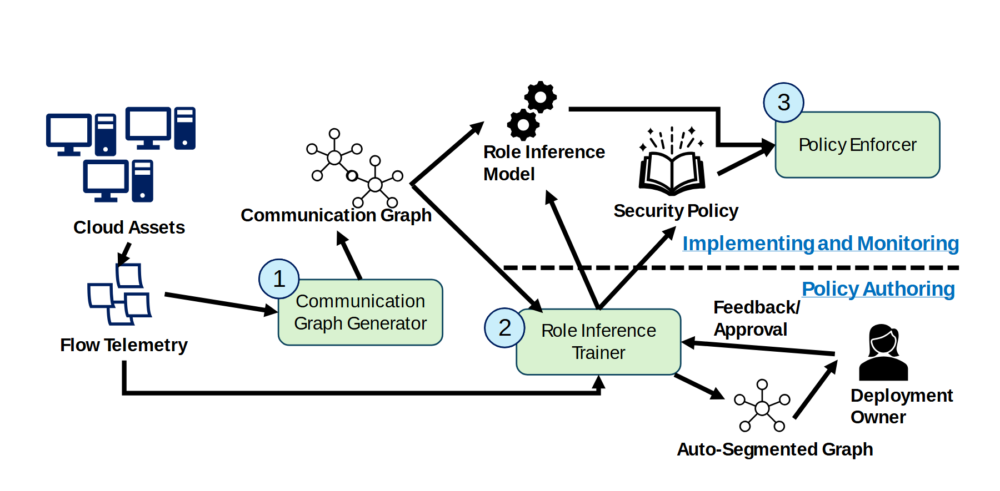

# VA-053 · 观测建图与人工反馈的策略闭环

设备遥测先形成关系图，再由训练与人工反馈产生模型和策略，最终交给执行器。图中水平虚线把下方策略编制与上方部署监控区分开。设备、网络图、齿轮、书本和人物图元分别承载对象、关系、模型、规则及人工参与，构图依赖这些语义而非装饰。



## 适用范围

- 观测数据驱动规则生成且有人机反馈
- 训练过程和运行部署需要放在同一总览

不适合：纯自动单向预测；不含关系图但直接沿用网络图元的任务。

## 阅读顺序

1. 从左上设备到左下遥测读取数据来源。
2. 经第一个编号模块生成关系图。
3. 向下进入训练区，辨认分段关系图与人员反馈。
4. 回到上方模型和规则，再汇入右侧执行器。

## 图形表达

**布局**：横向主线穿插上下两个层面，训练器位于中下方，反馈对象位于右下，执行器位于右上。

**对象**：圆角绿框为功能模块，网络图为关系产物，人物为人工输入，书本为规则产物。

**连线**：黑色箭头区分观测、训练产出和反馈；虚线仅分隔工作阶段，圆形数字标出三类主要操作。

**配色**：浅绿用于处理模块，浅蓝圆圈用于步骤，深蓝用于设备及阶段标题；图标颜色不代表数据指标。

**文字**：模块采用短句无衬线，图标下方粗体注明对象，阶段标签紧贴分隔线但不压线。

## 部件与复用

| 部件 | 含义 | 改造方法 |
|---|---|---|
| 观测入口 (`observation`) | 设备集合产生流量或事件记录。 | 换成真实观测对象和记录粒度。 |
| 关系构造 (`graph-construction`) | 记录被转换为节点和边。 | 必须定义边含义，不能只改图标题。 |
| 训练与反馈 (`training-feedback`) | 训练产物由人员检查并返回意见。 | 保留实际需要的人工决策，删除不存在的审批。 |
| 策略执行 (`policy-deployment`) | 模型与规则分别送入执行端。 | 区分模型更新与规则发布的输入。 |

## 改造步骤

1. 先定义关系图的节点、边和观测窗口。
2. 明确人工反馈改变标签、分组还是规则。
3. 若任务没有训练阶段，应重构下半区而非仅替换 Trainer 文字。

## 新情景示例（假设）

可用于交通区域划分与调度策略维护。

设备映射为路口传感器，关系图映射为交通联系，训练器生成区域分组，人员反馈校正边界，执行器应用调度规则。

需把安全策略图标改为调度规则对象，并补充策略作用到路口的返回线。

## 编辑入口

**入口**：运行 make_figure.py；example.json 为配置，labels.json 查文字键，asset.json 查部件。使用 --parts 导出独立矢量部件。

**配置可改**：labels 可改文字及字体；components 可设置 visible、dx/dy、attributes；elements 可按键改图元属性。移动量使用整图 viewBox 单位，重叠部件只选一个层级移动。

**需改代码**：增删节点、调整连接和重排结构须在 customize() 中处理；新增图元使用唯一 data-asset-key，并登记至相应部件 element_keys。配置不会自动排版。

**字体**：本图使用 Arimo-Bold.ttf、Arimo-Regular.ttf。font_size 是图元局部坐标单位，受既有缩放影响，不等于纸面 pt；改字后检查实际字宽与最终阅读尺寸。

准备独立工作副本：

```text
python "<SKILL>/scripts/prepare_architecture.py" --id VA-053 --out figures/architecture
```

在工作副本运行：

```text
python make_figure.py --config example.json --out . --parts
python render_architecture.py fig.svg
```

## 本图检查

- 人工反馈箭头是否落到可修改的训练或规则模块。
- 上下阶段边界是否把产物误归入操作区。
- 模型和规则是否仍保留各自到执行器的路径。

部件图用于复用局部对象；跨边界的连接和共享容器仍需按新关系处理。示例名称、数值和曲线不是当前研究结果。

来源与许可见 [ATTRIBUTION.md](ATTRIBUTION.md)。
