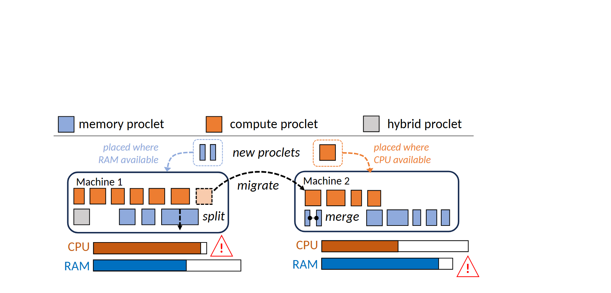

# VA-054 · 互补资源池之间的拆分迁移

两个资源池并排放置离散任务块，各自下方用两条占用条表现资源压力。上方新增对象和跨池弧线解释为何拆分、迁移或合并：任务类别的资源需求与两个池子的空余能力相匹配。它同时包含结构和容量示意，必须分清小方块数量与占用条长度的不同含义。



## 适用范围

- 算力与内存互补的动态放置
- 两类资源制约下的工作单元迁移

不适合：只有一种资源的简单分配；需要精确地理拓扑的跨站网络。

## 阅读顺序

1. 先读上方三类对象图例
2. 检查两个池内对象及下方资源占用条
3. 沿上方弧线看新增对象落点和跨池迁移
4. 回到池内的拆分合并箭头解释颗粒度改变

## 图形表达

**布局**：两池同高度同尺度，容量条紧贴各池底部；上方留出弧形迁移和新增对象的路由空间。

**对象**：小矩形表示可移动工作单元，圆角外框表示资源池，三角感叹号标记逼近上限。

**连线**：虚线弧箭头表现放置和迁移，池内短箭头表现拆分或合并；箭头不是固定网络连接。

**配色**：蓝色关联存储需求，橙色关联计算需求，灰色表示混合对象；资源条复用对应色系。

**文字**：无衬线小字与斜体动作注释配合，池名和资源名应保持短且相互一致。

## 部件与复用

| 部件 | 含义 | 改造方法 |
|---|---|---|
| 需求类别图例 (`resource-legend`) | 定义对象所需资源类型而非执行状态。 | 可替换为两类瓶颈资源及混合任务，须同步修改容量条名称。 |
| 第一资源池 (`pool-a`) | 第一组对象及其两维资源使用情况。 | 按数据重画条形长度，警告只放在达到定义阈值的资源旁。 |
| 第二资源池 (`pool-b`) | 与第一池存在互补余量的另一组资源。 | 容量总尺度必须和第一池一致，异容量需注明。 |
| 动态操作区 (`migration`) | 展示新建、拆分与跨池迁移的方向。 | 删去系统不支持的操作，迁移箭头必须落到对象或池的明确位置。 |

## 改造步骤

1. 先定义方块表示对象还是对象分片，避免数量混淆
2. 依据容量或清楚标注的假设设置两维占用条
3. 拆分后应能说明子块与父块关系，合并不能凭空创造容量
4. 增加第三池时需重排弧线，不能直接复制在下方造成循环方向不明

## 新情景示例（假设）

可用于医院检查任务在两个科室间的调配示意。

两类资源映射为设备时间和技师工时，方块为可转移检查任务，灰块为同时消耗两类资源的检查。

把拆分只用于可分阶段的任务；不能拆分的检查保留整块，并由实际可用时段生成占用条。

## 编辑入口

**入口**：make_figure.py 读取 example.json；labels.json 查文字键，asset.json 查部件键；输出 SVG，可用配套渲染脚本导出 PDF。

**配置可改**：labels 修改文字及字体属性；components 可设 visible、dx/dy、attributes；elements 修改单个对象属性。平移使用图的坐标单位，重叠部件不要同时平移。

**需改代码**：改变模块数量、连接关系或分栏布局须编辑 customize()，不会自动布线。新对象需唯一 data-asset-key，并加入对应部件 element_keys，才会随部件导出。

**字体**：本图映射字体：Carlito-Bold.ttf, Carlito-Italic.ttf, Carlito-Regular.ttf。沿用完整字体覆盖新字符；font_size 是元素局部单位，不是纸面 pt。改长标签后检查字宽、裁切及最终 PDF。

准备独立工作副本：

```text
python "<SKILL>/scripts/prepare_architecture.py" --id VA-054 --out figures/architecture
```

在工作副本运行：

```text
python make_figure.py --config example.json --out . --parts
python render_architecture.py fig.svg
```

## 本图检查

- 两池容量条是否使用相同尺度或明确归一化
- 迁移前后任务及资源需求是否守恒
- 警告符号是否对应实际瓶颈

部件图用于复用局部对象；跨边界的连接和共享容器仍需按新关系处理。示例名称、数值和曲线不是当前研究结果。

来源与许可见 [ATTRIBUTION.md](ATTRIBUTION.md)。
