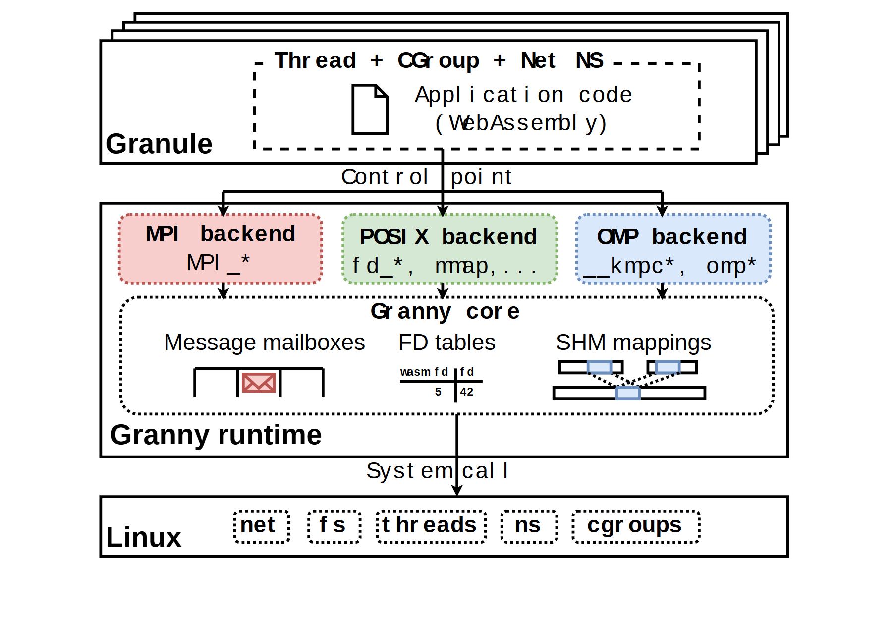

# VA-090 · 隔离应用与多接口共享运行核心

上部多个隔离应用通过同一个控制入口进入不同后端，后端共享内部状态管理，再访问底层系统能力。三个彩色后端与邮箱、描述符表、共享内存映射形成纵向对应关系，强调统一管理与接口适配同时存在。



## 适用范围

- 多种 API 共用运行核心
- 应用隔离与底层系统之间的适配层

不适合：各后端完全独立且无共享状态；不涉及权限或调用边界的普通流水线。

## 阅读顺序

1. 由上部应用叠层确认隔离单元。
2. 通过控制点进入三个并列后端。
3. 向下看各后端维护的具体状态对象。
4. 最后经系统调用进入底层能力条带。

## 图形表达

**布局**：纵向三层，中层再分后端行和共享状态行；顶部叠片表示多个同构隔离实例。

**对象**：文档图标代表程序，信封代表消息，表格代表映射，短连线小格代表共享内存关系。

**连线**：控制点一分为三，后端向下进入共享核心；底部只有一个系统调用边界。

**配色**：红绿蓝区分接口类别，白底和黑线保持整体简洁；颜色不表示执行顺序。

**文字**：代码标识与普通说明分开；当前替换映射不保证代码字体等宽，需要检查星号和下划线间距。

## 部件与复用

| 部件 | 含义 | 改造方法 |
|---|---|---|
| 隔离应用组 (`isolated-app`) | 程序实例及其资源隔离边界。 | 明确隔离单位是进程、线程还是容器。 |
| 接口后端列 (`backend-row`) | 把三种操作接口适配到运行核心。 | 更换接口时同时替换下方对应状态。 |
| 共享状态层 (`runtime-state`) | 保存消息、资源描述和共享映射。 | 图标必须对应实际被管理的数据结构。 |
| 系统能力条带 (`system-primitives`) | 表示运行时依赖的底层服务。 | 只列实际调用能力，不把支持项当成全部已实现。 |

## 改造步骤

1. 先界定应用可直接访问哪些接口以及哪些必须被拦截。
2. 增加后端时扩大中层并增加对应状态对象。
3. 隔离边界、共享核心边界和系统边界使用不同位置解释，不能统称模块框。

## 新情景示例（假设）

假设用于多租户仿真沙箱。

应用层为仿真作业，后端分别处理消息通信、文件访问和并行计算，核心维护每个作业的状态映射。

改写隔离机制与 API 名，若没有共享内存则替换为实际任务上下文，并重连该后端。

## 编辑入口

**入口**：以 make_figure.py 为入口，先复制 example.json 作为当前情景配置；labels.json 定位标签，asset.json 定位部件。

**配置可改**：labels 可改文字和文字样式，components 可做显隐、平移和局部样式调整；elements 可定位矢量元素。配置只作用于已有几何，不会自动解决布局冲突。

**需改代码**：改变后端数、隔离方式或状态对象结构需修改矢量与调用路径；代码字体需显式选择，不依赖当前替换自动保持等宽。

**字体**：当前替换字体为 Arimo-Bold、Arimo-Regular。改字后检查字宽、基线及 PDF 字体嵌入；原图的逐字定位不保证能容纳更长名称。

准备独立工作副本：

```text
python "<SKILL>/scripts/prepare_architecture.py" --id VA-090 --out figures/architecture
```

在工作副本运行：

```text
python make_figure.py --config example.json --out . --parts
python render_architecture.py fig.svg
```

## 本图检查

- 每个后端与下方状态对象有可解释对应。
- 应用没有绕过控制点直接接到底层系统。
- 代码标识换字后未发生错位或丢失符号。

部件图用于复用局部对象；跨边界的连接和共享容器仍需按新关系处理。示例名称、数值和曲线不是当前研究结果。

来源与许可见 [ATTRIBUTION.md](ATTRIBUTION.md)。
