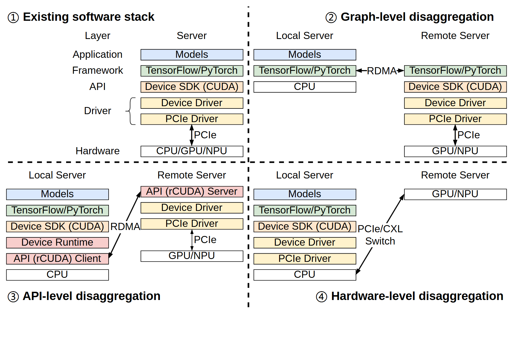

# VA-091 · 同一分层栈在不同拆分边界下的比较

四个象限展示共置基线和三种跨端拆分方式。每格重复相同层级与颜色，只改变哪些层留在本地、哪些移到远端，以及跨端连接落在哪层。对照成立的前提是层级定义一致，因此它首先是部署边界比较图，而不是四条顺序执行流程。



## 适用范围

- 比较同一系统在不同层级拆分的部署方式
- 边缘云协同或软硬件解耦方案说明

不适合：四种本来就没有共同层次的方法比较；需用图直接证明方案性能优劣。

## 阅读顺序

1. 先读左上完整栈，建立层名与颜色对应。
2. 右上观察高层拆分，找跨端链路落点。
3. 左下看接口中介与远端服务如何配合。
4. 右下检查仅资源端外置时本地还保留哪些层。

## 图形表达

**布局**：二乘二对照网格，粗虚线分隔方案；每个拆分方案内部按本地和远端并列。

**对象**：薄矩形重复成层，层高尽量一致；额外代理层单独呈现，不能隐藏在空白间距中。

**连线**：双向箭头表示跨端连接，竖线连接本地层次；箭头穿越哪层就是比较重点。

**配色**：蓝色应用、绿色框架、橙色接口、黄色驱动、粉色中介贯穿各格；新图必须保留同层同色。

**文字**：方案标题比层名醒目；层名宜短且四格一致，网络技术标签放在连线旁而非层内部。

## 部件与复用

| 部件 | 含义 | 改造方法 |
|---|---|---|
| 共置基线 (`baseline`) | 所有主要层位于同一端。 | 用作层级字典；先改这里再同步其余三格。 |
| 高层拆分 (`graph-split`) | 较高逻辑层之间进行跨端连接。 | 说明远端是否复制上层运行环境。 |
| 接口拆分 (`api-split`) | 本地代理与远端服务承接调用。 | 显式保留新增客户端和服务端层。 |
| 资源拆分 (`hardware-split`) | 上层栈留本地，仅底层资源远置。 | 改真实总线或网络接口，不沿用不适用协议。 |

## 改造步骤

1. 定义统一层级清单，逐格标记本地、远端或两侧都有。
2. 把新增代理层与原有层区别画出，不能靠相同色块掩盖成本。
3. 方案数变化时重排整个网格，避免空象限被误认为缺失结果。

## 新情景示例（假设）

假设比较视觉检测系统在工厂与云端的部署。

共同层为检测应用、推理框架、设备接口和计算资源；三种方案分别远置框架、接口调用或资源。

按真实部署重画四格，跨端链路统一写实际网络；硬件远置若不成立则换成另一种可行方案。

## 编辑入口

**入口**：以 make_figure.py 为入口，example.json 提供编辑配置，labels.json 用于查文字键，asset.json 对应下列部件。

**配置可改**：labels 改指定文字与字号；components 可显隐、平移和改属性；elements 修改单个矢量对象。平移保留固定几何，不会自动重新布线。

**需改代码**：修改层数、方案数或拆分位置时需要重排四格层条与跨端连线。 必须在 customize() 中处理新增矢量对象及连接，不能只扩大文字框。

**字体**：当前字体映射使用 Arimo-Bold.ttf, Arimo-Regular.ttf；换标签后按最终插入宽度检查字宽、上下标和边界，不直接继承小字号。

准备独立工作副本：

```text
python "<SKILL>/scripts/prepare_architecture.py" --id VA-091 --out figures/architecture
```

在工作副本运行：

```text
python make_figure.py --config example.json --out . --parts
python render_architecture.py fig.svg
```

## 本图检查

- 同一层在四格中名称和颜色是否一致。
- 跨端箭头落点是否准确体现拆分层级。
- 代理层是否只出现在需要它的方案中，且两端成对。

部件图用于复用局部对象；跨边界的连接和共享容器仍需按新关系处理。示例名称、数值和曲线不是当前研究结果。

来源与许可见 [ATTRIBUTION.md](ATTRIBUTION.md)。
