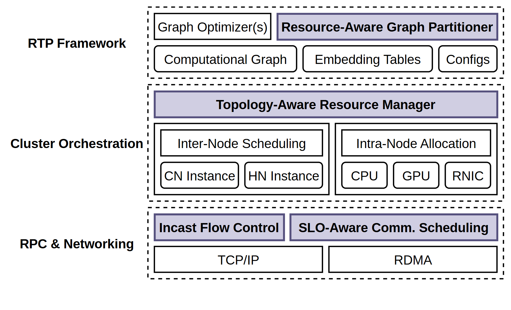

# VA-148 · 三层资源编排与通信支撑图

三条虚线横带分开框架、集群编排和通信网络。每层浅紫强调专门能力，白色小框保留通用组件，便于说明新能力嵌入哪些既有层。



## 适用范围

- 以图划分、资源放置、通信调度协同实现的系统
- 需要区分专门模块与常规基础组件的三层架构

不适合：严格时序或反馈路径需要明确箭头的流程；大量节点间互联的物理部署拓扑。

## 阅读顺序

1. 读左侧三层名称确定职责尺度。
2. 在顶层区分图优化、资源感知划分与输入对象。
3. 中层读拓扑感知管理器，再分辨节点间调度和节点内分配。
4. 底层读拥塞控制、通信调度及 TCP/IP、RDMA 传输。

## 图形表达

**布局**：左列是层名，右侧三条虚线容器纵向堆叠；中层内部分左右两组。

**对象**：直角小框表达模块，虚线边界表达层；中层外框嵌套两种分配粒度。

**连线**：图中没有显式跨层箭头；不能把上下位置当作已绘出的数据或控制通道。

**配色**：浅紫仅强调分区、资源管理与通信控制，白色表示其输入或通用支撑；黑色虚线边界统一。

**文字**：无衬线小字，突出模块粗体；左侧层名占固定列，较长标题应换行保持对齐。

## 部件与复用

| 部件 | 含义 | 改造方法 |
|---|---|---|
| 框架和图划分层 (`framework-layer`) | 计算图、嵌入表与配置支撑图处理模块。 | 替换输入类型与划分职责，保持强调范围。 |
| 集群编排层 (`orchestration-layer`) | 资源管理统一组织跨节点与节点内两级分配。 | 根据新系统拆分粒度修改两组嵌套框。 |
| 通信与网络层 (`networking-layer`) | 控制与调度能力位于两种传输方式之上。 | 更新通信机制，避免保留没有采用的传输协议。 |

## 改造步骤

1. 先写出新系统的三层职责并确认上下依赖，再更换层名。
2. 浅紫突出的是本图关注能力，不能将所有框改成强调色。
3. 需要说明调度指令或数据流时，在代码中增加带标签的跨层箭头。
4. 若节点内资源不止三类，先扩容器宽度再复制资源框。

## 新情景示例（假设）

假设场景：城市交通仿真的资源编排平台

顶层为路网划分，中层为分区到机器的放置和 CPU/GPU 分配，底层为状态同步调度。

将嵌入表替换为路网状态，增加真实分区下发和反馈边后才能表述运行流程。

## 编辑入口

**入口**：从 make_figure.py 的 customize 入口修改结构；example.json 保存本次配置，labels.json 定位文字，asset.json 登记语义部件。运行 python make_figure.py --config example.json --out . --parts。

**配置可改**：labels 与 components 可改文字、配色、显隐和位移；配置不会自动重排版面，也不会替移动节点重新连接箭头。

**需改代码**：新增、删除、复制节点及重接连线在 customize(root, context) 中完成；新增元素设置唯一 data-asset-key，并将实际成员加入相应部件 element_keys。共享容器与跨区连线留在整图，不能对重叠部件重复施加位移。

**字体**：无衬线小字，突出模块粗体；左侧层名占固定列，较长标题应换行保持对齐。 最终字体文件以构建映射为准；局部 font_size 受 SVG 变换影响，不等于最终纸面 pt。本批构建已确认并嵌入完整字体：Arimo-Bold.ttf, Arimo-Regular.ttf。映射可能改变原字形和字宽，需按实际论文尺寸复核。

准备独立工作副本：

```text
python "<SKILL>/scripts/prepare_architecture.py" --id VA-148 --out figures/architecture
```

在工作副本运行：

```text
python make_figure.py --config example.json --out . --parts
python render_architecture.py fig.svg
```

## 本图检查

- 三层边界是否完整且名称对齐。
- 两级分配是否各有明确对象。
- 紫色是否仍只突出主要能力。
- 文字描述是否误称图上存在跨层箭头。

部件图用于复用局部对象；跨边界的连接和共享容器仍需按新关系处理。示例名称、数值和曲线不是当前研究结果。

来源与许可见 [ATTRIBUTION.md](ATTRIBUTION.md)。
