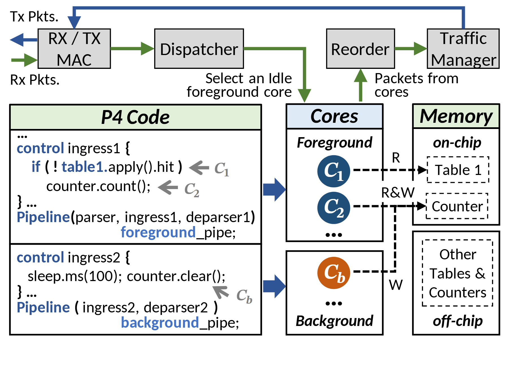

# VA-149 · 代码到前后台核心及共享存储映射

上方包处理环给出输入输出，下方三列将两段代码、前后台核心和存储对象对齐。C1、C2、Cb 连接代码语句与执行实体，虚线上的 R、R&W、W 明确访问方式。



## 适用范围

- 代码片段映射到不同执行核心并共享状态的设计
- 需要区分事件触发前台与周期后台的包处理或实时系统

不适合：没有代码级映射证据的高层系统图；共享数据访问关系非常复杂的完整依赖图。

## 阅读顺序

1. 先沿顶端绿色接收路径与蓝色发送回路理解包处理。
2. 读左列两段代码和灰色语句标记。
3. 将 C1、C2 对到前台核心，将 Cb 对到后台核心。
4. 沿虚线及 R/W 标签核对右列片上、片外存储访问。

## 图形表达

**布局**：顶部横向处理条，下方代码列较宽，核心列居中，存储列靠右；前台与后台上下对应。

**对象**：代码框、核心圆形和虚线存储对象各有不同含义；片上与片外用上下隔间区分。

**连线**：蓝色实心箭头映射代码到核心，黑虚线标记内存访问；绿色接收与蓝色发送组成上方回路。

**配色**：前台圆形深蓝、后台圆形橙；浅绿表头用于代码和内存，核心表头浅蓝；颜色不表示耗时。

**文字**：代码小字具有语法强调，但不得假定替换字体后仍等宽；C 标记需保持下标与主体区分。

## 部件与复用

| 部件 | 含义 | 改造方法 |
|---|---|---|
| 收发调度与回排环 (`packet-loop`) | 包通过 MAC、分发、回排及流量管理器。 | 改调度实体时同时修改流入核心与返回核心的路径。 |
| 前后台代码片段 (`code-programs`) | 两段控制程序通过语句标记对到执行核心。 | 用真实简短伪代码替换，重画指向相应语句的灰箭头。 |
| 前后台执行核心 (`execution-cores`) | 上部前台 C1/C2 与下部后台 Cb 分工。 | 增删核心时更新代码注记和所有读写边。 |
| 片上片外共享状态 (`shared-memory`) | 表与计数器分布于片上和片外区域。 | 根据实际存储位置修改对象，读写模式随算法更新。 |

## 改造步骤

1. 从已实现程序中提取两段短代码及其状态访问，先核对 C1/C2/Cb 映射。
2. 替换内存对象并确认每条虚线的 R、W 或 R&W。
3. 前后台数量改变时用 customize 调整行高和跨列连线。
4. 保留包收发环只适用于新场景仍有此链路；否则重建输入输出部分。

## 新情景示例（假设）

假设场景：实时传感流与周期校准协同处理

前台核心处理传感包并累积统计，后台核心周期清零或校准；表和计数器映射实际共享状态。

把 P4 代码替换为可核实的伪代码，按同步机制补充互斥或原子访问标记，不能沿用虚构读写边。

## 编辑入口

**入口**：从 make_figure.py 的 customize 入口修改结构；example.json 保存本次配置，labels.json 定位文字，asset.json 登记语义部件。运行 python make_figure.py --config example.json --out . --parts。

**配置可改**：labels 与 components 可改文字、配色、显隐和位移；配置不会自动重排版面，也不会替移动节点重新连接箭头。

**需改代码**：新增、删除、复制节点及重接连线在 customize(root, context) 中完成；新增元素设置唯一 data-asset-key，并将实际成员加入相应部件 element_keys。共享容器与跨区连线留在整图，不能对重叠部件重复施加位移。

**字体**：代码小字具有语法强调，但不得假定替换字体后仍等宽；C 标记需保持下标与主体区分。 最终字体文件以构建映射为准；局部 font_size 受 SVG 变换影响，不等于最终纸面 pt。本批构建已确认并嵌入完整字体：Carlito-Bold.ttf, Carlito-BoldItalic.ttf, Carlito-Regular.ttf, STIXTwoMath-Regular.ttf。映射可能改变原字形和字宽，需按实际论文尺寸复核。

准备独立工作副本：

```text
python "<SKILL>/scripts/prepare_architecture.py" --id VA-149 --out figures/architecture
```

在工作副本运行：

```text
python make_figure.py --config example.json --out . --parts
python render_architecture.py fig.svg
```

## 本图检查

- 代码标记是否精确对应核心。
- 读写箭头是否连到正确表或计数器。
- 前后台是否存在未说明的数据竞争。
- 顶部包回路是否闭合。
- 代码换行后是否仍处于边框内。

部件图用于复用局部对象；跨边界的连接和共享容器仍需按新关系处理。示例名称、数值和曲线不是当前研究结果。

来源与许可见 [ATTRIBUTION.md](ATTRIBUTION.md)。
