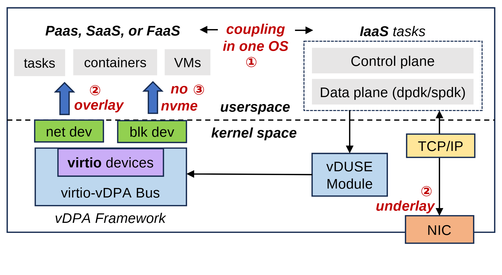

# VA-150 · 用户内核分界与虚拟设备耦合图

横向虚线切开用户空间与内核空间，两组用户任务位于上方，虚拟设备和 vDUSE 位于下方。红色编号指出耦合、overlay 与设备支持限制，使部署边界和问题位置同图表达。



## 适用范围

- 需要说明虚拟 I/O 层次及同宿主系统耦合的架构
- 部署现状伴随少量具体限制或改进动机的分析

不适合：不带问题定位的中性系统总览；多个宿主的真实网络拓扑或性能定量比较。

## 阅读顺序

1. 先读横向 userspace/kernel space 分界。
2. 上方左组任务与右组 IaaS 控制数据面建立两类工作负载。
3. 下方从 virtio 设备沿控制路径连接 vDUSE，并查看 TCP/IP 与 NIC。
4. 最后逐一核对红色编号在图中的问题位置。

## 图形表达

**布局**：两侧用户任务横排，横虚线贯穿域；内核设备框在左、模块与网络栈在右下。

**对象**：灰任务块、浅蓝虚拟设备组、黄色协议框与橙色 NIC 分别表示不同对象；红注记独立于模块。

**连线**：黑色细线连接控制数据面和内核模块，蓝箭头从虚拟设备指向上层；红字是诊断注记而不是额外执行边。

**配色**：浅蓝设备组件、浅绿 net/blk 接口、浅黄 TCP/IP、橙色 NIC；红色只用于限制说明及编号。

**文字**：无衬线正文与斜体空间标签混用；红色限制说明体量小，图内编号②在上下网络路径均出现，不能误改成唯一序列。

## 部件与复用

| 部件 | 含义 | 改造方法 |
|---|---|---|
| 应用侧任务与设备接口 (`application-side`) | 任务、容器和 VM 经虚拟 net/blk 接口访问。 | 改任务形态后同步检查上行接口及限制标记。 |
| IaaS 控制数据面 (`iaas-side`) | 控制面和数据面同宿主部署。 | 按实际部署边界修改容器，取消耦合时需重画边界。 |
| 虚拟设备与总线 (`virtual-device`) | virtio 设备嵌在 vDPA 框架与总线内。 | 替换设备类型时保留总线与设备层次。 |
| 内核模块和物理网口 (`module-network`) | vDUSE 模块与 TCP/IP、NIC 组成下方后端。 | 模块和物理路径要随实现一起修改。 |

## 改造步骤

1. 先核对新部署的用户态和内核态边界，不能只改模块名称。
2. 逐条重写红色问题标记，只保留有依据的限制。
3. 将 overlay 与 underlay 及相应箭头作为一组修改。
4. 若分离宿主或服务虚拟机，应扩为独立部署域并重接跨域路径。

## 新情景示例（假设）

假设场景：边缘设备模拟服务的宿主 I/O 架构

左组为业务容器，右组为设备模拟服务，底层为虚拟设备后端和物理接口。

取消同 OS 约束时增加第二宿主边界，并删除原耦合诊断；有 NVMe 支持时移除 no nvme 文案。

## 编辑入口

**入口**：从 make_figure.py 的 customize 入口修改结构；example.json 保存本次配置，labels.json 定位文字，asset.json 登记语义部件。运行 python make_figure.py --config example.json --out . --parts。

**配置可改**：labels 与 components 可改文字、配色、显隐和位移；配置不会自动重排版面，也不会替移动节点重新连接箭头。

**需改代码**：新增、删除、复制节点及重接连线在 customize(root, context) 中完成；新增元素设置唯一 data-asset-key，并将实际成员加入相应部件 element_keys。共享容器与跨区连线留在整图，不能对重叠部件重复施加位移。

**字体**：无衬线正文与斜体空间标签混用；红色限制说明体量小，图内编号②在上下网络路径均出现，不能误改成唯一序列。 最终字体文件以构建映射为准；局部 font_size 受 SVG 变换影响，不等于最终纸面 pt。本批构建已确认并嵌入完整字体：Arimo-Bold.ttf, Arimo-BoldItalic.ttf, Arimo-Italic.ttf, Arimo-Regular.ttf, DejaVuSans-Bold.ttf。映射可能改变原字形和字宽，需按实际论文尺寸复核。

准备独立工作副本：

```text
python "<SKILL>/scripts/prepare_architecture.py" --id VA-150 --out figures/architecture
```

在工作副本运行：

```text
python make_figure.py --config example.json --out . --parts
python render_architecture.py fig.svg
```

## 本图检查

- 所有组件是否处于正确空间。
- ②的重复是否仍表达同一网络约束。
- 红色注记是否有证据支撑。
- 控制面和数据面连线是否与实际机制一致。

部件图用于复用局部对象；跨边界的连接和共享容器仍需按新关系处理。示例名称、数值和曲线不是当前研究结果。

来源与许可见 [ATTRIBUTION.md](ATTRIBUTION.md)。
