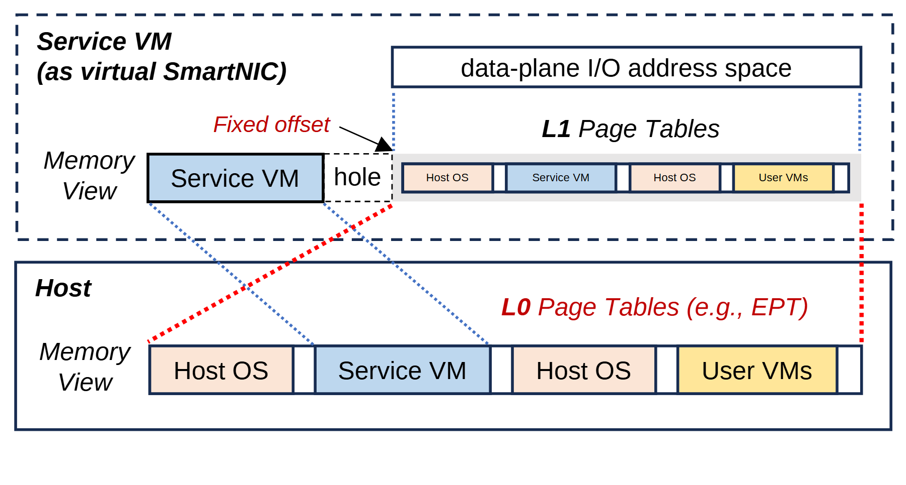

# VA-151 · 双地址视图与两级页表映射

上下两个内存视图通过斜虚线对应，服务虚拟机上方再接数据面 I/O 地址空间。相同颜色的地址段在两视图重复出现，固定偏移和空洞标记解释映射方式。



## 适用范围

- 宿主与虚拟机地址空间之间的映射关系
- 需要区分 L0 与 L1 页表以及固定偏移的内存机制

不适合：不涉及地址对应关系的通用分层系统；要求精确容量、位宽或按比例地址长度的定量示意。

## 阅读顺序

1. 先读下方 Host 内存条中的四段地址。
2. 沿红色与蓝色斜虚线查看服务虚拟机内的对应范围。
3. 上方服务虚拟机本地段之后有 hole，后续缩小内存条显示映射视图。
4. 读 Fixed offset 和 L0/L1 Page Tables，最后到 data-plane I/O address space。

## 图形表达

**布局**：上下两域，宿主内存条较大且居底；服务虚拟机视图将本地段、空洞和映射副本排在同一行，I/O 空间放在右上。

**对象**：长条中的分隔色块表示地址段，虚线外框表示虚拟机域，矩形外框表示宿主域。

**连线**：红点虚线和蓝点虚线连接对应边界；斜线用于地址对应，不表示数据沿时间流动。

**配色**：服务虚拟机蓝，宿主 OS 浅桃，用户 VM 浅黄；两视图同色同对象；红色文字标 L0 和偏移关系。

**文字**：斜体域标题和页表名区分说明文字；内存条内标签很小，缩略条不宜继续增加分段。

## 部件与复用

| 部件 | 含义 | 改造方法 |
|---|---|---|
| 数据面地址空间 (`io-address`) | 上层数据面 I/O 地址范围。 | 换成实际进程可见地址空间名。 |
| 服务虚拟机内存视图 (`service-memory`) | 本地段、hole 和映射区以及 L1 标注。 | 修改偏移时同步调整空洞、内存副本和引线端点。 |
| 宿主物理内存视图 (`host-memory`) | 宿主中各类地址范围及 L0 标注。 | 替换内存所有者，保留上下视图的颜色对应。 |

## 改造步骤

1. 先列清新场景的地址空间、映射方向和真实边界，明确示意图不按容量比例。
2. 在上下内存条同步更换地址段，不能仅改宿主侧标签。
3. 调整固定偏移或取消 hole 时，代码中重画所有对应虚线。
4. 若地址有访问权限或不可映射区，新增明确图例并保留映射限制。

## 新情景示例（假设）

假设场景：仿真器中的设备 DMA 地址映射

下层为主机物理内存，上层为设备服务进程视图，I/O 地址空间为设备可访问范围。

按真实 IOMMU 机制重命名页表级别；不存在固定偏移时删除该标记并用映射表或分段连接替代。

## 编辑入口

**入口**：从 make_figure.py 的 customize 入口修改结构；example.json 保存本次配置，labels.json 定位文字，asset.json 登记语义部件。运行 python make_figure.py --config example.json --out . --parts。

**配置可改**：labels 与 components 可改文字、配色、显隐和位移；配置不会自动重排版面，也不会替移动节点重新连接箭头。

**需改代码**：新增、删除、复制节点及重接连线在 customize(root, context) 中完成；新增元素设置唯一 data-asset-key，并将实际成员加入相应部件 element_keys。共享容器与跨区连线留在整图，不能对重叠部件重复施加位移。

**字体**：斜体域标题和页表名区分说明文字；内存条内标签很小，缩略条不宜继续增加分段。 最终字体文件以构建映射为准；局部 font_size 受 SVG 变换影响，不等于最终纸面 pt。本批构建已确认并嵌入完整字体：Arimo-BoldItalic.ttf, Arimo-Italic.ttf, Arimo-Regular.ttf。映射可能改变原字形和字宽，需按实际论文尺寸复核。

准备独立工作副本：

```text
python "<SKILL>/scripts/prepare_architecture.py" --id VA-151 --out figures/architecture
```

在工作副本运行：

```text
python make_figure.py --config example.json --out . --parts
python render_architecture.py fig.svg
```

## 本图检查

- 上下颜色是否一一对应。
- hole 与偏移标注是否仍成立。
- 虚线端点是否落在正确段边界。
- L0/L1 是否被误认为执行步骤编号。

部件图用于复用局部对象；跨边界的连接和共享容器仍需按新关系处理。示例名称、数值和曲线不是当前研究结果。

来源与许可见 [ATTRIBUTION.md](ATTRIBUTION.md)。
