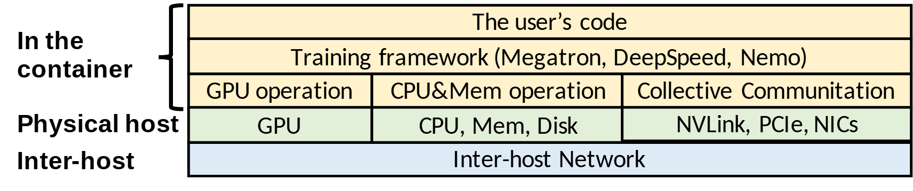

# VA-152 · 软件容器到跨机网络的对齐层栈

上部两行全宽软件层，下部三列把计算、存储与通信操作对齐到硬件，底层跨机网络再次贯通全宽。左侧括号把前三行归于容器，层级紧凑且边界明确。



## 适用范围

- 需要从用户代码概览到物理硬件和跨机网络的执行栈
- 软件操作类别与硬件资源可以按列对应的系统

不适合：必须展示实际数据或控制流方向的图；操作与硬件存在复杂多对多关系的实现细节。

## 阅读顺序

1. 顶部读用户代码和训练框架。
2. 第三行分辨 GPU、CPU/内存、集合通信三类操作。
3. 沿列向下核对对应物理资源。
4. 最下方读所有主机共享的跨机网络，左侧括号确认容器范围。

## 图形表达

**布局**：右侧表格式层栈，前三行属于容器；操作与硬件各分三列，全宽底层表示公共网络。

**对象**：普通矩形与分隔线构成表格式结构，左侧大括号单独表达部署范围。

**连线**：没有箭头；列对齐表达类别对应，纵向堆叠表达支撑层次，不代表严格一对一调用。

**配色**：容器层淡黄、物理主机淡绿、跨机网络淡蓝，同层不再使用多色干扰。

**文字**：无衬线正文，左侧层标签加粗；框架例名较长，换名时先缩短列举再调整宽度。

## 部件与复用

| 部件 | 含义 | 改造方法 |
|---|---|---|
| 用户代码和框架 (`software-upper`) | 两层全宽软件环境。 | 替换用户入口与框架例名，避免长串工具名。 |
| 三类运行操作 (`operation-row`) | 计算、主机资源、通信操作按列展开。 | 改变操作分类时与下一行列界同步。 |
| 物理主机资源 (`hardware-row`) | 三类操作下方对应硬件资源及主机标签。 | 保持上下列边界一致，必要时明确多对多对应。 |
| 跨主机网络底座 (`network-base`) | 所有类别共用的跨机网络基础。 | 若系统不跨机，应删除该层并重新定义范围。 |

## 改造步骤

1. 先区分软件部署范围与物理设备范围，再决定左侧标签。
2. 按新系统真正的操作类别同时改第三、四行列宽。
3. 保留三种层色和公共底层，避免把各个硬件画成独立无关系模块。
4. 需要证明调用关系时补带标签的箭头；仅靠列对齐不能表达复杂依赖。

## 新情景示例（假设）

假设场景：大规模科学仿真的执行环境

用户代码为仿真模型，框架为数值求解环境，三列为加速计算、主机资源、并行通信。

根据仿真实现替换资源名，无 GPU 时合并列；运行在单机时删跨机网络并重画容器括号。

## 编辑入口

**入口**：从 make_figure.py 的 customize 入口修改结构；example.json 保存本次配置，labels.json 定位文字，asset.json 登记语义部件。运行 python make_figure.py --config example.json --out . --parts。

**配置可改**：labels 与 components 可改文字、配色、显隐和位移；配置不会自动重排版面，也不会替移动节点重新连接箭头。

**需改代码**：新增、删除、复制节点及重接连线在 customize(root, context) 中完成；新增元素设置唯一 data-asset-key，并将实际成员加入相应部件 element_keys。共享容器与跨区连线留在整图，不能对重叠部件重复施加位移。

**字体**：无衬线正文，左侧层标签加粗；框架例名较长，换名时先缩短列举再调整宽度。 最终字体文件以构建映射为准；局部 font_size 受 SVG 变换影响，不等于最终纸面 pt。本批构建已确认并嵌入完整字体：Arimo-Bold.ttf, Carlito-Regular.ttf。映射可能改变原字形和字宽，需按实际论文尺寸复核。

准备独立工作副本：

```text
python "<SKILL>/scripts/prepare_architecture.py" --id VA-152 --out figures/architecture
```

在工作副本运行：

```text
python make_figure.py --config example.json --out . --parts
python render_architecture.py fig.svg
```

## 本图检查

- 容器括号是否只覆盖软件三行。
- 操作与硬件列是否对齐。
- 底层网络范围是否与实际部署一致。
- 长框架名是否溢出。

部件图用于复用局部对象；跨边界的连接和共享容器仍需按新关系处理。示例名称、数值和曲线不是当前研究结果。

来源与许可见 [ATTRIBUTION.md](ATTRIBUTION.md)。
