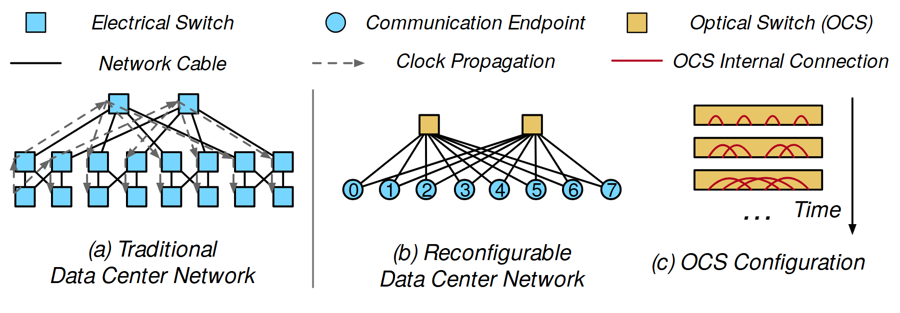

# VA-055 · 固定网络与可重构连接的三联对照

左图展示固定多层网络及其传播路径，中图展示由可重构交换单元连接的端点，右图补充交换单元内部连接随时间变化。共享图例统一解释形状与线型，使静态拓扑和动态配置可以在一张图里比较。



## 适用范围

- 固定连接与可重构连接的架构比较
- 内部切换状态会影响端到端路径的通信或调度系统

不适合：只有一张静态网络而无状态变化；需要精确显示空间位置或地理距离的网络地图。

## 阅读顺序

1. 先读顶端图例，区分方形交换点、圆形端点及金色重构单元。
2. 左侧看固定网络和灰色虚线传播路线。
3. 中间看两个重构单元如何连接编号端点。
4. 右侧沿时间方向读多条内部配置快照。

## 图形表达

**布局**：共享图例横跨顶端，下方三个面板依次由整体比较收缩到内部配置。

**对象**：青色方块与圆点表达不同角色；金色横条表示交换内部，红弧表示一时刻的内部配对。

**连线**：黑色实线画固定线缆，灰色虚箭头画传播方向，红色弧线画内部连接；右侧单独竖箭头表示时间。

**配色**：青色统一常规网络对象，金色强调可配置设备，红色只用于内部配对；同色不同形状仍须图例。

**文字**：以无衬线正文和斜体面板名区分符号说明与场景标题，编号端点采用短数字。

## 部件与复用

| 部件 | 含义 | 改造方法 |
|---|---|---|
| 拓扑符号图例 (`topology-legend`) | 定义节点类型、线缆、传播与内部配对。 | 只保留新图实际出现的符号，随新连接类型增补。 |
| 固定多层网络 (`static-topology`) | 层级连接及传播树提供静态基准。 | 按真实拓扑重画连线，不从层次结构推断未声明的容量。 |
| 可重构端点网络 (`dynamic-topology`) | 少数交换单元连接多个通信端点。 | 明确哪些连接物理存在、哪些同时激活。 |
| 内部配置时间序列 (`time-configurations`) | 不同横条表示不同时间的连接配对。 | 配对要符合端口占用规则，时间次序与主图一致。 |

## 改造步骤

1. 先区分物理连接集合和当前激活连接，不能用同一种线混画。
2. 端点编号在中图与右侧配对中建立可追踪关系。
3. 如比较的是设备数量，应统一节点统计口径，不能用示意数量论证节省。
4. 保留时间箭头及快照含义；需要定量切换开销时另加时间轴。

## 新情景示例（假设）

可用于港区固定运输线路与动态泊位接驳的对照。

方块为固定中转站，圆点为服务端点，金色单元为可重新分配的接驳资源。

把内部红弧改成当前端点配对，添加各时段编号，并确保一台资源不能在同一时刻服务互斥任务。该例不代表实际仿真。

## 编辑入口

**入口**：以 make_figure.py 为入口，example.json 存修改参数；labels.json 定位文字键，asset.json 定位部件。运行后查看整图和独立部件。

**配置可改**：labels 改文字及字体；components 改显示、dx/dy 和属性；elements 改对象属性。位移采用整图 viewBox 单位，父子部件重叠时只选一个层级移动。

**需改代码**：增减端点、调整网络层数或更换内部配对需写 customize()；现有参数不能根据配对表自动重排网络。

**字体**：采用 TeX Gyre Heros Regular 与 Italic；时间序列标题需短，避免挤入端口弧线区域。 font_size 是元素局部单位，受变换影响，不等于纸面字号。

准备独立工作副本：

```text
python "<SKILL>/scripts/prepare_architecture.py" --id VA-055 --out figures/architecture
```

在工作副本运行：

```text
python make_figure.py --config example.json --out . --parts
python render_architecture.py fig.svg
```

## 本图检查

- 灰虚传播线是否沿实际存在的物理边。
- 右侧每个配置是否满足端口或资源互斥条件。
- 图例中的青色方块与圆点在印刷尺寸下是否可区分。

部件图用于复用局部对象；跨边界的连接和共享容器仍需按新关系处理。示例名称、数值和曲线不是当前研究结果。

来源与许可见 [ATTRIBUTION.md](ATTRIBUTION.md)。
