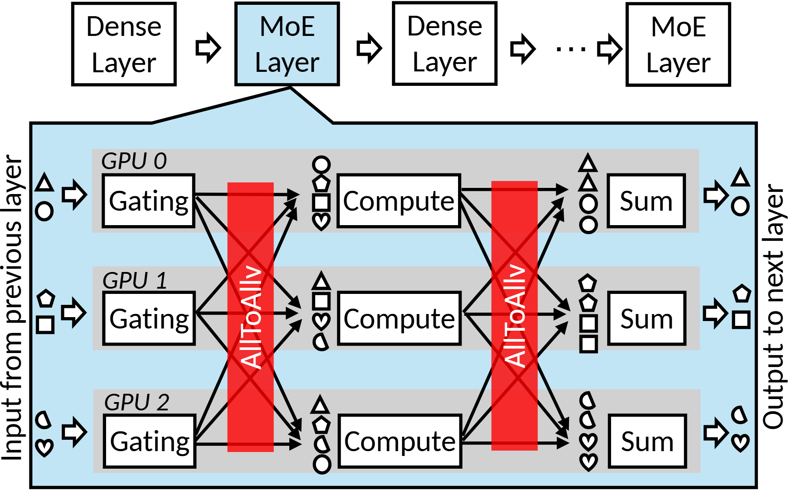

# VA-153 · 层级总览展开为三路通信计算图

顶部短模型链将一个 MoE 层展开为下方三路 GPU 泳道。每路含门控、计算与聚合，两段全互联以贯穿泳道的红条突出；小形状展示令牌在交换前后的重组。



## 适用范围

- 某个高层阶段需要展开为多个并行执行者的内部步骤
- 两次跨执行者交换夹住局部计算的通信计算架构

不适合：普通单线流程或没有全互联交换的任务；需要定量表示传输量的网络流量图。

## 阅读顺序

1. 顶部读 Dense/MoE 交替层链，并定位被放大的蓝色 MoE。
2. 下方从左到右读 Gating、Compute、Sum 三类步骤。
3. 比较三个 GPU 泳道的小形状在各步骤前后的排列。
4. 检查两道红色 AllToAllv 及连接各泳道的黑箭头。

## 图形表达

**布局**：上方概览链、下方展开气泡共用一个高亮层；展开区含三条灰底水平泳道，左右有竖排输入输出说明。

**对象**：矩形操作框和三角、圆、方等小形状区分执行步骤与令牌；展开区轮廓指向顶部选中模块。

**连线**：泳道间黑箭头交叉表示全互联分发和回收；跨泳道边保留整图，移动单个阶段必须重接。

**配色**：浅蓝定义展开层及选中模块，灰色划分 GPU，红色只强调两次 AllToAllv，令牌保持黑白。

**文字**：无衬线标签、斜体 GPU 标号，通信标签与边缘输入输出竖排；保持竖排方向和字距可读。

## 部件与复用

| 部件 | 含义 | 改造方法 |
|---|---|---|
| 顶层交替层链 (`layer-overview`) | 多个模型层以及被展开的 MoE。 | 替换概览阶段时保留选中框与下方尖角对应。 |
| 三路门控步骤 (`gating-column`) | 三执行者的门控与 GPU 标号。 | 同步调整三路门控名称与令牌分配。 |
| 首次全交换强调 (`dispatch-exchange`) | 第一次红色全交换区域。 | 只有确实全互联时保留名称；跨泳道箭头另行重绘。 |
| 三路局部计算 (`compute-column`) | 交换后各执行者的计算模块。 | 按执行任务改名，令牌输入与输出同步检查。 |
| 第二次全交换强调 (`return-exchange`) | 局部计算后的第二次全交换。 | 若汇聚方式变化，替换红条名称并重接返回边。 |
| 三路结果聚合 (`sum-column`) | 各执行者收回结果并聚合。 | 修改聚合操作时核对最终输出令牌。 |

## 改造步骤

1. 先确认新流程真的包含两次跨执行者交换，避免把任意同步都称为 AllToAllv。
2. 以真实输入分组替换小形状，并按分发、计算、返回、聚合重排形状。
3. 执行者数量改变时复制整条泳道并重画全互联边，配置改字不能完成该操作。
4. 红色强调保留给研究焦点；顶部被放大阶段与展开容器的颜色和尖角一起修改。

## 新情景示例（假设）

假设场景：三台工作机执行分布式稀疏任务

门控对应任务分配，计算对应局部求解，Sum 对应结果汇总，形状代表任务类型。

若实际只是主从分发，应将全互联改成主从边并修改红条；不能保留错误的全交换拓扑。

## 编辑入口

**入口**：从 make_figure.py 的 customize 入口修改结构；example.json 保存本次配置，labels.json 定位文字，asset.json 登记语义部件。运行 python make_figure.py --config example.json --out . --parts。

**配置可改**：labels 与 components 可改文字、配色、显隐和位移；配置不会自动重排版面，也不会替移动节点重新连接箭头。

**需改代码**：新增、删除、复制节点及重接连线在 customize(root, context) 中完成；新增元素设置唯一 data-asset-key，并将实际成员加入相应部件 element_keys。共享容器与跨区连线留在整图，不能对重叠部件重复施加位移。

**字体**：无衬线标签、斜体 GPU 标号，通信标签与边缘输入输出竖排；保持竖排方向和字距可读。 最终字体文件以构建映射为准；局部 font_size 受 SVG 变换影响，不等于最终纸面 pt。本批构建已确认并嵌入完整字体：Arimo-Regular.ttf, Carlito-Italic.ttf, Carlito-Regular.ttf。映射可能改变原字形和字宽，需按实际论文尺寸复核。

准备独立工作副本：

```text
python "<SKILL>/scripts/prepare_architecture.py" --id VA-153 --out figures/architecture
```

在工作副本运行：

```text
python make_figure.py --config example.json --out . --parts
python render_architecture.py fig.svg
```

## 本图检查

- 顶层展开对应是否明确。
- 三路输入输出形状是否一致且能追踪。
- 两次交换方向与参与者是否正确。
- 新增泳道后所有连线是否重接。
- 竖排文字与红条是否发生遮挡。

部件图用于复用局部对象；跨边界的连接和共享容器仍需按新关系处理。示例名称、数值和曲线不是当前研究结果。

来源与许可见 [ATTRIBUTION.md](ATTRIBUTION.md)。
