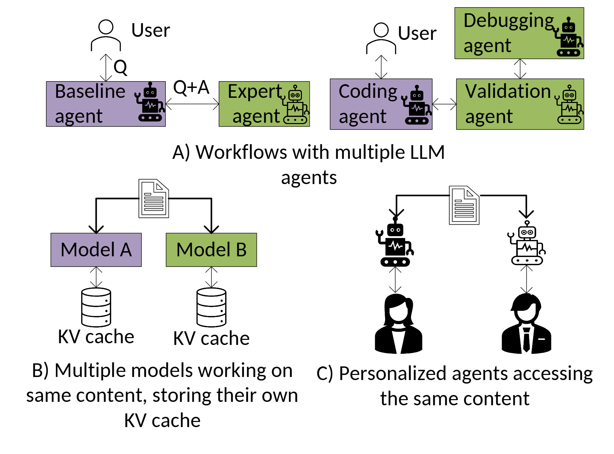

# VA-154 · 共享上下文的三情景对照图

上半幅用两个智能体工作流，下半幅并列多模型与个性化助手情景，反复出现共享内容进入多个处理者的关系。文档、人物、机器人和缓存图标让不同场景保持共同语言。



## 适用范围

- 用多个具体应用说明共享输入或重复处理问题
- 需要在小篇幅中对照智能体协作、多模型和个性化服务

不适合：详细解释缓存共享实现或证明性能收益；需要一致量纲和公平条件的定量方案比较。

## 阅读顺序

1. 上半幅先读左侧问答接力，再读右侧编码到调试、验证的分支。
2. 读 A 标题，确认上面两个例子同属智能体工作流。
3. 下半左读文档分发到两个模型及各自缓存。
4. 下半右读共同文档与两个个性化助手及用户，最后对照三个情景的共同输入。

## 图形表达

**布局**：A 占上方全宽并含两个小例；B 和 C 位于下方左右；不是三个等宽横排面板。

**对象**：人物、机器人、文档及圆柱缓存为可编辑矢量图标，矩形彩块用于部分智能体和模型名称。

**连线**：细黑箭头描述文档分发和问答接力；A 中 Q 与 Q+A 明确内容传递，B 缓存独立，C 不画缓存。

**配色**：紫色与黄绿色区分不同处理者，未给出统一的性能或职责图例；C 使用黑白图标，不应强行赋予跨面板相同色义。

**文字**：无衬线正文，小块内名称两行；A/B/C 场景标题在各小图下方，长标题需保留换行和间距。

## 部件与复用

| 部件 | 含义 | 改造方法 |
|---|---|---|
| 双智能体工作流示例 (`agent-workflows`) | 问答接力与编码分支说明上下文在处理者间传递。 | 同时更新用户请求、接力标签及后继智能体名称。 |
| 多模型和独立缓存 (`model-caches`) | 共享文档分别进入两模型，各自保留缓存。 | 若新设计共享缓存，必须合并图形并重新连接，而非只改标题。 |
| 个性化助手与用户 (`personal-agents`) | 两个用户的助手访问共同文档。 | 替换人物和助手图标可表达不同组织角色。 |

## 改造步骤

1. 先确定要证明的共同问题，再为三个情景写不同但可核实的例子。
2. 保留 A 的两个子例和 B/C 的并列层次，避免把面板标题当成流程步骤。
3. 改成共享缓存方案时需代码重画 B 的缓存拓扑，不能继续保留两个独立缓存。
4. 人物、机器人和文档都是矢量部件，按新语义替换；原文中的性能数字不进入新例子。

## 新情景示例（假设）

假设场景：多部门共同分析一份城市风险报告

A 为初步分析转交专业审阅，B 为两种分析模型各建缓存，C 为不同部门的定制助手。

若实际没有编码任务，替换右上分支为复核与建议；根据实现决定是否仍存在独立缓存。

## 编辑入口

**入口**：从 make_figure.py 的 customize 入口修改结构；example.json 保存本次配置，labels.json 定位文字，asset.json 登记语义部件。运行 python make_figure.py --config example.json --out . --parts。

**配置可改**：labels 与 components 可改文字、配色、显隐和位移；配置不会自动重排版面，也不会替移动节点重新连接箭头。

**需改代码**：新增、删除、复制节点及重接连线在 customize(root, context) 中完成；新增元素设置唯一 data-asset-key，并将实际成员加入相应部件 element_keys。共享容器与跨区连线留在整图，不能对重叠部件重复施加位移。

**字体**：无衬线正文，小块内名称两行；A/B/C 场景标题在各小图下方，长标题需保留换行和间距。 最终字体文件以构建映射为准；局部 font_size 受 SVG 变换影响，不等于最终纸面 pt。本批构建已确认并嵌入完整字体：Carlito-Regular.ttf。映射可能改变原字形和字宽，需按实际论文尺寸复核。

准备独立工作副本：

```text
python "<SKILL>/scripts/prepare_architecture.py" --id VA-154 --out figures/architecture
```

在工作副本运行：

```text
python make_figure.py --config example.json --out . --parts
python render_architecture.py fig.svg
```

## 本图检查

- A 两个子例是否仍属于同一情景。
- B 是否确实表达独立缓存而非共享缓存。
- C 是否被误说成含缓存节点。
- 面板之间颜色是否被赋予不存在的统一意义。
- 标题、箭头和图标是否遮挡。

部件图用于复用局部对象；跨边界的连接和共享容器仍需按新关系处理。示例名称、数值和曲线不是当前研究结果。

来源与许可见 [ATTRIBUTION.md](ATTRIBUTION.md)。
