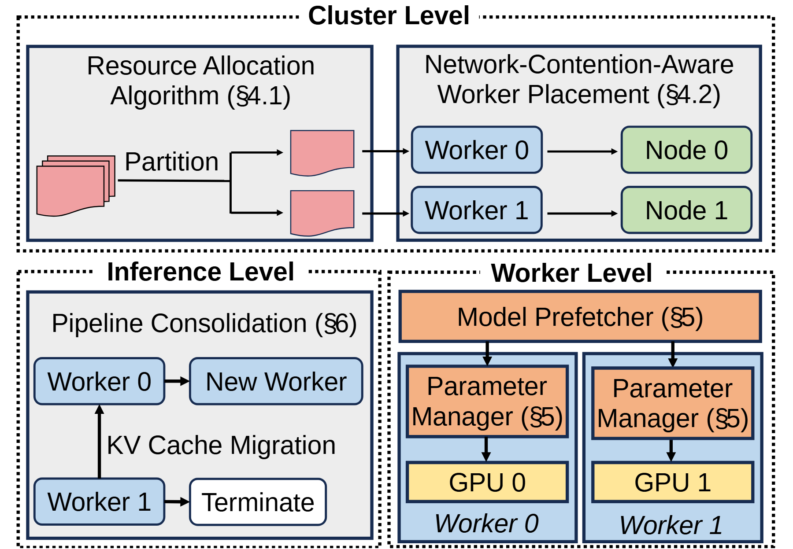

# VA-092 · 资源分配、节点执行与实例整合

上半部展示集群范围的任务划分和执行者放置，下半部左右分别展开运行实例整合与节点内部加载。三个带标题的虚线区域按职责范围组织同一系统，能避免把跨节点调度、节点内准备和运行期生命周期混成一条流水线。



## 适用范围

- 同时有集群规划、节点内准备和运行整合的系统
- 需要解释执行者与实体节点区别的分层方案

不适合：三个阶段严格按顺序发生且无职责分层；没有状态迁移却要保留实例终止图示的系统。

## 阅读顺序

1. 从顶端资源分配读到任务分区。
2. 向右看执行者与实体节点的一对一放置关系。
3. 转到右下读取共享预取与各节点内部管理。
4. 最后看左下实例迁移、整合为新实例和终止旧实例。

## 图形表达

**布局**：上部一条通栏集群区，下部两区并排；节点内细节在右，生命周期在左。

**对象**：纸片表示模型或任务分片，圆角块表示执行者和节点，内层矩形表示加载管理。

**连线**：顶端横线为放置链；右下垂直线是预取分发；左下迁移箭头不能读成普通任务调度。

**配色**：粉色为任务分片，蓝色为执行者，绿为实体节点，橙色为准备管理，黄色为设备。

**文字**：区标题压在虚线框上方需留白；当前章节号应替换或移除，避免依赖外部论文定位。

## 部件与复用

| 部件 | 含义 | 改造方法 |
|---|---|---|
| 任务资源划分 (`resource-partition`) | 把整体任务拆成可放置的分区。 | 替换划分目标和约束，纸片数量按实际分片方案。 |
| 执行者到节点映射 (`worker-placement`) | 将逻辑执行者安排到实体节点。 | 保留逻辑与物理不同名称，变为多对一时重画连线。 |
| 实例整合与终止 (`instance-lifecycle`) | 迁移状态后留下新实例并关闭冗余实例。 | 明确先迁移后终止，去掉不成立的状态缓存术语。 |
| 节点内部准备 (`worker-internals`) | 共享预取器分别向两个内部管理器送入资源。 | 改成数据或模型加载职责；不需要设备加速时换底部设备图块。 |

## 改造步骤

1. 先列每项职责属于哪个管理范围。
2. 保证上方执行者编号与右下内部实例对应。
3. 将迁移对象、迁移方向和关闭条件写清。
4. 不要给三个区域强加连续步骤编号，除非当前系统确有该顺序。

## 新情景示例（假设）

假设绘制区域洪水模拟的弹性计算系统。

资源划分按流域分片，执行者映射计算节点，右下预加载地形数据，左下在负载降低后合并子域状态。

用边界状态迁移替换缓存迁移，并核实合并后仍可关闭旧节点。

## 编辑入口

**入口**：运行 make_figure.py，以 example.json 为改造配置；labels.json 查文字键，--parts 同步导出部件。

**配置可改**：labels 改文字，components 改显示、位移及样式，elements 改单个矢量属性；只选一个部件层级移动，避免重叠归属使对象移动两次。

**需改代码**：这是可编辑矢量结构，未实现自动布局。增删模块、改变连接或重新排版，须在 customize() 中改真实对象并更新部件成员。

**字体**：使用随包完整映射字体；改字后核查换行、符号和最终纸面字号。font_size 是对象局部单位，不能直接当作 PDF 的磅值。

准备独立工作副本：

```text
python "<SKILL>/scripts/prepare_architecture.py" --id VA-092 --out figures/architecture
```

在工作副本运行：

```text
python make_figure.py --config example.json --out . --parts
python render_architecture.py fig.svg
```

## 本图检查

- 逻辑执行者与实体节点是否被标签混用。
- 关闭旧实例前是否存在完整状态转移。
- 三处区域标题与内部模块是否仍在对应虚线范围。

部件图用于复用局部对象；跨边界的连接和共享容器仍需按新关系处理。示例名称、数值和曲线不是当前研究结果。

来源与许可见 [ATTRIBUTION.md](ATTRIBUTION.md)。
