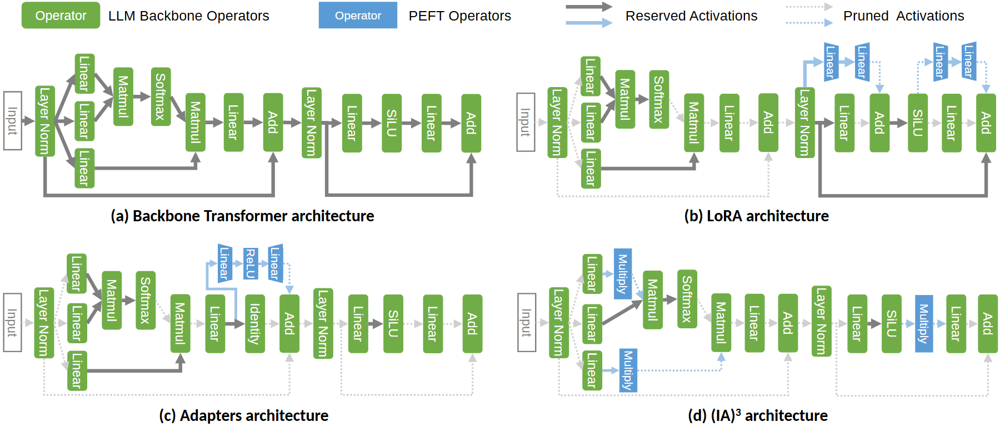

# VA-155 · 共享骨干的四方案算子比较

四个子图重复同一条算子骨干，通过蓝色新增模块及实线、虚线差异表达四种实现。复用价值在于固定对照基准后突出局部结构变化，而非把四张不相关的流程塞进同一页。



## 适用范围

- 同一网络骨干下比较微调或适配方法
- 同一主流程下比较缓存、筛选或旁路模块

不适合：四个方案没有共同阶段的概念拼盘；需要精确时间、吞吐或效果对比的结果图。

## 阅读顺序

1. 先读顶端图例：绿色为骨干算子、蓝色为新增算子，实线和点线分别编码保留与裁剪。
2. 读左上基准链及两处残差回路。
3. 读右上和左下的蓝色旁路及回接位置。
4. 读右下插入的乘法模块，与前三格逐位置比较。

## 图形表达

**布局**：上方一条共享图例，下面两行两列独立算子链，每格标题在下方。

**对象**：竖向圆角算子块配白字；分叉、合流、加法均以实际节点表示。

**连线**：灰色连线承担骨干，浅蓝连线接新增模块；浅色点线仍有方向，不能解释为没有任何关系。

**配色**：绿色统一骨干身份，蓝色统一新增算子，颜色不表示方法优劣。

**文字**：算子标签旋转竖排，子图标题粗体居中；缩小后短标签仍需可读。

## 部件与复用

| 部件 | 含义 | 改造方法 |
|---|---|---|
| 共享编码图例 (`shared-legend`) | 统一四格的节点与边语义 | 增删边类型时同步更新图例 |
| 基准骨干 (`baseline`) | 含分叉和残差的对照流程 | 作为新任务所有方案的共同基准 |
| 双节点旁路方案 (`low-rank-branch`) | 在骨干上方新增短支路并合流 | 替换支路功能并校正回接节点 |
| 瓶颈适配方案 (`adapter-branch`) | 小型多节点支路与恒等通道并存 | 更改瓶颈长度时整体重算支路间距 |
| 乘法插入方案 (`multiplicative`) | 多个乘法节点分别作用在局部路径 | 保留各乘法节点作用位置的可比性 |

## 改造步骤

1. 先画清新场景的共同骨干，再同步改四格中的同名节点。
2. 为每格明确仅有的新增或移除关系，不以配色替代拓扑说明。
3. 按真实计算需求设置保留与裁剪连线；上下残差线需一起检查。
4. 新增长标签时扩宽节点或改横排，不能期待直接换字自动布置。

## 新情景示例（假设）

假设比较四种传感器数据处理方案。

绿色映射为共同预处理与预测链，蓝色映射为偏差校正模块。

重新安排校正支路的插入点，并把反向传播的保留/裁剪图例改成新任务真实采用的边语义。

## 编辑入口

**入口**：make_figure.py 运行本图构建与 customize 入口；example.json 提供实例配置，labels.json 定位文字键，asset.json 定义部件及 element_keys。运行 python make_figure.py --config example.json --out . --parts。

**配置可改**：labels、components 可改文字、配色、显隐和位移；配置不自动重排、延长连线或重新计算容器。

**需改代码**：结构变化在 customize(root, context) 中编辑；新增对象赋予唯一 data-asset-key 并补入所属部件的 element_keys。跨区域连线保留在整图时，移动部件后须显式重接；重叠部件不可重复平移同一元素。

**字体**：算子为无衬线白字，标题较粗；源文件存在多套 Arial/Calibri 子集名称。 最终字体文件以构建映射为准；局部 font_size 是源坐标中的字号，不等于论文纸面 pt，换字后须检查实际宽度。本批构建已确认并嵌入完整字体：Arimo-Regular.ttf, Carlito-Bold.ttf。映射可能改变原字形和字宽，需按实际论文尺寸复核。

准备独立工作副本：

```text
python "<SKILL>/scripts/prepare_architecture.py" --id VA-155 --out figures/architecture
```

在工作副本运行：

```text
python make_figure.py --config example.json --out . --parts
python render_architecture.py fig.svg
```

## 本图检查

- 四格骨干对应阶段名称和顺序一致。
- 蓝色节点的输入输出均接到正确的骨干位置。
- 点线箭头在最终尺寸下可辨识。
- 四个子图标题和左侧输入框未被裁切。

部件图用于复用局部对象；跨边界的连接和共享容器仍需按新关系处理。示例名称、数值和曲线不是当前研究结果。

来源与许可见 [ATTRIBUTION.md](ATTRIBUTION.md)。
