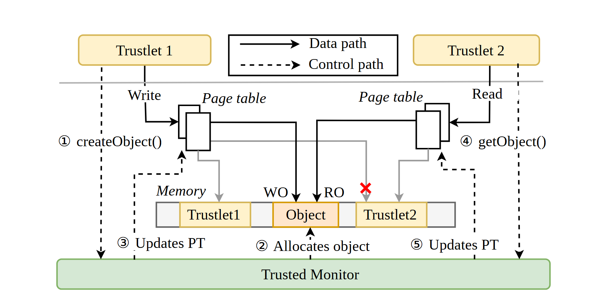

# VA-156 · 双端共享对象与权限控制底座

两个上方参与端围绕中央内存对象通信，底部控制器负责对象分配与权限更新。黑实线、黑虚线和灰色访问线共同解释直接数据访问与受控授权，红叉强调禁止跨域访问。



## 适用范围

- 生产者与消费者共享缓冲区的权限设计
- 两个服务之间通过受控对象交换数据

不适合：多跳路由或大量端点网络；希望用一条箭头表示全部调用细节的简略总览。

## 阅读顺序

1. 先识别左右参与端和底部可信控制器。
2. 沿编号1至3读左端申请、对象分配和权限更新。
3. 沿编号4至5读右端获取对象与权限更新。
4. 再读实线访问、WO/RO权限和红叉禁止路径。

## 图形表达

**布局**：左右对称端点，中间两份页表与横向内存带，底部整宽控制器。

**对象**：浅黄圆角端点、叠页形页表、分格内存与绿色控制底座。

**连线**：实线表示数据路径，虚线表示控制调用；灰线连接各端私有内存，红叉标记其中一条被禁止的越界访问。

**配色**：淡黄强调访问主体与共享对象，淡绿标识控制器，红色仅用于拒绝符号。

**文字**：正文为衬线体，页表与内存标签斜体，圈号承担顺序；英文 API 名应保持完整。

## 部件与复用

| 部件 | 含义 | 改造方法 |
|---|---|---|
| 发送端 (`left-peer`) | 申请并写入共享对象的一端 | 可改为生产者或上游服务 |
| 接收端 (`right-peer`) | 获取并读取对象的一端 | 可改为消费者或下游服务 |
| 路径类型图例 (`permission-legend`) | 区分数据与控制线型 | 如保留红叉，应在图例新增拒绝访问解释 |
| 内存对象与隔离域 (`memory-strip`) | 私有区域包围中央共享对象及权限标注 | 同步改变对象边界、WO/RO及私有域标签 |
| 统一控制底座 (`trusted-base`) | 统一分配与授权的控制模块 | 替换职责时校对所有虚线终点 |

## 改造步骤

1. 明确新场景两个端点的数据权限，不能仅替换WO和RO字样。
2. 替换中央对象与私有域名称，并核实被禁止访问的那条灰线。
3. 所有步骤编号按新的调用顺序重新编排。
4. 两份页表和跨区连线留在整图；搬动端点或内存带时重接这些连线。

## 新情景示例（假设）

假设为医院与研究机构设计受控统计数据交换。

左端为数据提供服务，右端为分析服务，中间为授权数据对象，底座为权限服务。

将内存页表改为权限映射表，重新定义可写、可读与禁止访问的实体范围。

## 编辑入口

**入口**：make_figure.py 运行本图构建与 customize 入口；example.json 提供实例配置，labels.json 定位文字键，asset.json 定义部件及 element_keys。运行 python make_figure.py --config example.json --out . --parts。

**配置可改**：labels、components 可改文字、配色、显隐和位移；配置不自动重排、延长连线或重新计算容器。

**需改代码**：结构变化在 customize(root, context) 中编辑；新增对象赋予唯一 data-asset-key 并补入所属部件的 element_keys。跨区域连线保留在整图时，移动部件后须显式重接；重叠部件不可重复平移同一元素。

**字体**：正文与 API 标签采用衬线体，Page table/Memory 斜体；圈号来自不同字体，导出后须核对。 最终字体文件以构建映射为准；局部 font_size 是源坐标中的字号，不等于论文纸面 pt，换字后须检查实际宽度。本批构建已确认并嵌入完整字体：DejaVuSans.ttf, Tinos-Italic.ttf, Tinos-Regular.ttf。映射可能改变原字形和字宽，需按实际论文尺寸复核。

准备独立工作副本：

```text
python "<SKILL>/scripts/prepare_architecture.py" --id VA-156 --out figures/architecture
```

在工作副本运行：

```text
python make_figure.py --config example.json --out . --parts
python render_architecture.py fig.svg
```

## 本图检查

- 红叉准确压在被拒绝的访问线上而不是共享对象上。
- 步骤1至5没有重复或缺号。
- 数据路径与控制路径图例和实际线型一致。
- 读写权限与箭头含义一致，不凭箭头朝向替代权限文字。

部件图用于复用局部对象；跨边界的连接和共享容器仍需按新关系处理。示例名称、数值和曲线不是当前研究结果。

来源与许可见 [ATTRIBUTION.md](ATTRIBUTION.md)。
